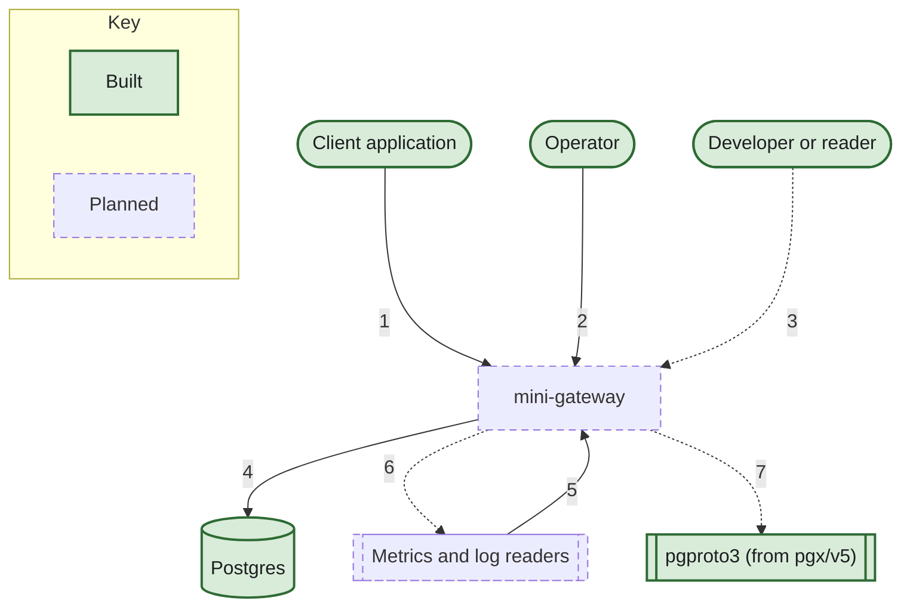

# C4 Level 1: System context

**Built so far: chunks 0–8. Dashed parts are planned.** In this diagram 5 of 7 elements and 4 of 7 relationships are built. Model: diagram `context` in [model.json](model.json). Source of this page: [gen.py](gen.py).

Clients speak the Postgres wire protocol to mini-gateway as if it were the database. The proxy holds the only connections to Postgres. Metrics leave through exporters; nothing inside the proxy depends on who reads them.

A solid box or arrow is built; a dashed one is planned. An arrow points to the supplier.

## Elements

| Element | Kind | Status | What it is |
| --- | --- | --- | --- |
| Client application | person | built (chunk 6) | Any program that speaks the Postgres wire protocol. Its startup user name selects its tenant. |
| Operator | person | built (chunk 6) | Runs proxy instances, writes the config file with its static fleet block, reads health and stats (directly or with mgctl), stops an instance with SIGTERM (a plain stop so far; a graceful drain from chunk 13). |
| Developer or reader | person | built (chunk 1) | Runs simulator scenarios from a seed, replays a failure from its printed REPLAY line, runs make test / chaos / bench, starts the dev stack and puts load on it (make run-up / load / run-down), reads a run as a report (make report). |
| mini-gateway | softwareSystem | planned | A proxy that speaks the Postgres wire protocol (simple-query subset) in front of one Postgres: a hard-capped connection pool lent per transaction, per-tenant admission with two CoDel modes, read coalescing, an off-by-default retry policy, snapshot observability. Terminates client TLS; logs clients in with SCRAM-SHA-256. Runs as N independent instances. **So far:** Built in chunk 6: a working proxy, the walking skeleton — cmd/mini-gateway terminates client TLS, logs clients in with SCRAM-SHA-256, lends a database connection per transaction, resets it after every lease, queues waiting requests, and serves health, stats and metrics from snapshots. Chunk 6a built the operator tools around it: the client mgctl, the load generator, the dev stack with its run targets, and the story report. Chunk 8 built the admission queues: one bounded queue per tenant with the two CoDel modes (the config file selects one), adaptive LIFO, and every shed request answered at once with 53M01. Chunk 7 built the pool: connections opened on demand under a hard cap and a creation limit, checked before reuse, cleaned up or closed when a lease ends badly, reset by one of two release policies, client cancels forwarded, one breaker that answers 53M03 while the database is down, TCP keepalive on the database sockets, and the connection and creation-rate budgets taken from the fleet block. Not built: fairness between tenants, the adaptive limit and the rate gate, read coalescing, the retry policy, the OTLP push, and the rest of the fleet configuration and the drain of N instances. |
| Postgres | softwareSystem, external | built (chunk 6) | One ordinary Postgres server. Sees at most the fleet's connection budget, all logged in as one role. |
| Metrics and log readers | softwareSystem, external | planned | Everything that reads what the adapters produce: a Prometheus fed through an OpenTelemetry Collector or by direct scrape, flushed CSV files read by tests and DuckDB, log readers. They merge across instances; no component knows about them. The observability component view shows them one by one. |
| pgproto3 (from pgx/v5) | softwareSystem, external | built (chunk 2) | Go package github.com/jackc/pgx/v5/pgproto3: Postgres wire message structs with Encode and Decode. The one external dependency, used for message encoding only. |

## Relationships

| # | From | To | Status | What | How |
| --- | --- | --- | --- | --- | --- |
| 1 | Client application | mini-gateway | built | Connects, logs in, sends statements and transactions | Postgres wire protocol v3, simple query; TCP, TLS when the client asks for it |
| 2 | Operator | mini-gateway | built | Configures the instance and the fleet block; reads health and stats; stops an instance (a plain stop so far; a graceful drain from chunk 13) | Config file, HTTP admin port, SIGTERM |
| 3 | Developer or reader | mini-gateway | planned | Runs simulator scenarios and the test, chaos and benchmark commands | go test, make, cmd/mgsim |
| 4 | mini-gateway | Postgres | built | Lends pooled connections per transaction; at most the configured budget | Postgres wire protocol v3; TCP, TLS by config |
| 5 | Metrics and log readers | mini-gateway | built | Scrapes metrics and stats from every instance and merges them | HTTP: Prometheus text, JSON |
| 6 | mini-gateway | Metrics and log readers | planned | Pushes metrics to a Collector that feeds Prometheus; flushes CSV files; writes log lines | OTLP/HTTP JSON, files |
| 7 | mini-gateway | pgproto3 (from pgx/v5) | planned | Encodes and decodes wire messages | Go import, wire layer only |
