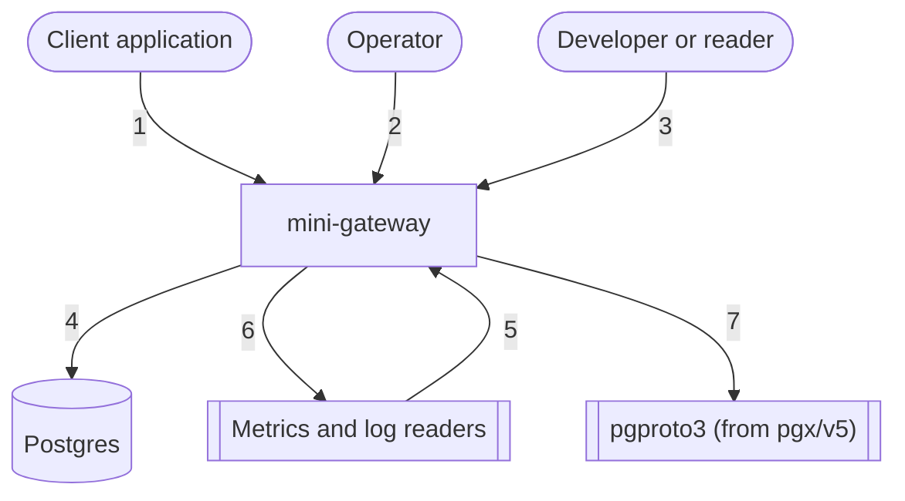

# C4 Level 1: System context

**Target architecture (planned). Nothing in this diagram is built yet.** Model: diagram `context` in [model.json](model.json). Source of this page: [gen.py](gen.py).

Clients speak the Postgres wire protocol to mini-gateway as if it were the database. The proxy holds the only connections to Postgres. Metrics leave through exporters; nothing inside the proxy depends on who reads them.

## Elements

| Element | Kind | What it is |
| --- | --- | --- |
| Client application | person | Any program that speaks the Postgres wire protocol. Its startup user name selects its tenant. |
| Operator | person | Runs proxy instances, writes the static fleet config, reads health and stats, drains an instance with SIGTERM. |
| Developer or reader | person | Runs simulator scenarios from a seed, replays a failure from its printed REPLAY line, runs make test / chaos / bench. |
| mini-gateway | softwareSystem | A proxy that speaks the Postgres wire protocol (simple-query subset) in front of one Postgres: a hard-capped connection pool lent per transaction, per-tenant admission with two CoDel modes, read coalescing, timer-free batching, an off-by-default retry policy, snapshot observability. Runs as N independent instances. |
| Postgres | softwareSystem, external | One ordinary Postgres server. Sees at most the fleet's connection budget, all logged in as one role. |
| Metrics and log readers | softwareSystem, external | A Prometheus scraper, an OpenTelemetry Collector, CSV files, log readers. They read exporters and merge across instances; no component knows about them. |
| pgproto3 (from pgx/v5) | softwareSystem, external | Go package github.com/jackc/pgx/v5/pgproto3: Postgres wire message structs with Encode and Decode. The one external dependency, used for message encoding only. |

## Relationships

| # | From | To | What | How |
| --- | --- | --- | --- | --- |
| 1 | Client application | mini-gateway | Connects, logs in, sends statements and transactions | Postgres wire protocol v3, simple query, TCP |
| 2 | Operator | mini-gateway | Configures the fleet; reads health and stats; drains | Config file, HTTP admin port, SIGTERM |
| 3 | Developer or reader | mini-gateway | Runs simulator scenarios and the test, chaos and benchmark commands | go test, make, cmd/mgsim |
| 4 | mini-gateway | Postgres | Lends pooled connections per transaction; at most the configured budget | Postgres wire protocol v3, TCP |
| 5 | Metrics and log readers | mini-gateway | Scrapes metrics and stats from every instance and merges them | HTTP: Prometheus text, JSON |
| 6 | mini-gateway | Metrics and log readers | Pushes metrics; writes CSV and log lines | OTLP/HTTP JSON, files |
| 7 | mini-gateway | pgproto3 (from pgx/v5) | Encodes and decodes wire messages | Go import, wire layer only |
