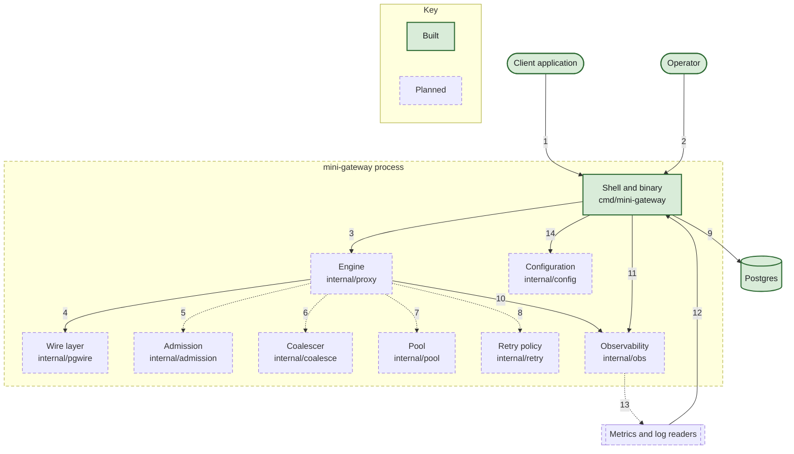

# C4 Level 2: Containers: the request path

**Built so far: chunks 0–6a. Dashed parts are planned.** In this diagram 4 of 13 elements and 9 of 14 relationships are built. Model: diagram `container` in [model.json](model.json). Source of this page: [gen.py](gen.py).

Containers are Go packages inside one process. The shell does all socket I/O and makes no decisions. The engine is one single-threaded state machine that calls the wire layer and the four pure cores. Observability hangs off the side: the engine publishes snapshots, and the admin listener serves them.

A solid box or arrow is built; a dashed one is planned. An arrow points to the supplier.

## Elements

| Element | Kind | Status | What it is |
| --- | --- | --- | --- |
| Client application | person | built (chunk 6) | Any program that speaks the Postgres wire protocol. Its startup user name selects its tenant. |
| Operator | person | built (chunk 6) | Runs proxy instances, writes the config file with its static fleet block, reads health and stats (directly or with mgctl), stops an instance with SIGTERM (a plain stop so far; a graceful drain from chunk 13). |
| Shell and binary | container | built (chunk 6) | cmd/mini-gateway and internal/shell. The binary (-config, -check, -verifier) and the goroutine shell: the client listener, one reader and one writer goroutine per connection, one bounded mailbox into the engine's goroutine, a bounded write queue per connection, a deadline on every socket operation, TLS on both legs with crypto/tls (it reads exactly the 8 bytes of a client's first packet, upgrades the socket when the engine says so and buffers nothing across the upgrade), the admin listener on its own port, the collector with its JSON, Prometheus and CSV adapters, and signal handling: SIGTERM or SIGINT stops the process (a plain stop so far; the graceful drain is chunk 13). Makes no decisions: it posts events to the engine and performs the actions the engine returns. |
| Engine | container | planned | internal/proxy. One single-threaded, sans-I/O state machine per instance: events in, actions out. Holds the client and database connection tables and the request pipeline with its stage seams. The simulator and the shell drive this same code; its test package proxysim is the simulator's driver. **So far:** Built in chunk 6 (internal/proxy, internal/proxy/proxysim): every component drawn here except two parts — the fan-out of a shared reply to its waiters (chunk 11) and the drain sequence (chunk 13). The stages that belong to cores not built yet run their stand-ins: a breaker that is always closed, a rate gate that always allows, no coalescing, one bounded first-come queue, a fixed set of connections, retry off. |
| Wire layer | container | planned | internal/pgwire. Everything that knows Postgres: framing, both session state machines, the query-cycle tracker, the SQL lexer, the statement classifier with its courtesy reject list, the safe-shape recogniser that decides sharing, the error contract, the wire snapshot. The only product package allowed to import pgproto3. Its test packages pgwiretest, wireworld and clsworld run this code in the simulator. **So far:** Built in chunks 4 and 5 (internal/pgwire): every component drawn here except the codec boundary. Chunk 4: the framer, the hand-written message coding, both session machines, the SCRAM-SHA-256 functions, the two trackers, the startup FATAL replies, the wire snapshot, and the test packages pgwiretest and wireworld. Chunk 5: the SQL lexer, the reject list, the statement classifier, the safe-shape recogniser, the error table with its reply builders, and the test package clsworld. Chunk 6: the engine drives this code, and the client session machine takes every FATAL from the error table (three startup rows added). Not built: the codec boundary (no file in the package imports pgproto3; the reply builders code their messages by hand). Nothing produces outcomes yet. |
| Admission | container | planned | internal/admission. Rate gate, per-tenant queues with two selectable queue rules, adaptive LIFO, round-robin dispatcher with shares that bind under saturation, adaptive concurrency limit. |
| Coalescer | container | planned | internal/coalesce. Identical statements share one database read: in auto mode those the wire layer marks as fitting the safe shape, in hinted mode those carrying the client's mark. Never writes. |
| Pool | container | planned | internal/pool. Hard-capped database connections, creation limiter, leases per transaction, the one breaker, the dirty-connection table. |
| Retry policy | container | planned | internal/retry. A policy interface. Off by default; the other policy retries once, only when nothing reached the database, within a 10% budget. |
| Observability | container | planned | internal/obs and its sub-packages; test/analysis; scripts/csv-assert.sh; scripts/report.sh. Snapshot conventions (the one raw export), integer histogram, metric registry, collector, the adapter interface and its adapters (Prometheus text, JSON, CSV flush, log line, OTLP push), fleet merge, health, the SQL assertions over flushed files, and the story report over the same files. **So far:** Built in chunks 1, 3, 4, 5 and 6: everything except the OTLP push adapter (chunk 15) and the health rules for shedding, an open breaker, the limit's floor and draining (chunk 7 on). Since chunk 6 the shell creates a collector in the real process, with the engine, wire and classifier sources, and serves the outputs over HTTP. The binary attaches the JSON, Prometheus and CSV adapters; the log-line adapter is attached only by the scenario flush harness. Chunk 6a: the story report, and the load generator's metrics in the catalog. |
| Configuration | container | planned | internal/config. The config file (JSON), the client_tls and backend_tls blocks, the static fleet block (instance count N; fleet budgets divided by N), load-time validation that fails closed and names the key, and the config fingerprint. **So far:** Built in chunk 6 (internal/config): the JSON config file with its defaults, validation that fails closed and names the key (the timeout nesting too), the client_tls and backend_tls blocks, the config fingerprint, and the fleet block parsed and checked (pool.connections must fit fleet.backend_connections / fleet.instances, which must divide evenly and fit the database's limit with a reserve). Not built: nothing takes its budget from the division yet (chunk 7 on; the fleet configuration is chunk 13). |
| Postgres | softwareSystem, external | built (chunk 6) | One ordinary Postgres server. Sees at most the fleet's connection budget, all logged in as one role. |
| Metrics and log readers | softwareSystem, external | planned | Everything that reads what the adapters produce: a Prometheus fed through an OpenTelemetry Collector or by direct scrape, flushed CSV files read by tests and DuckDB, log readers. They merge across instances; no component knows about them. The observability component view shows them one by one. |

## Relationships

| # | From | To | Status | What | How |
| --- | --- | --- | --- | --- | --- |
| 1 | Client application | Shell and binary | built | Connects, logs in, sends statements | Postgres wire protocol; TCP, TLS when the client asks for it |
| 2 | Operator | Shell and binary | built | Reads health, stats and metrics; sends SIGTERM to stop (a plain stop so far; a graceful drain from chunk 13) | HTTP admin port, signal |
| 3 | Shell and binary | Engine | built | Posts events (bytes arrived, bytes written, connection opened or closed, TLS result, clock) and performs the returned actions | Go, one bounded mailbox |
| 4 | Engine | Wire layer | built | Runs the session machines and trackers over the bytes; turns each Query into a work unit; builds the replies the proxy makes itself | Go, in-process |
| 5 | Engine | Admission | planned | Gate, enqueue, pick the next request, report completions | Go, in-process |
| 6 | Engine | Coalescer | planned | Join or start a shared read; fan the reply out | Go, in-process |
| 7 | Engine | Pool | planned | Lend and release connections; open and close decisions; breaker state | Go, in-process |
| 8 | Engine | Retry policy | planned | Ask whether a failure may be retried | Go, in-process |
| 9 | Shell and binary | Postgres | built | Opens the pooled connections and moves their bytes | Postgres wire protocol; TCP, TLS by config |
| 10 | Engine | Observability | built | Keeps its counters as one plain snapshot (histograms, gauges, a conservation check); answers each publish event with a publish action | Go, plain structs |
| 11 | Shell and binary | Observability | built | Creates the collector and publishes once per interval; the admin listener serves exporters and health from the last published snapshot | Go, in-process |
| 12 | Metrics and log readers | Shell and binary | built | Scrapes Prometheus text and JSON stats | HTTP admin port |
| 13 | Observability | Metrics and log readers | planned | Pushes OTLP metrics to a Collector that feeds Prometheus (last build chunk); flushes CSV files; writes log lines | OTLP/HTTP JSON, files |
| 14 | Shell and binary | Configuration | built | Loads and validates the config and the fleet block at start | Go, in-process |
