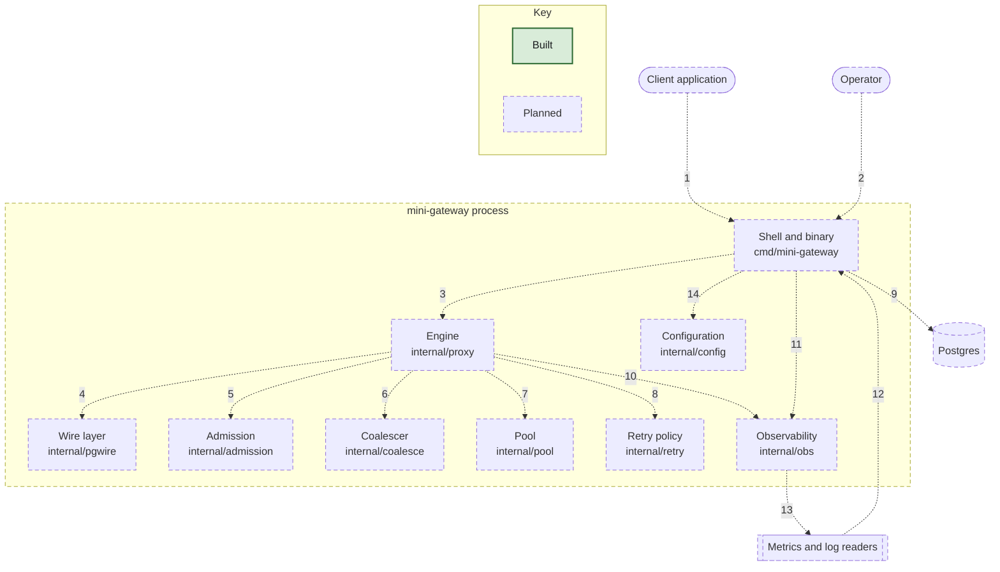

# C4 Level 2: Containers: the request path

**Built so far: chunks 0–1. Dashed parts are planned.** In this diagram 0 of 13 elements and 0 of 14 relationships are built. Model: diagram `container` in [model.json](model.json). Source of this page: [gen.py](gen.py).

Containers are Go packages inside one process. The shell does all socket I/O and makes no decisions. The engine is one single-threaded state machine that calls the wire layer and the four pure cores. Observability hangs off the side: the engine publishes snapshots, the admin listener serves them.

A solid box or arrow is built; a dashed one is planned. An arrow points to the supplier.

## Elements

| Element | Kind | Status | What it is |
| --- | --- | --- | --- |
| Client application | person | planned | Any program that speaks the Postgres wire protocol. Its startup user name selects its tenant. |
| Operator | person | planned | Runs proxy instances, writes the static fleet config, reads health and stats, drains an instance with SIGTERM. |
| Shell and binary | container | planned | cmd/mini-gateway and internal/shell. Listeners, one reader and one writer goroutine per connection, bounded mailboxes, a deadline on every socket operation, TLS on both legs with crypto/tls (it answers a client's TLS request, upgrades the socket and buffers nothing across the upgrade), the admin listener on its own port, signal handling. Makes no decisions: it posts events to the engine and performs the actions the engine returns. |
| Engine | container | planned | internal/proxy. One single-threaded, sans-I/O state machine per instance: events in, actions out. Holds the client and database connection tables and the request pipeline with its stage seams. The simulator and the shell drive this same code. |
| Wire layer | container | planned | internal/pgwire. Everything that knows Postgres: framing, both session state machines, the query-cycle tracker, the statement classifier, the error contract. The only product package that imports pgproto3. |
| Admission | container | planned | internal/admission. Rate gate, per-tenant queues with two selectable queue rules, adaptive LIFO, round-robin dispatcher with shares that bind under saturation, adaptive concurrency limit. |
| Coalescer | container | planned | internal/coalesce. Identical provably-read-only statements share one database read. Never writes. |
| Pool | container | planned | internal/pool. Hard-capped database connections, creation limiter, leases per transaction, the one breaker, the dirty-connection table. |
| Retry policy | container | planned | internal/retry. A policy interface. Off by default; the other policy retries once, only when nothing reached the database, within a 10% budget. |
| Observability | container | planned | internal/obs. Snapshot conventions (the one raw export), integer histogram, collector, the adapter interface and its adapters (Prometheus text, JSON, CSV flush, log line, OTLP push), fleet merge, health. **So far:** Built in chunk 1: the integer histogram, the conservation check and gauge, and the snapshot test helpers (obstest). Not built: the instance snapshot, the collector, the adapter interface and every adapter, fleet merge, health. |
| Configuration | container | planned | internal/config. The config file, the static fleet block (instance count N; fleet budgets divided by N), and load-time validation that fails closed. |
| Postgres | softwareSystem, external | planned | One ordinary Postgres server. Sees at most the fleet's connection budget, all logged in as one role. |
| Metrics and log readers | softwareSystem, external | planned | Everything that reads what the adapters produce: a Prometheus fed through an OpenTelemetry Collector or by direct scrape, flushed CSV files read by tests and DuckDB, log readers. They merge across instances; no component knows about them. The observability component view shows them one by one. |

## Relationships

| # | From | To | Status | What | How |
| --- | --- | --- | --- | --- | --- |
| 1 | Client application | Shell and binary | planned | Connects, logs in, sends statements | Postgres wire protocol; TCP, TLS when the client asks for it |
| 2 | Operator | Shell and binary | planned | Reads health, stats and metrics; sends SIGTERM to drain | HTTP admin port, signal |
| 3 | Shell and binary | Engine | planned | Posts events (bytes arrived, connection opened or closed, clock) and performs the returned actions | Go, bounded mailboxes |
| 4 | Engine | Wire layer | planned | Turns bytes into work units and outcomes; builds replies the proxy makes itself | Go, in-process |
| 5 | Engine | Admission | planned | Gate, enqueue, pick the next request, report completions | Go, in-process |
| 6 | Engine | Coalescer | planned | Join or start a shared read; fan the reply out | Go, in-process |
| 7 | Engine | Pool | planned | Lend and release connections; open and close decisions; breaker state | Go, in-process |
| 8 | Engine | Retry policy | planned | Ask whether a failure may be retried | Go, in-process |
| 9 | Shell and binary | Postgres | planned | Opens the pooled connections and moves their bytes | Postgres wire protocol; TCP, TLS by config |
| 10 | Engine | Observability | planned | Publishes one instance snapshot per interval | Go, plain structs |
| 11 | Shell and binary | Observability | planned | Admin listener serves exporters and health from the last published snapshot | Go, in-process |
| 12 | Metrics and log readers | Shell and binary | planned | Scrapes Prometheus text and JSON stats | HTTP admin port |
| 13 | Observability | Metrics and log readers | planned | Pushes OTLP metrics to a Collector that feeds Prometheus (last build chunk); flushes CSV files; writes log lines | OTLP/HTTP JSON, files |
| 14 | Shell and binary | Configuration | planned | Loads and validates the config and the fleet block at start | Go, in-process |
