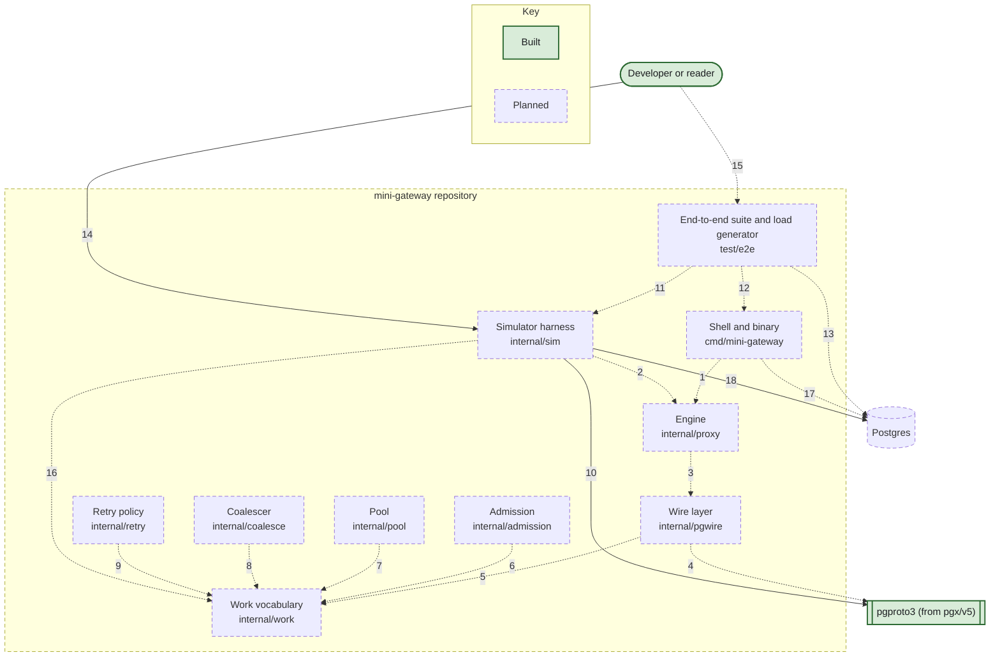

# C4 Level 2: Containers: drivers and seams

**Built so far: chunks 0–2. Dashed parts are planned.** In this diagram 2 of 13 elements and 3 of 18 relationships are built. Model: diagram `container-seams` in [model.json](model.json). Source of this page: [gen.py](gen.py).

The verdict on the backend interface, drawn. There is no generic backend interface. There are three seams: the engine's byte transport (implemented by the shell with TCP and by the simulator), the wire layer (the only product package that imports pgproto3), and the work vocabulary (the only thing the cores see). A second protocol would be a sibling of the wire layer producing the same vocabulary.

A solid box or arrow is built; a dashed one is planned. An arrow points to the supplier.

## Elements

| Element | Kind | Status | What it is |
| --- | --- | --- | --- |
| Developer or reader | person | built (chunk 1) | Runs simulator scenarios from a seed, replays a failure from its printed REPLAY line, runs make test / chaos / bench. |
| Simulator harness | container, test code | planned | internal/sim and its sub-packages simnet, fakepg, workload, world, simtest and simtoy; internal/testclient; internal/randdist; cmd/mgsim; scripts/tier-r.sh. A deterministic single-threaded world: virtual clock, simulated byte streams, a fake Postgres, simulated clients, scenarios with a driver interface, faults, replay. Its fake Postgres is checked against a real Postgres 17. Test code; built before any proxy code. **So far:** Built in chunks 1 and 2: the kernel (internal/sim), simnet, simtest, the toy protocol (simtoy), cmd/mgsim, the fake Postgres, the simulated clients, the test client, the scenario world with its five direct baselines (clients straight at the fake, no proxy) and the fidelity runner, and scripts/tier-r.sh. Not built: SCRAM login and the TLS faults in the fake and the clients (chunk 4). No engine exists yet, so the harness drives the fake Postgres and the toy protocol, and nothing implements the engine's transport seam. |
| End-to-end suite and load generator | container, test code | planned | test/e2e and cmd/loadgen. Each scenario is written once and runs on the simulator (tier S) and on the real binary against a real Postgres (tier R). The load generator is open-loop. |
| Shell and binary | container | planned | cmd/mini-gateway and internal/shell. Listeners, one reader and one writer goroutine per connection, bounded mailboxes, a deadline on every socket operation, TLS on both legs with crypto/tls (it answers a client's TLS request, upgrades the socket and buffers nothing across the upgrade), the admin listener on its own port, signal handling. Makes no decisions: it posts events to the engine and performs the actions the engine returns. |
| Engine | container | planned | internal/proxy. One single-threaded, sans-I/O state machine per instance: events in, actions out. Holds the client and database connection tables and the request pipeline with its stage seams. The simulator and the shell drive this same code. |
| Wire layer | container | planned | internal/pgwire. Everything that knows Postgres: framing, both session state machines, the query-cycle tracker, the statement classifier, the error contract. The only product package that imports pgproto3. |
| Work vocabulary | container | planned | internal/work. Small plain types the cores are written against: tenant, unit of work and its class, share key, outcome. Carries no Postgres type. This is the extension seam for a second protocol. |
| Admission | container | planned | internal/admission. Rate gate, per-tenant queues with two selectable queue rules, adaptive LIFO, round-robin dispatcher with shares that bind under saturation, adaptive concurrency limit. |
| Pool | container | planned | internal/pool. Hard-capped database connections, creation limiter, leases per transaction, the one breaker, the dirty-connection table. |
| Coalescer | container | planned | internal/coalesce. Identical provably-read-only statements share one database read. Never writes. |
| Retry policy | container | planned | internal/retry. A policy interface. Off by default; the other policy retries once, only when nothing reached the database, within a 10% budget. |
| pgproto3 (from pgx/v5) | softwareSystem, external | built (chunk 2) | Go package github.com/jackc/pgx/v5/pgproto3: Postgres wire message structs with Encode and Decode. The one external dependency, used for message encoding only. |
| Postgres | softwareSystem, external | planned | One ordinary Postgres server. Sees at most the fleet's connection budget, all logged in as one role. |

## Relationships

| # | From | To | Status | What | How |
| --- | --- | --- | --- | --- | --- |
| 1 | Shell and binary | Engine | planned | Posts events (bytes arrived, connection opened or closed, clock) and performs the returned actions | Go, bounded mailboxes |
| 2 | Simulator harness | Engine | planned | Drives the same engine on its event loop, over simulated byte streams | Go, transport seam |
| 3 | Engine | Wire layer | planned | Turns bytes into work units and outcomes; builds replies the proxy makes itself | Go, in-process |
| 4 | Wire layer | pgproto3 (from pgx/v5) | planned | The codec boundary: message structs encoded and decoded here and nowhere else in product code | Go import |
| 5 | Wire layer | Work vocabulary | planned | Produces work units and outcomes | Go types |
| 6 | Admission | Work vocabulary | planned | Written against these types only | Go types |
| 7 | Pool | Work vocabulary | planned | Written against these types only | Go types |
| 8 | Coalescer | Work vocabulary | planned | Written against these types only | Go types |
| 9 | Retry policy | Work vocabulary | planned | Written against these types only | Go types |
| 10 | Simulator harness | pgproto3 (from pgx/v5) | built | The fake Postgres and the test client encode and decode real wire messages, in one file each | Go import, test code |
| 11 | End-to-end suite and load generator | Simulator harness | planned | Tier S: runs each scenario on the simulator | Go test |
| 12 | End-to-end suite and load generator | Shell and binary | planned | Tier R: runs the real binary and drives it with test clients and open-loop load | Process, Postgres wire protocol |
| 13 | End-to-end suite and load generator | Postgres | planned | Tier R: starts a real Postgres 17 container and checks its state | Docker, Postgres wire protocol |
| 14 | Developer or reader | Simulator harness | built | Runs a scenario from a seed; replays a failure | cmd/mgsim, go test |
| 15 | Developer or reader | End-to-end suite and load generator | planned | make test, make chaos, make bench | make |
| 16 | Simulator harness | Work vocabulary | planned | Synthetic workloads drive the cores directly, with no Postgres code | Go types, test code |
| 17 | Shell and binary | Postgres | planned | Opens the pooled connections and moves their bytes | Postgres wire protocol; TCP, TLS by config |
| 18 | Simulator harness | Postgres | built | Tier R of the simulated world: the fidelity script and three direct baselines run against a real Postgres 17, to show the fake is faithful | scripts/tier-r.sh, Docker, TCP |
