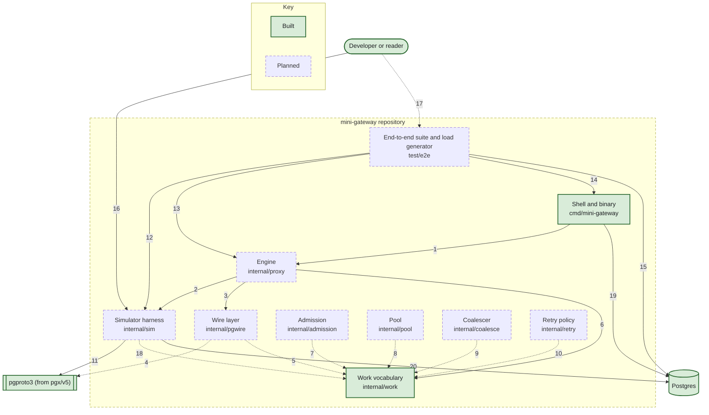

# C4 Level 2: Containers: drivers and seams

**Built so far: chunks 0–6. Dashed parts are planned.** In this diagram 5 of 13 elements and 12 of 20 relationships are built. Model: diagram `container-seams` in [model.json](model.json). Source of this page: [gen.py](gen.py).

The verdict on the backend interface, drawn. There is no generic backend interface. There are three seams: the engine's byte transport (implemented by the shell with TCP and, on the simulator, by the engine's test package proxysim), the wire layer (the only product package allowed to import pgproto3), and the work vocabulary (the only thing the cores see). A second protocol would be a sibling of the wire layer producing the same vocabulary.

A solid box or arrow is built; a dashed one is planned. An arrow points to the supplier.

## Elements

| Element | Kind | Status | What it is |
| --- | --- | --- | --- |
| Developer or reader | person | built (chunk 1) | Runs simulator scenarios from a seed, replays a failure from its printed REPLAY line, runs make test / chaos / bench. |
| Simulator harness | container, test code | planned | internal/sim and its sub-packages simnet, simtls, fakepg, workload, world, simtest and simtoy; internal/testclient; internal/randdist; cmd/mgsim; scripts/tier-r.sh. A deterministic single-threaded world: virtual clock, simulated byte streams, a simulated TLS handshake, a fake Postgres, simulated clients, scenarios with a driver interface, faults, replay. Its fake Postgres is checked against a real Postgres 17. Test code; built before any proxy code. **So far:** Built in chunks 1, 2 and 4: every component drawn here — the kernel (internal/sim), simnet, simtest, the toy protocol (simtoy), cmd/mgsim, the fake Postgres, the simulated clients, the test client, the simulated TLS handshake (simtls), the scenario world with its five direct baselines (clients straight at the fake, no proxy) and the fidelity runner, and scripts/tier-r.sh. Since chunk 6 the engine runs on it, through the engine's own test package internal/proxy/proxysim. Not built: no synthetic workload drives the cores (no core exists yet). |
| End-to-end suite and load generator | container, test code | planned | test/e2e and cmd/loadgen. Each scenario is written once and runs on the simulator (tier S) and on the real binary against a real Postgres (tier R), with the CSV flush on and SQL assertions over the files. Holds the engine's operation fuzz target and the canaries. The load generator is open-loop. **So far:** Built in chunk 6 (test/e2e): the scenario harness — a scenario is written once as a Spec and runs in tier S and tier R; 21 tier S scenarios, 14 tier R tests, the canaries and ablations, the operation fuzz target FuzzEngineOps, and make chaos (scripts/chaos.sh). Not built: cmd/loadgen, the open-loop load generator (chunk 6a), and make bench. |
| Shell and binary | container | built (chunk 6) | cmd/mini-gateway and internal/shell. The binary (-config, -check, -verifier) and the goroutine shell: the client listener, one reader and one writer goroutine per connection, one bounded mailbox into the engine's goroutine, a bounded write queue per connection, a deadline on every socket operation, TLS on both legs with crypto/tls (it reads exactly the 8 bytes of a client's first packet, upgrades the socket when the engine says so and buffers nothing across the upgrade), the admin listener on its own port, the collector with its JSON, Prometheus and CSV adapters, and signal handling: SIGTERM or SIGINT stops the process (a plain stop so far; the graceful drain is chunk 13). Makes no decisions: it posts events to the engine and performs the actions the engine returns. |
| Engine | container | planned | internal/proxy. One single-threaded, sans-I/O state machine per instance: events in, actions out. Holds the client and database connection tables and the request pipeline with its stage seams. The simulator and the shell drive this same code; its test package proxysim is the simulator's driver. **So far:** Built in chunk 6 (internal/proxy, internal/proxy/proxysim): every component drawn here except two parts — the fan-out of a shared reply to its waiters (chunk 11) and the drain sequence (chunk 13). The stages that belong to cores not built yet run their stand-ins: a breaker that is always closed, a rate gate that always allows, no coalescing, one bounded first-come queue, a fixed set of connections, retry off. |
| Wire layer | container | planned | internal/pgwire. Everything that knows Postgres: framing, both session state machines, the query-cycle tracker, the SQL lexer, the statement classifier with its courtesy reject list, the safe-shape recogniser that decides sharing, the error contract, the wire snapshot. The only product package allowed to import pgproto3. Its test packages pgwiretest, wireworld and clsworld run this code in the simulator. **So far:** Built in chunks 4 and 5 (internal/pgwire): every component drawn here except the codec boundary. Chunk 4: the framer, the hand-written message coding, both session machines, the SCRAM-SHA-256 functions, the two trackers, the startup FATAL replies, the wire snapshot, and the test packages pgwiretest and wireworld. Chunk 5: the SQL lexer, the reject list, the statement classifier, the safe-shape recogniser, the error table with its reply builders, and the test package clsworld. Chunk 6: the engine drives this code, and the client session machine takes every FATAL from the error table (three startup rows added). Not built: the codec boundary (no file in the package imports pgproto3; the reply builders code their messages by hand). Nothing produces outcomes yet. |
| Work vocabulary | container | built (chunk 5) | internal/work. Small plain types the cores are written against: tenant, unit of work with its class, reject reason and sharing flags, share key and its scope, outcome, refusal. Carries no Postgres type and imports only the standard library. This is the extension seam for a second protocol. |
| Admission | container | planned | internal/admission. Rate gate, per-tenant queues with two selectable queue rules, adaptive LIFO, round-robin dispatcher with shares that bind under saturation, adaptive concurrency limit. |
| Pool | container | planned | internal/pool. Hard-capped database connections, creation limiter, leases per transaction, the one breaker, the dirty-connection table. |
| Coalescer | container | planned | internal/coalesce. Identical statements share one database read: in auto mode those the wire layer marks as fitting the safe shape, in hinted mode those carrying the client's mark. Never writes. |
| Retry policy | container | planned | internal/retry. A policy interface. Off by default; the other policy retries once, only when nothing reached the database, within a 10% budget. |
| pgproto3 (from pgx/v5) | softwareSystem, external | built (chunk 2) | Go package github.com/jackc/pgx/v5/pgproto3: Postgres wire message structs with Encode and Decode. The one external dependency, used for message encoding only. |
| Postgres | softwareSystem, external | built (chunk 6) | One ordinary Postgres server. Sees at most the fleet's connection budget, all logged in as one role. |

## Relationships

| # | From | To | Status | What | How |
| --- | --- | --- | --- | --- | --- |
| 1 | Shell and binary | Engine | built | Posts events (bytes arrived, bytes written, connection opened or closed, TLS result, clock) and performs the returned actions | Go, one bounded mailbox |
| 2 | Engine | Simulator harness | built | The engine's test package proxysim runs the same engine on the simulator's event loop, over simulated byte streams | Go, transport seam, test code |
| 3 | Engine | Wire layer | built | Runs the session machines and trackers over the bytes; turns each Query into a work unit; builds the replies the proxy makes itself | Go, in-process |
| 4 | Wire layer | pgproto3 (from pgx/v5) | planned | The codec boundary: message structs encoded and decoded here and nowhere else in product code | Go import |
| 5 | Wire layer | Work vocabulary | planned | Produces work units and outcomes | Go types |
| 6 | Engine | Work vocabulary | built | Stage seams are written against these types; work units pass between stages | Go types |
| 7 | Admission | Work vocabulary | planned | Written against these types only | Go types |
| 8 | Pool | Work vocabulary | planned | Written against these types only | Go types |
| 9 | Coalescer | Work vocabulary | planned | Written against these types only | Go types |
| 10 | Retry policy | Work vocabulary | planned | Written against these types only | Go types |
| 11 | Simulator harness | pgproto3 (from pgx/v5) | built | The fake Postgres and the test client encode and decode real wire messages, in one file each | Go import, test code |
| 12 | End-to-end suite and load generator | Simulator harness | built | Tier S: runs each scenario on the simulator | Go test |
| 13 | End-to-end suite and load generator | Engine | built | Tier S: puts the engine between simulated clients and the fake Postgres with proxysim; the operation fuzz target and the canaries set the engine's test-only switches | Go test |
| 14 | End-to-end suite and load generator | Shell and binary | built | Tier R: runs the real binary and drives it with test clients (open-loop load from chunk 6a) | Process, Postgres wire protocol |
| 15 | End-to-end suite and load generator | Postgres | built | Tier R: starts a real Postgres 17 container and checks its state | Docker, Postgres wire protocol |
| 16 | Developer or reader | Simulator harness | built | Runs a scenario from a seed; replays a failure | cmd/mgsim, go test |
| 17 | Developer or reader | End-to-end suite and load generator | planned | make test, make chaos, make bench | make |
| 18 | Simulator harness | Work vocabulary | planned | Synthetic workloads drive the cores directly, with no Postgres code | Go types, test code |
| 19 | Shell and binary | Postgres | built | Opens the pooled connections and moves their bytes | Postgres wire protocol; TCP, TLS by config |
| 20 | Simulator harness | Postgres | built | Tier R of the simulated world: the fidelity script and three direct baselines run against a real Postgres 17, to show the fake is faithful | scripts/tier-r.sh, Docker, TCP |
