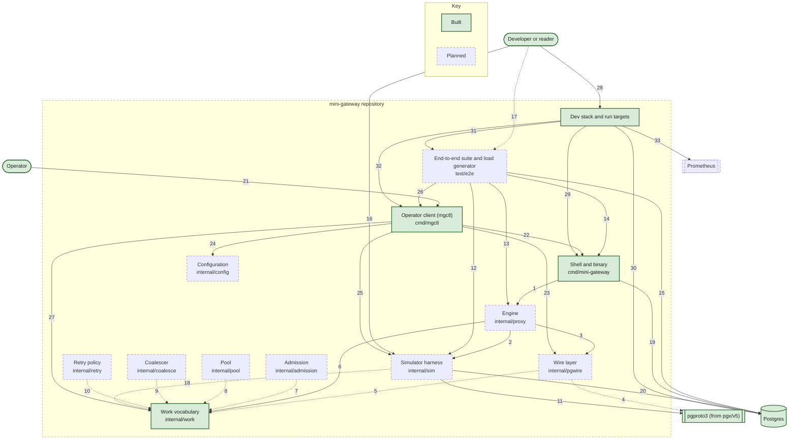

# C4 Level 2: Containers: drivers and seams

**Built so far: chunks 0–6a and chunk 8 (chunk 7 has not landed yet). Dashed parts are planned.** In this diagram 8 of 18 elements and 25 of 33 relationships are built. Model: diagram `container-seams` in [model.json](model.json). Source of this page: [gen.py](gen.py).

This diagram shows the verdict on the backend interface: there is no generic backend interface. Instead, there are three seams. The first is the engine's byte transport, which the shell implements over TCP and the engine's test package proxysim implements on the simulator. The second is the wire layer, the only product package allowed to import pgproto3. The third is the work vocabulary, the only thing the cores see. A second protocol would be a sibling of the wire layer producing the same vocabulary. Chunk 6a added the tools that drive the running binary from outside: the client mgctl, the load generator, and the dev stack, whose run targets start a gateway, a Postgres and a Prometheus.

A solid box or arrow is built; a dashed one is planned. An arrow points to the supplier.

## Elements

| Element | Kind | Status | What it is |
| --- | --- | --- | --- |
| Developer or reader | person | built (chunk 1) | Runs simulator scenarios from a seed, replays a failure from its printed REPLAY line, runs make test / chaos / bench, starts the dev stack and puts load on it (make run-up / load / run-down), reads a run as a report (make report). |
| Operator | person | built (chunk 6) | Runs proxy instances, writes the config file with its static fleet block, reads health and stats (directly or with mgctl), stops an instance with SIGTERM (a plain stop so far; a graceful drain from chunk 13). |
| Simulator harness | container, test code | planned | internal/sim and its sub-packages simnet, simtls, fakepg, workload, world, simtest and simtoy; internal/testclient; internal/randdist; cmd/mgsim; scripts/tier-r.sh. A deterministic single-threaded world: virtual clock, simulated byte streams, a simulated TLS handshake, a fake Postgres, simulated clients, scenarios with a driver interface, faults, replay. Its fake Postgres is checked against a real Postgres 17. Test code; built before any proxy code. **So far:** Built in chunks 1, 2 and 4: every component drawn here — the kernel (internal/sim), simnet, simtest, the toy protocol (simtoy), cmd/mgsim, the fake Postgres, the simulated clients, the test client, the simulated TLS handshake (simtls), the scenario world with its five direct baselines (clients straight at the fake, no proxy) and the fidelity runner, and scripts/tier-r.sh. Since chunk 6 the engine runs on it, through the engine's own test package internal/proxy/proxysim. Not built: no synthetic workload drives the cores (the one core that has landed, admission, is driven by its own reference-model tests and through the engine). |
| End-to-end suite and load generator | container, test code | planned | test/e2e; cmd/loadgen with internal/loadgen. Each scenario is written once and runs on the simulator (tier S) and on the real binary against a real Postgres (tier R), with the CSV flush on and SQL assertions over the files. Holds the engine's operation fuzz target and the canaries. The load generator is open-loop at a constant rate: every request has an intended send time that depends only on the rate, the duration and the seed, and it never waits for a reply before the next send. Operations, keys and payloads are drawn from the printed seed; two profiles, simple and errors. Latency is measured from the intended send time. Late and could-not-send requests are counted, and a SHORTFALL line with exit status 3 says when the achieved rate is below the target. Its own snapshot goes through a collector and the CSV flush. **So far:** Built in chunk 6 (test/e2e): the scenario harness — a scenario is written once as a Spec and runs in tier S and tier R; 21 tier S scenarios, 14 tier R tests, the canaries and ablations, the operation fuzz target FuzzEngineOps, and make chaos (scripts/chaos.sh). Built in chunk 6a: the load generator (cmd/loadgen, internal/loadgen with its runner live and its test fake loadgentest), all of what is said of it here; the seeded mgctl model test in both tiers; and a tier R test of the run targets (16 tier R tests). Built in chunk 8: the admission world (open-loop clients through the engine on the simulator, one connection, a fixed read time) with the head-to-head scenarios (four arms at 1.2×, 2× and 10× load), anti-bufferbloat with recovery for both rules against a first-come control, the first burst after idle, two canaries, and a tier R overload test against Postgres with pg_sleep (17 tier R tests now). Not built: make bench (scripts/bench.sh answers "not built yet"; chunk 14). |
| Operator client (mgctl) | container | built (chunk 6a) | cmd/mgctl and internal/mgctl. A read-only client for a running gateway. Subcommands: health, stats (with -watch), metrics, tenants (the tenant-labelled points of the stats — the admission queues' per-tenant rows, present when obs.detail is on — and the configured tenant users), config show (instance, build, fingerprint and the capacity gauges; with a file, its effective settings and whether its fingerprint matches), config check (a file checked offline with the gateway's own validation), verifier (a tenant's SCRAM verifier from a password, which it never prints), and query (one statement through the proxy as a tenant: the rows, or the SQLSTATE with its error-contract row). Every admin request is a GET, so it changes nothing in a running gateway. Standard-library flag; the logic in internal/mgctl imports neither flag nor net/http. MGCTL_TRANSCRIPT=<file> writes a step log with passwords hidden. |
| Dev stack and run targets | container | built (chunk 6a) | deploy/dev and the Makefile targets run-up, load and run-down. make run-up builds the gateway, mgctl and the load generator, starts a Postgres 17 and a Prometheus with docker-compose (pinned images, every port on 127.0.0.1 only, tmpfs data, names prefixed mg-), starts the gateway on the host with a generated config, waits until Prometheus reports the gateway's /metrics target up, and prints the URLs of three ready-made graphs. make load puts open-loop load on it; make run-down stops the gateway and removes every container, network and volume, keeping the CSV runs for the report. |
| Shell and binary | container | built (chunk 6) | cmd/mini-gateway and internal/shell. The binary (-config, -check, -verifier) and the goroutine shell: the client listener, one reader and one writer goroutine per connection, one bounded mailbox into the engine's goroutine, a bounded write queue per connection, a deadline on every socket operation, TLS on both legs with crypto/tls (it reads exactly the 8 bytes of a client's first packet, upgrades the socket when the engine says so and buffers nothing across the upgrade), the admin listener on its own port, the collector with its JSON, Prometheus and CSV adapters, and signal handling: SIGTERM or SIGINT stops the process (a plain stop so far; the graceful drain is chunk 13). Makes no decisions: it posts events to the engine and performs the actions the engine returns. |
| Engine | container | planned | internal/proxy. One single-threaded, sans-I/O state machine per instance: events in, actions out. Holds the client and database connection tables and the request pipeline with its stage seams. The simulator and the shell drive this same code; its test package proxysim is the simulator's driver. **So far:** Built in chunk 6 (internal/proxy, internal/proxy/proxysim): every component drawn here except two parts — the fan-out of a shared reply to its waiters (chunk 11) and the drain sequence (chunk 13). Chunk 8 put the admission queues behind the queue seam (admission.go). The stages that belong to cores not landed yet run their stand-ins: a breaker that is always closed, a rate gate that always allows, no coalescing, a fixed set of connections, retry off. |
| Wire layer | container | planned | internal/pgwire. Everything that knows Postgres: framing, both session state machines, the query-cycle tracker, the SQL lexer, the statement classifier with its courtesy reject list, the safe-shape recogniser that decides sharing, the error contract, the wire snapshot. The only product package allowed to import pgproto3. Its test packages pgwiretest, wireworld and clsworld run this code in the simulator. **So far:** Built in chunks 4 and 5 (internal/pgwire): every component drawn here except the codec boundary. Chunk 4: the framer, the hand-written message coding, both session machines, the SCRAM-SHA-256 functions, the two trackers, the startup FATAL replies, the wire snapshot, and the test packages pgwiretest and wireworld. Chunk 5: the SQL lexer, the reject list, the statement classifier, the safe-shape recogniser, the error table with its reply builders, and the test package clsworld. Chunk 6: the engine drives this code, and the client session machine takes every FATAL from the error table (three startup rows added). Not built: the codec boundary (no file in the package imports pgproto3; the reply builders code their messages by hand). Nothing produces outcomes yet. |
| Work vocabulary | container | built (chunk 5) | internal/work. Small plain types the cores are written against: tenant, unit of work with its class, reject reason and sharing flags, share key and its scope, outcome, refusal. Carries no Postgres type and imports only the standard library. This is the extension seam for a second protocol. |
| Admission | container | planned | internal/admission. Rate gate, per-tenant queues with two selectable queue rules, adaptive LIFO, a load gauge, round-robin dispatcher with shares that bind under saturation, adaptive concurrency limit. **So far:** Built in chunk 8 (internal/admission): the per-tenant queues, the QueueRule interface, the timeout rule, the control-law rule and the two comparison arms, all of what is said of them here; the Dispatcher interface with one default (oldest head first); and Snapshot() for the queues. The engine runs them behind its queue seam, and the config file always selects one of the two rules. The core does not import internal/work so far: it takes a tenant as a string and a request as an integer id, and the engine converts. Not built: round robin with shares (chunk 9), the adaptive limit and the rate gate (chunk 10), and the tenant table's in-flight counts, shares and gate state. |
| Pool | container | planned | internal/pool. Hard-capped database connections, creation limiter, leases per transaction, the one breaker, the dirty-connection table. |
| Coalescer | container | planned | internal/coalesce. Identical statements share one database read: in auto mode those the wire layer marks as fitting the safe shape, in hinted mode those carrying the client's mark. Never writes. |
| Retry policy | container | planned | internal/retry. A policy interface. Off by default; the other policy retries once, only when nothing reached the database, within a 10% budget. |
| Configuration | container | planned | internal/config. The config file (JSON), the client_tls and backend_tls blocks, the queue block (the rule and its times, the capacities, adaptive LIFO), the static fleet block (instance count N; fleet budgets divided by N), load-time validation that fails closed and names the key, and the config fingerprint. **So far:** Built in chunk 6 (internal/config): the JSON config file with its defaults, validation that fails closed and names the key (the timeout nesting too), the client_tls and backend_tls blocks, the config fingerprint, and the fleet block parsed and checked (pool.connections must fit fleet.backend_connections / fleet.instances, which must divide evenly and fit the database's limit with a reserve). Built in chunk 8 (queue.go): the queue keys rule, target, interval, tenant_capacity, max_tenants, lifo and lifo_hold, with their defaults; queue.rule accepts only timeout and control-law. Not built: nothing takes its budget from the division yet (chunk 7 on; the fleet configuration is chunk 13). |
| pgproto3 (from pgx/v5) | softwareSystem, external | built (chunk 2) | Go package github.com/jackc/pgx/v5/pgproto3: Postgres wire message structs with Encode and Decode. The one external dependency, used for message encoding only. |
| Postgres | softwareSystem, external | built (chunk 6) | One ordinary Postgres server. Sees at most the fleet's connection budget, all logged in as one role. |
| Prometheus | softwareSystem, external | planned | End of the production path. Scrapes the Collector; sees low-cardinality labels and the bounded tenant label only. Fleet totals are sums over the instance label. It can scrape an instance's /metrics directly instead, as the dev stack's Prometheus does. **So far:** Built in chunk 6a (deploy/dev): the dev stack starts a Prometheus v3.9.1 that scrapes the gateway's /metrics directly, every second. Not built: the production path through the Collector (chunk 15). |

## Relationships

| # | From | To | Status | What | How |
| --- | --- | --- | --- | --- | --- |
| 1 | Shell and binary | Engine | built | Posts events (bytes arrived, bytes written, connection opened or closed, TLS result, clock) and performs the returned actions | Go, one bounded mailbox |
| 2 | Engine | Simulator harness | built | The engine's test package proxysim runs the same engine on the simulator's event loop, over simulated byte streams | Go, transport seam, test code |
| 3 | Engine | Wire layer | built | Runs the session machines and trackers over the bytes; turns each Query into a work unit; builds the replies the proxy makes itself | Go, in-process |
| 4 | Wire layer | pgproto3 (from pgx/v5) | planned | The codec boundary: message structs encoded and decoded here and nowhere else in product code | Go import |
| 5 | Wire layer | Work vocabulary | planned | Produces work units and outcomes | Go types |
| 6 | Engine | Work vocabulary | built | Stage seams are written against these types; work units pass between stages | Go types |
| 7 | Admission | Work vocabulary | planned | Written against these types only | Go types |
| 8 | Pool | Work vocabulary | planned | Written against these types only | Go types |
| 9 | Coalescer | Work vocabulary | planned | Written against these types only | Go types |
| 10 | Retry policy | Work vocabulary | planned | Written against these types only | Go types |
| 11 | Simulator harness | pgproto3 (from pgx/v5) | built | The fake Postgres and the test client encode and decode real wire messages, in one file each | Go import, test code |
| 12 | End-to-end suite and load generator | Simulator harness | built | Tier S: runs each scenario on the simulator | Go test |
| 13 | End-to-end suite and load generator | Engine | built | Tier S: puts the engine between simulated clients and the fake Postgres with proxysim; the operation fuzz target and the canaries set the engine's test-only switches | Go test |
| 14 | End-to-end suite and load generator | Shell and binary | built | Tier R: runs the real binary and drives it with test clients. The load generator logs in as its tenants and sends open-loop load | Process, Postgres wire protocol |
| 15 | End-to-end suite and load generator | Postgres | built | Tier R: starts a real Postgres 17 container and checks its state | Docker, Postgres wire protocol |
| 16 | Developer or reader | Simulator harness | built | Runs a scenario from a seed; replays a failure | cmd/mgsim, go test |
| 17 | Developer or reader | End-to-end suite and load generator | planned | make test, make chaos, make bench | make |
| 18 | Simulator harness | Work vocabulary | planned | Synthetic workloads drive the cores directly, with no Postgres code | Go types, test code |
| 19 | Shell and binary | Postgres | built | Opens the pooled connections and moves their bytes | Postgres wire protocol; TCP, TLS by config |
| 20 | Simulator harness | Postgres | built | Tier R of the simulated world: the fidelity script and three direct baselines run against a real Postgres 17, to show the fake is faithful | scripts/tier-r.sh, Docker, TCP |
| 21 | Operator | Operator client (mgctl) | built | Asks a running gateway how it is; checks a config file; derives a verifier; runs one statement as a tenant | Command line |
| 22 | Operator client (mgctl) | Shell and binary | built | Reads /healthz, /stats and /metrics (GET only); logs in as a tenant and runs one statement | HTTP admin port; Postgres wire protocol, TCP, TLS on request |
| 23 | Operator client (mgctl) | Wire layer | built | Names an error reply by its error-contract row; uses the SCRAM client and the verifier functions | Go import |
| 24 | Operator client (mgctl) | Configuration | built | config check and config show load a file with the gateway's own validation and fingerprint | Go import |
| 25 | Operator client (mgctl) | Simulator harness | built | Its session frames and decodes messages with the test client (internal/testclient) | Go import |
| 26 | End-to-end suite and load generator | Operator client (mgctl) | built | The load generator logs in with mgctl's session and TLS settings and tells a proxy-made reply by its lookup | Go import |
| 27 | Operator client (mgctl) | Work vocabulary | built | Prints whether an error-contract row says the statement reached the database (the three-valued type) | Go types |
| 28 | Developer or reader | Dev stack and run targets | built | make run-up, make load, make run-down | make |
| 29 | Dev stack and run targets | Shell and binary | built | Builds the binary and starts it on the host with a generated config | Process |
| 30 | Dev stack and run targets | Postgres | built | Starts a Postgres 17 container with the gateway's role and the table the load uses | docker-compose |
| 31 | Dev stack and run targets | End-to-end suite and load generator | built | make load runs the load generator against the gateway | Process |
| 32 | Dev stack and run targets | Operator client (mgctl) | built | Derives the tenants' verifiers, checks the generated config and waits for health with it | Process |
| 33 | Dev stack and run targets | Prometheus | built | Starts a Prometheus that scrapes the gateway's /metrics every second; waits until the target is up | docker-compose, HTTP |
