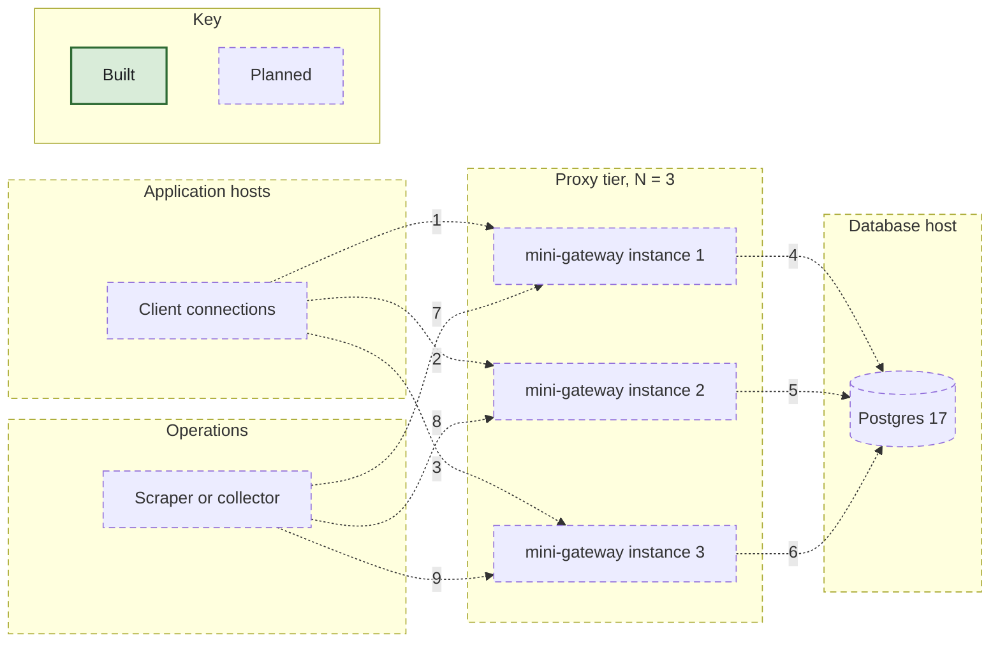

# C4 Deployment: Deployment: three instances, one database

**Built so far: chunks 0–6a and chunk 8 (chunk 7 has not landed yet). Dashed parts are planned.** In this diagram 0 of 10 elements and 0 of 9 relationships are built. Model: diagram `deployment` in [model.json](model.json). Source of this page: [gen.py](gen.py).

Each instance enforces its own limits. The config declares the instance count and divides the fleet budgets. The table in PLAN.md section 8.2 lists what multiplies, weakens, or survives at N instances. The weakened rows are measured in three-instance scenarios.

A solid box or arrow is built; a dashed one is planned. An arrow points to the supplier.

## Elements

| Element | Kind | Status | What it is |
| --- | --- | --- | --- |
| Application hosts | deploymentNode | planned | Clients of every tenant. They spread their connections over the instances themselves, or through any TCP balancer; we build none. |
| Client connections | infrastructureNode | planned | 500 clients here; each connects to one instance. |
| Proxy tier, N = 3 | deploymentNode | planned | Three independent mini-gateway processes with the same static config: fleet.instances = 3, so each takes a third of every fleet budget. No instance knows about the others. |
| mini-gateway instance 1 | instance | planned | Own engine, pool (fleet budget / 3), queues, flights, limit, retry budget and snapshots. Drains on SIGTERM. |
| mini-gateway instance 2 | instance | planned | Own engine, pool (fleet budget / 3), queues, flights, limit, retry budget and snapshots. Drains on SIGTERM. |
| mini-gateway instance 3 | instance | planned | Own engine, pool (fleet budget / 3), queues, flights, limit, retry budget and snapshots. Drains on SIGTERM. |
| Database host | deploymentNode | planned | One Postgres. Its connection limit must cover the fleet budget plus a reserve; config validation checks it. |
| Postgres 17 | infrastructureNode | planned | Sees at most the fleet connection budget (for example 3 x 32 = 96), all as one role. |
| Operations | deploymentNode | planned | Where metrics are scraped or pushed to, and merged across instances. |
| Scraper or collector | infrastructureNode | planned | Reads each instance's exporters; sums counters, merges histograms, recomputes ratios. |

## Relationships

| # | From | To | Status | What | How |
| --- | --- | --- | --- | --- | --- |
| 1 | Client connections | mini-gateway instance 1 | planned | About a third of the client connections | Postgres wire protocol, TCP |
| 2 | Client connections | mini-gateway instance 2 | planned | About a third of the client connections | Postgres wire protocol, TCP |
| 3 | Client connections | mini-gateway instance 3 | planned | About a third of the client connections | Postgres wire protocol, TCP |
| 4 | mini-gateway instance 1 | Postgres 17 | planned | At most budget / 3 pooled connections; dials at most rate / 3 | Postgres wire protocol, TCP |
| 5 | mini-gateway instance 2 | Postgres 17 | planned | At most budget / 3 pooled connections; dials at most rate / 3 | Postgres wire protocol, TCP |
| 6 | mini-gateway instance 3 | Postgres 17 | planned | At most budget / 3 pooled connections; dials at most rate / 3 | Postgres wire protocol, TCP |
| 7 | Scraper or collector | mini-gateway instance 1 | planned | Scrapes this instance's snapshot | HTTP admin port |
| 8 | Scraper or collector | mini-gateway instance 2 | planned | Scrapes this instance's snapshot | HTTP admin port |
| 9 | Scraper or collector | mini-gateway instance 3 | planned | Scrapes this instance's snapshot | HTTP admin port |
