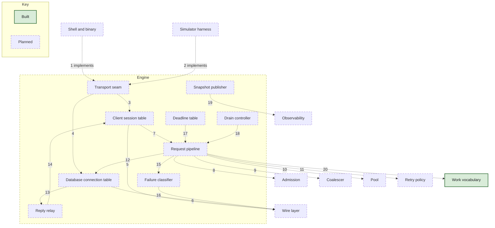

# C4 Level 3: Components: engine

**Built so far: chunks 0–5. Dashed parts are planned.** In this diagram 1 of 18 elements and 0 of 20 relationships are built. Model: diagram `component-engine` in [model.json](model.json). Source of this page: [gen.py](gen.py).

The engine is where the seams meet. The transport seam below it has two implementations. The pipeline above calls each core through a small stage interface, so a core can be replaced by a pass-through (which is how each scenario's ablation run is made).

A solid box or arrow is built; a dashed one is planned. An arrow points to the supplier. An arrow marked "implements" means the source implements the target's interface; every other arrow means "uses".

## Elements

| Element | Kind | Status | What it is |
| --- | --- | --- | --- |
| Transport seam | component | planned | Dialer and byte-stream connection events and actions: open, bytes in, bytes out, closed. Knows no protocol. Two implementations: TCP in the shell, simulated streams in the harness. |
| Client session table | component | planned | One entry per client connection: its wire state machine, tenant, transaction state, the single request it may have inside the proxy, and its bounded reply buffer. |
| Database connection table | component | planned | One entry per database connection: its wire state machine, the query-cycle tracker, and who holds it. |
| Request pipeline | component | planned | The fixed order every request takes, each stage a small interface: classify, reject list, draining, breaker, rate gate, coalesce, queue, lease, forward, release. Statements inside an open transaction skip from classify straight to forward on the connection the client already holds. |
| Reply relay | component | planned | Streams database messages to the client (or to every waiter of a shared read) through bounded buffers, with back pressure in both directions. Never sends a short reply that looks complete. |
| Failure classifier | component | planned | For every failure records whether any byte reached the database, and picks the error-contract row. |
| Deadline table | component | planned | Every wait in the timeout budget, as deadlines on the injected clock; returns the next wake-up time as an action. |
| Drain controller | component | planned | Sequences shutdown: stop admitting, finish transactions in progress within a bound, close idle connections, exit. |
| Snapshot publisher | component | planned | Collects every component's Snapshot() between events and hands the copy to the collector. |
| Shell and binary | neighbouring container | planned | cmd/mini-gateway and internal/shell. Listeners, one reader and one writer goroutine per connection, bounded mailboxes, a deadline on every socket operation, TLS on both legs with crypto/tls (it answers a client's TLS request, upgrades the socket and buffers nothing across the upgrade), the admin listener on its own port, signal handling. Makes no decisions: it posts events to the engine and performs the actions the engine returns. |
| Simulator harness | neighbouring container | planned | internal/sim and its sub-packages simnet, simtls, fakepg, workload, world, simtest and simtoy; internal/testclient; internal/randdist; cmd/mgsim; scripts/tier-r.sh. A deterministic single-threaded world: virtual clock, simulated byte streams, a simulated TLS handshake, a fake Postgres, simulated clients, scenarios with a driver interface, faults, replay. Its fake Postgres is checked against a real Postgres 17. Test code; built before any proxy code. **So far:** Built in chunks 1, 2 and 4: every component drawn here — the kernel (internal/sim), simnet, simtest, the toy protocol (simtoy), cmd/mgsim, the fake Postgres, the simulated clients, the test client, the simulated TLS handshake (simtls), the scenario world with its five direct baselines (clients straight at the fake, no proxy) and the fidelity runner, and scripts/tier-r.sh. Not built: no engine exists yet, so the harness drives the fake Postgres, the toy protocol and the wire layer's two test proxies (startup-only, and the classifier scenarios' gateway); nothing implements the engine's transport seam, and no synthetic workload drives the cores. |
| Wire layer | neighbouring container | planned | internal/pgwire. Everything that knows Postgres: framing, both session state machines, the query-cycle tracker, the SQL lexer, the statement classifier with its courtesy reject list, the safe-shape recogniser that decides sharing, the error contract, the wire snapshot. The only product package allowed to import pgproto3. Its test packages pgwiretest, wireworld and clsworld run this code in the simulator. **So far:** Built in chunks 4 and 5 (internal/pgwire): every component drawn here except the codec boundary. Chunk 4: the framer, the hand-written message coding, both session machines, the SCRAM-SHA-256 functions, the two trackers, the startup FATAL replies, the wire snapshot, and the test packages pgwiretest and wireworld. Chunk 5: the SQL lexer, the reject list, the statement classifier, the safe-shape recogniser, the error table with its reply builders, and the test package clsworld. Not built: the codec boundary (no file in the package imports pgproto3; the reply builders code their messages by hand). No engine exists yet, so only the test proxies drive this code, and nothing produces outcomes. |
| Admission | neighbouring container | planned | internal/admission. Rate gate, per-tenant queues with two selectable queue rules, adaptive LIFO, round-robin dispatcher with shares that bind under saturation, adaptive concurrency limit. |
| Coalescer | neighbouring container | planned | internal/coalesce. Identical statements share one database read: in auto mode those the wire layer marks as fitting the safe shape, in hinted mode those carrying the client's mark. Never writes. |
| Pool | neighbouring container | planned | internal/pool. Hard-capped database connections, creation limiter, leases per transaction, the one breaker, the dirty-connection table. |
| Retry policy | neighbouring container | planned | internal/retry. A policy interface. Off by default; the other policy retries once, only when nothing reached the database, within a 10% budget. |
| Observability | neighbouring container | planned | internal/obs and its sub-packages; test/analysis; scripts/csv-assert.sh. Snapshot conventions (the one raw export), integer histogram, metric registry, collector, the adapter interface and its adapters (Prometheus text, JSON, CSV flush, log line, OTLP push), fleet merge, health, and the SQL assertions over flushed files. **So far:** Built in chunks 1, 3, 4 and 5: everything except the OTLP push adapter (chunk 15) and the health rules that read other components (chunk 6 on). No engine or shell exists yet, so only the simulator's scenario harness (internal/obs/simrun) creates a collector, and nothing serves the outputs over HTTP. |
| Work vocabulary | neighbouring container | built (chunk 5) | internal/work. Small plain types the cores are written against: tenant, unit of work with its class, reject reason and sharing flags, share key and its scope, outcome, refusal. Carries no Postgres type and imports only the standard library. This is the extension seam for a second protocol. |

## Relationships

| # | From | To | Status | What | How |
| --- | --- | --- | --- | --- | --- |
| 1 | Shell and binary | Transport seam | planned | Implements it with TCP sockets; posts events through bounded mailboxes | Go, interface implementation |
| 2 | Simulator harness | Transport seam | planned | Implements it with simulated byte streams on the event loop | Go, interface implementation |
| 3 | Transport seam | Client session table | planned | Client bytes and connection events | Go |
| 4 | Transport seam | Database connection table | planned | Database bytes and connection events | Go |
| 5 | Client session table | Wire layer | planned | Client session machine; statement classifier | Go |
| 6 | Database connection table | Wire layer | planned | Database session machine; query-cycle tracker | Go |
| 7 | Client session table | Request pipeline | planned | One work unit at a time per client | Go |
| 8 | Request pipeline | Admission | planned | Gate, queue, dispatch, limit | Go |
| 9 | Request pipeline | Coalescer | planned | Join or lead a shared read | Go |
| 10 | Request pipeline | Pool | planned | Lend, release, breaker state, dirty connections | Go |
| 11 | Request pipeline | Retry policy | planned | May this failure be retried | Go |
| 12 | Request pipeline | Database connection table | planned | Forwards the statement on the lent connection | Go |
| 13 | Database connection table | Reply relay | planned | Reply messages and the end-of-reply status byte | Go |
| 14 | Reply relay | Client session table | planned | Reply bytes for each recipient | Go |
| 15 | Request pipeline | Failure classifier | planned | Every refusal and failure | Go |
| 16 | Failure classifier | Wire layer | planned | Builds the error reply for its contract row | Go |
| 17 | Deadline table | Request pipeline | planned | A deadline was reached | Go |
| 18 | Drain controller | Request pipeline | planned | Sets the draining input | Go |
| 19 | Snapshot publisher | Observability | planned | Hands over the instance snapshot | Go, plain structs |
| 20 | Request pipeline | Work vocabulary | planned | Passes work units and outcomes between stages | Go types |
