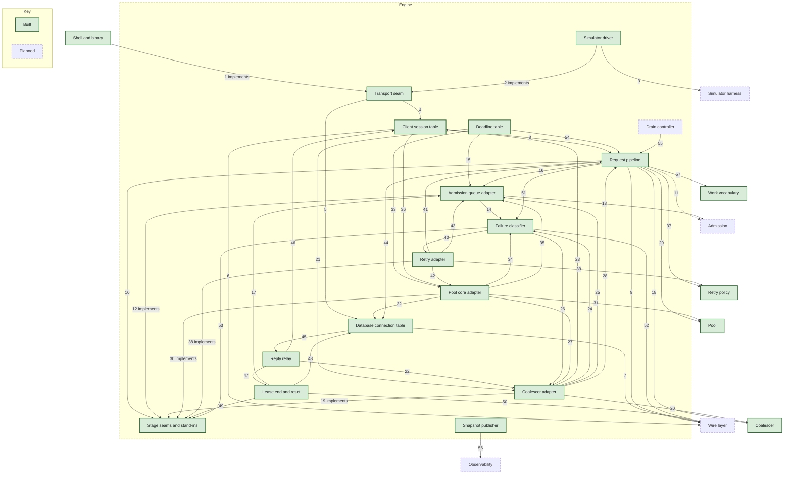

# C4 Level 3: Components: engine

**Built so far: chunks 0–9 and chunks 11 and 12 (chunk 10 has not landed yet). Dashed parts are planned.** In this diagram 20 of 25 elements and 56 of 57 relationships are built. Model: diagram `component-engine` in [model.json](model.json). Source of this page: [gen.py](gen.py).

The engine is where the seams meet. Below it, the transport seam has two implementations. Above it, the pipeline calls each core through a small stage interface, so a core can be replaced by a pass-through. That is how each scenario's ablation run is made. Chunk 6 built the walking skeleton: the whole path of a request, with a stand-in at every stage whose core is not built yet. Chunk 7 put the pool core behind the pool, breaker and release seams, through the pool core adapter, and chunk 8 the admission queues behind the queue seam, through the admission queue adapter. Where the two meet, a request waits in one place, its tenant's queue, and a breaker that opens refuses the queue through the admission queues. Chunk 9 installed the fair dispatcher on those queues: the engine reports every lease start and end to it, and tells the pool only the demand the dispatcher would release. Chunk 12 put the retry policy behind the retry seam, through the retry adapter: a granted retry goes back to its tenant's queue holding no connection, so the fair dispatcher and the pool treat it as any waiting request. Chunk 11 put the flight table behind the coalescer seam, through the coalescer adapter: a follower waits on its flight and holds no queue place and no connection, and only the flight's owner is queued, so the queue, the dispatcher, the pool and the retry policy see one request per shared read. The pipeline's arrow to admission stays dashed until the limit and the gate exist.

A solid box or arrow is built; a dashed one is planned. An arrow points to the supplier. An arrow marked "implements" means the source implements the target's interface; every other arrow means "uses".

## Elements

| Element | Kind | Status | What it is |
| --- | --- | --- | --- |
| Transport seam | component | built (chunk 6) | The engine's contract with its driver, as plain events and actions (no Go interface). Events in: accepted, bytes arrived, bytes written, write refused, closed, dial failed, TLS result, cancel done, timer, publish. Actions out: write, close, start TLS, pause and resume reading, open a database connection, send a cancel request on a connection of its own, wake at a time, publish. Knows no protocol; its read rule (exactly 8 bytes of a new client, one unprocessed read per connection) keeps bytes from crossing a TLS upgrade. Two implementations: TCP in the shell, simulated streams in proxysim. |
| Client session table | component | built (chunk 6) | One entry per client connection: its wire state machines, tenant, phase (startup, idle, queued, active, holding a connection, waiting on a shared read), transaction status, the single request it may have inside the proxy, a bounded input buffer and the count of reply bytes not yet written. Caps the clients connected and the clients in startup. Keeps the map from proxy-issued key data to its client, which a cancel request is looked up in, and the idle-in-transaction deadline of a client that holds a connection (with the pool core). |
| Database connection table | component | built (chunk 6) | One entry per database connection: its wire state machine, the query-cycle tracker, its phase (dialing, startup, idle, lent, resetting, checking, cleaning) and who holds it. With the pool core, every open and close is the core's decision and the phase mirrors the core's state. With the fixed set (tests only since chunk 7) the table keeps the set full itself: opens the configured number at start, one dial at a time, and dials again after a loss, after a short delay when the connect failed. |
| Request pipeline | component | built (chunk 6) | The fixed order every request takes: classify, reject list, draining, breaker, rate gate, coalesce, queue, lease, forward, release. Each stage is counted as passed or refused, and each refusal is answered with its error-contract row: while the breaker is open, 53M03 at once and no dial. A queued request has a wait deadline, the outer bound whatever the queue rule; a request the queue sheds is answered at once with 53M01. At the coalesce stage (through the coalescer adapter) a shareable request leads a shared read, waits on one, passes on unshared, or is refused 53M04; only the request that owns a shared read goes on to the queue. A request waits in one of two places, its tenant's queue or a shared read: a checkout that cannot lend leaves it in the queue, and so does a request the fair dispatcher holds back; while one is held back the dispatch is tried once more at the end of every event. A request is queued, checked out and lent under the tenant it arrived with, which it keeps when a shared read passes to another client. Statements inside an open transaction skip from the reject list straight to forward on the connection the client already holds. A request the retry policy grants a retry re-enters at the queue stage: the stages before it are not run again. |
| Stage seams and stand-ins | component | built (chunk 6) | The small interfaces the pipeline calls: classifier, breaker, rate gate, coalescer, queue, pool, release policy, retry policy. The queue seam has an extension for a queue that sheds: remove, expire or refuse at an instant, sweep, next deadline, take the shed requests, put back a popped one, close. The retry seam is handed each failure with its facts: reached, in a transaction, the attempt, breaker open, draining, the request's deadline. The coalescer seam has an extension for a flight table: a verdict per request, the send, the stored bytes, the end, a leave, sweep, next deadline, take the notices. Also the stand-ins: a rate gate that always allows, used until its core is built; no coalescing, which an engine whose config leaves coalescing off uses (the config file's default is auto); a retry policy that never retries, which no engine uses by default any more (the engine builds the retry core from its config, and that core's default is Off); and a breaker that is always closed, a fixed set of connections, reset after every lease and one bounded first-come queue, which an engine configured without the pool core or without a queue rule still uses (tests only: the config file always gives both). The engine's config can replace any of them. |
| Lease end and reset | component | built (chunk 6) | A lease ends when a reply ends with status idle; while the status is in-transaction or failed the client keeps its connection. At release the policy answers reset, lend as is, or close (close when the status is not idle or bytes are left unread). The reset is DISCARD ALL sent as the proxy's own Query: the connection is lent again only after exactly that tag and status idle, with nothing after them, inside the reset deadline. Anything else closes it, counted by reason. Nothing of the reset's reply reaches a client. With the pool core the release is the core's: under on-switch a clean connection is tagged with its tenant and not reset until another tenant needs it; with lease.reseed on, a SELECT setseed follows DISCARD ALL and its reply is judged too; and a lease that does not end clean goes to the dirty-connection table instead of being closed. |
| Reply relay | component | built (chunk 11) | Streams database messages to the client as they arrive, through a bounded buffer per client, with back pressure in both directions: reading the database connection is paused while the client is behind, reading the client while its request is in progress. ErrorResponse and ReadyForQuery are held whole, so a FATAL from the database becomes an error-contract reply. Never sends a short reply that looks complete. The reply of a shared read is not streamed: its bytes go to the coalescer adapter, which stores them up to the cap and writes them out when the reply ends; no slow client pauses the database read meanwhile. Past the cap the stored bytes are written to the owner and the rest is streamed to it as usual. |
| Failure classifier | component | built (chunk 6) | For every failure records whether the request may have reached the database (no only when the driver reports that its first write was refused with zero bytes accepted) and picks the error-contract row: 08006 for a safe read or when nothing reached, 08007 otherwise, FATAL 08006 when a transaction lost its connection (between statements, or mid-statement unless the message could have ended the transaction: then 08007), and a close with no message once part of the reply was sent. Offers every lost statement, with the fact, to the retry seam before it is counted failed: when a retry is granted the request runs again and this failure sends the client nothing. The lost statement of a shared read is offered once, for the whole flight, and only while the coalescer still has the flight (not at or after its flight deadline); when no retry is granted every waiter gets the owner's row once. The fault × path table (matrix.go) lists every fault and place with its row, its deadline, the reached fact and whether the proxy retries it; docs/fault-matrix.md is generated from it. |
| Deadline table | component | built (chunk 6) | Every wait the engine has, as deadlines on the clock passed in with each event: one heap, and the next wake-up time returned as an action. The admission queues' next deadline is one timer in it, the pool core's next deadline another, and the coalescer's a third. Timers due at or before an event's time fire before the event is processed, so whatever arrives at the instant of its deadline is late. |
| Drain controller | component | planned | Sequences shutdown: stop admitting, finish transactions in progress within a bound, close idle connections, exit. **So far:** Built in chunk 6 (internal/proxy: the EvDraining input, gates in lease.go, Shutdown in engine.go): while the draining input is on, new work from a client outside a transaction is refused with 53M05 and that client is closed after the reply (unit-tested; nothing in the binary sets it yet); and a plain stop that closes every client and connection. Not built: the sequence — finish transactions in progress within a bound, close idle connections, exit (chunk 13). |
| Snapshot publisher | component | built (chunk 6) | Snapshot(): the engine's counters as one plain struct — clients, requests by stage and outcome, replies by row, leases, resets, relay, connections, cancels, retries, requests waiting on shared reads and what the coalesce stage did, three histograms — with its conservation check (accepted = completed + failed + shed + queued + in flight + waiting on a shared read), beside the wire, classifier, reply, pool, admission, retry and coalescer snapshots the engine holds. On a publish event the engine returns a publish action; its driver then has the collector read the snapshots, between events. |
| Simulator driver | component, test code | built (chunk 6) | internal/proxy/proxysim. The engine on the simulator: accepts and dials on simulated streams, keeps the same read rule as the shell, plays the simulated TLS handshake on both legs, reports writes and refused writes, sends a cancel request on a simulated connection of its own, and registers the engine's invariants, quiesce check and state with the simulator. Its World builds the simulator, the network, the fake Postgres and the engine for a scenario. |
| Admission queue adapter | component | built (chunk 9) | internal/proxy/admission.go. Puts the admission queues behind the queue seam and its shedding extension. After every queue operation the engine takes the sheds the core decided, answers each at once with 53M01 and an end marker, and arms its one admission timer at the core's next deadline. With it no connection is lent directly: every request is pushed and popped, so the rule sees zero-wait requests too. At a stop it sweeps first and answers what was due, then removes the rest as client-gone. When the breaker opens it sweeps, then refuses every queued request in arrival order: each is a shed with reason breaker, answered 53M03. The engine's invariants require the core's shed count to equal the sheds answered. It installs the fair dispatcher on the queues it builds (fairness.go), with the limit at the pool size, and the engine reports to it every lease start (at the lend) and every lease end (a release on either pool, the dirty-connection table, a lost lease), so a transaction held open stays in flight until its lease ends. A lease starts and ends on the tenant its request was queued under, also when a shared read has passed to a client of another tenant. The invariants require the dispatcher's leases in flight, in total and per tenant, to equal the connections the engine has lent. |
| Pool core adapter | component | built (chunk 7) | internal/proxy/corepool.go. Puts the pool core behind the pool, breaker and release-policy seams and performs the actions the core returns: dial, the empty-query check, a cancel request, ROLLBACK, the reset with its re-seed, close, and refusing the queued requests with 53M03. It reports back every result, loss and lease end, drains a cancelled statement's reply, tells the core how many waiting requests the fair dispatcher would release now (a request held back opens no connection), and arms one timer at the core's next deadline. A client's cancel request goes to the connection that client holds; for a request still queued, or waiting on a shared read, the client gets 57014 at once. A breaker refusal of a queued request that owns a shared read answers every waiter on it 53M03. A client idle inside a transaction past its deadline gets FATAL 25P03 and its connection is rolled back, reset and reused. The engine's invariants require every connection's phase to agree with the core after every event. |
| Retry adapter | component | built (chunk 12) | internal/proxy/retry.go. Puts the retry policy behind the retry seam. Reports each first attempt to it at the forward. When a statement is lost it offers the failure with its facts: whether anything reached the database, whether the request is inside a transaction, the attempt, whether the breaker is not closed (read without side effect; half-open counts as open), draining, and the request's deadline (its arrival plus timeouts.statement). A granted retry re-enters at the queue stage in the same step and waits in its tenant's admission queue like any request, with a new turn from the fair dispatcher. It holds one place in that queue and no connection: the failed one was already closed or sent to the dirty-connection table. Its queue wait and its statement deadline end at the request's deadline at the latest. Before every lend the breaker is read again, and a waiting retry behind a breaker that is not closed is answered 53M03; its token is not returned. The client gets one reply: the retry's outcome, or the failure's own row when the policy declines. The retry of a shared read is the flight's: its waiters stay on it and get the retry's outcome once, and its deadline counts from the arrival of the request that started the flight. Every retried request ends counted once (completed, failed, shed, gone, breaker). The engine's invariants require its counts to equal the policy's, and its quiesce check refuses a retry still pending. |
| Coalescer adapter | component | built (chunk 11) | internal/proxy/coalesce.go. Puts the flight table behind the coalescer seam and its flight-table extension. At the coalesce stage it asks the core and acts on the verdict: lead (the request owns a new flight and goes on to its tenant's queue), follow or hold (the client waits on the flight, with no queue place and no connection; a held flight goes to the queue when the running read of its key ends), pass (on unshared) or refuse (53M04 at the waiter cap, before acceptance). It stores the owner's reply and reports the bytes to the core. When the reply ends, the owner gets the stored bytes and the database's end marker, and every follower the same bytes and an end marker of its own. Past the reply cap, or when the reply leaves a transaction open, the followers get 53M04 and the owner alone gets the reply. A flight that fails, is shed or is refused by the breaker answers every waiter once with the same row. A waiter's own cancel is answered 57014 and touches nobody else. When the owner leaves and others wait, its queue place or its lease passes to a waiter; when the last waiter leaves a running read, the cancel goes to the database as without coalescing. It arms one timer at the core's next deadline: at a flight deadline a queued owner is shed through the admission queue (53M01 to every waiter) and a running one takes the statement-deadline path (its row to every waiter). A held flight promoted while the breaker is not closed is refused 53M03 with all its waiters, never queued; none is promoted during a stop. The engine's invariants require every client on a flight to agree with the core and the timer to be armed at the core's next deadline; its quiesce check requires an empty table and no timer. |
| Shell and binary | neighbouring container | built (chunk 6) | cmd/mini-gateway and internal/shell. The binary (-config, -check, -verifier) and the goroutine shell: the client listener, one reader and one writer goroutine per connection, one bounded mailbox into the engine's goroutine, a bounded write queue per connection, a deadline on every socket operation, TLS on both legs with crypto/tls (it reads exactly the 8 bytes of a client's first packet, upgrades the socket when the engine says so and buffers nothing across the upgrade), TCP keepalive on the database sockets by config, each cancel request sent on a database connection of its own, a short write deadline before every close so no close can wait, the admin listener on its own port, the collector with its JSON, Prometheus and CSV adapters, and signal handling: SIGTERM or SIGINT stops the process (a plain stop so far; the graceful drain is chunk 13). Makes no decisions: it posts events to the engine and performs the actions the engine returns. |
| Simulator harness | neighbouring container | planned | internal/sim and its sub-packages simnet, simtls, fakepg, workload, world, simtest and simtoy; internal/testclient; internal/randdist; cmd/mgsim; scripts/tier-r.sh. A deterministic single-threaded world: virtual clock, simulated byte streams, a simulated TLS handshake, a fake Postgres, simulated clients, scenarios with a driver interface, faults, replay. Its fake Postgres is checked against a real Postgres 17. Test code; built before any proxy code. **So far:** Built in chunks 1, 2 and 4: every component drawn here — the kernel (internal/sim), simnet, simtest, the toy protocol (simtoy), cmd/mgsim, the fake Postgres, the simulated clients, the test client, the simulated TLS handshake (simtls), the scenario world with its five direct baselines (clients straight at the fake, no proxy) and the fidelity runner, and scripts/tier-r.sh. Since chunk 6 the engine runs on it, through the engine's own test package internal/proxy/proxysim. Not built: no synthetic workload drives the cores (the four cores built so far, the pool, admission, the retry policy and the coalescer, are driven by their own reference-model tests and through the engine). |
| Wire layer | neighbouring container | planned | internal/pgwire. Everything that knows Postgres: framing, both session state machines, the query-cycle tracker, the SQL lexer, the statement classifier with its courtesy reject list, the safe-shape recogniser that decides sharing, the error contract, the wire snapshot. The only product package allowed to import pgproto3. Its test packages pgwiretest, wireworld and clsworld run this code in the simulator. **So far:** Built in chunks 4 and 5 (internal/pgwire): every component drawn here except the codec boundary. Chunk 4: the framer, the hand-written message coding, both session machines, the SCRAM-SHA-256 functions, the two trackers, the startup FATAL replies, the wire snapshot, and the test packages pgwiretest and wireworld. Chunk 5: the SQL lexer, the reject list, the statement classifier, the safe-shape recogniser, the error table with its reply builders, and the test package clsworld. Chunk 6: the engine drives this code, and the client session machine takes every FATAL from the error table (three startup rows added). Not built: the codec boundary (no file in the package imports pgproto3; the reply builders code their messages by hand). Nothing produces outcomes yet. |
| Admission | neighbouring container | planned | internal/admission. Rate gate, per-tenant queues with two selectable queue rules, adaptive LIFO, a load gauge, a fair dispatcher (a share of the limit per tenant by weight, a tenant below its share served first, round robin), adaptive concurrency limit. **So far:** Built in chunk 8 (internal/admission): the per-tenant queues, the QueueRule interface, the timeout rule, the control-law rule and the two comparison arms, all of what is said of them here; the Dispatcher interface; and Snapshot() for the queues. Built in chunk 9 (fair.go): the fair dispatcher, all of what is said of it here — shares by weight, a tenant below its share first, round robin, the last-lease rule, leases counted per tenant — with the limit it enforces held as a settable integer, fixed at the pool size so far. The engine runs the queues behind its queue seam with the fair dispatcher installed, and the config file always selects one of the two rules. The core does not import internal/work so far: it takes a tenant as a string and a request as an integer id, and the engine converts. Chunk 7's join added Refuse and the shed reason breaker, for the queued requests an opening breaker refuses. Not built: the adaptive limit and the rate gate (chunk 10), with the tenant table's gate state and the snapshot's limit changes and gate refusals. |
| Coalescer | neighbouring container | built (chunk 11) | internal/coalesce. Identical statements share one database read: in auto mode those the wire layer marks shareable (they fit the safe shape and arrive outside a transaction), so never a write; in hinted mode those carrying the client's mark, whatever the statement. It never reads SQL. Strict joins by default: no request gets a read that was already running when it arrived; relaxed joins are selectable. A deterministic core with no Postgres types and no I/O: every call takes the time, and what the engine must do next comes back as notices. It holds no reply bytes; the engine does. Its tests check it against a reference model and with the fuzz target FuzzCoalesceOps. |
| Pool | neighbouring container | built (chunk 7) | internal/pool. Hard-capped database connections opened on demand, a creation limiter, leases with two release policies, a check before reuse, the one breaker, the dirty-connection table, cancels. A deterministic core with no Postgres types and no I/O: every call takes the time and returns actions (dial, check, cancel, roll back, reset, close, refuse the queued requests), and it owns every pool deadline. Its tests check it against a reference model and with the fuzz target FuzzPoolOps. |
| Retry policy | neighbouring container | built (chunk 12) | internal/retry. A policy interface with two policies. Off is the default. PreForwardOnce grants a request at most one retry, only when nothing of it reached the database, outside a transaction, within an integer token budget: a tenth of a token per first attempt, one token per retry, a cap and a starting floor. A deterministic core with no Postgres types and no I/O: every call takes the time. Its tests check it against a reference model and with the fuzz target FuzzRetryOps. The test-only retry-everything policy is in its test package retrytest, which the binary does not link. |
| Observability | neighbouring container | planned | internal/obs and its sub-packages; test/analysis; scripts/csv-assert.sh; scripts/report.sh; scripts/admission-head-to-head.sh. Snapshot conventions (the one raw export), integer histogram, metric registry, collector, the adapter interface and its adapters (Prometheus text, JSON, CSV flush, log line, OTLP push), fleet merge, health, the SQL assertions over flushed files, and the story report and the admission head-to-head table over the same files. **So far:** Built in chunks 1, 3, 4, 5, 6, 7, 8, 9, 11 and 12: everything except the OTLP push adapter (chunk 15) and the health rules for the limit's floor and draining. Since chunk 6 the shell creates a collector in the real process, with the engine, wire and classifier sources, and serves the outputs over HTTP. The binary attaches the JSON, Prometheus and CSV adapters; the log-line adapter is attached only by the scenario flush harness. Chunk 6a: the story report, and the load generator's metrics in the catalog. Chunk 7: the pool source with the health rule for the breaker. Chunk 8: the admission source with the health rule for shedding, and the head-to-head table. Chunk 9: the fairness metrics in the admission source, totals and per tenant, with no new health rule. Chunk 12: the retry source and the engine's retry metrics, with no new health rule. Chunk 11: the coalescer source, the engine's coalesce metrics, and the health rule coalescer, which is always ok. |
| Work vocabulary | neighbouring container | built (chunk 5) | internal/work. Small plain types the cores are written against: tenant, unit of work with its class, reject reason and sharing flags, share key and its scope, outcome, refusal. Carries no Postgres type and imports only the standard library. This is the extension seam for a second protocol. |

## Relationships

| # | From | To | Status | What | How |
| --- | --- | --- | --- | --- | --- |
| 1 | Shell and binary | Transport seam | built | Implements it with TCP sockets; posts events through one bounded mailbox | Go, interface implementation |
| 2 | Simulator driver | Transport seam | built | Implements it with simulated byte streams on the simulator's event loop | Go, interface implementation |
| 3 | Simulator driver | Simulator harness | built | Runs on the simulator's loop, byte streams and simulated TLS handshake; starts the fake Postgres | Go, test code |
| 4 | Transport seam | Client session table | built | Client bytes and connection events | Go |
| 5 | Transport seam | Database connection table | built | Database bytes and connection events | Go |
| 6 | Client session table | Wire layer | built | Client session machine; client query-phase tracker; the discard-until-Sync rule | Go |
| 7 | Database connection table | Wire layer | built | Database session machine; query-cycle tracker | Go |
| 8 | Client session table | Request pipeline | built | One work unit at a time per client | Go |
| 9 | Request pipeline | Wire layer | built | Statement classifier: Query text in, work unit out | Go |
| 10 | Request pipeline | Stage seams and stand-ins | built | Calls each stage through its interface | Go |
| 11 | Request pipeline | Admission | planned | Gate, queue, dispatch, limit | Go |
| 12 | Admission queue adapter | Stage seams and stand-ins | built | Implements the queue seam and its shedding extension | Go, interface implementation |
| 13 | Admission queue adapter | Admission | built | Push, pop, remove, expire, sweep; takes the sheds and the next deadline; installs the fair dispatcher; lease starts and ends; the demand it would release | Go |
| 14 | Admission queue adapter | Failure classifier | built | Each shed request, answered at once with 53M01 | Go |
| 15 | Deadline table | Admission queue adapter | built | The admission deadline was reached: sweep | Go |
| 16 | Request pipeline | Admission queue adapter | built | Reports each lease start at the lend; while a request is held back, dispatches again at the end of every event | Go |
| 17 | Lease end and reset | Admission queue adapter | built | Reports the lease end at a release | Go |
| 18 | Request pipeline | Coalescer | built | Through the coalescer adapter: a verdict for each request at the coalesce stage; the send of a flight's statement | Go |
| 19 | Coalescer adapter | Stage seams and stand-ins | built | Implements the coalescer seam and its flight-table extension | Go, interface implementation |
| 20 | Coalescer adapter | Coalescer | built | Join, started, stored, finish, leave, sweep; takes the notices and the next deadline | Go |
| 21 | Deadline table | Coalescer adapter | built | The coalescer's deadline was reached: sweep | Go |
| 22 | Reply relay | Coalescer adapter | built | The reply bytes of a flight's owner, to store; the end of that reply | Go |
| 23 | Coalescer adapter | Client session table | built | Writes the stored reply and an end marker to each waiter; moves a flight's request to a waiter when its owner leaves | Go |
| 24 | Coalescer adapter | Failure classifier | built | Each waiter's shared error row; 53M04 at a cap; 57014 for a waiter's own cancel; 53M03 for a flight promoted behind an open breaker | Go |
| 25 | Coalescer adapter | Admission queue adapter | built | At a flight deadline, sheds the queued owner through the queue | Go |
| 26 | Failure classifier | Coalescer adapter | built | A flight's lost statement: kept for its one retry, or its row shared with every waiter | Go |
| 27 | Pool core adapter | Coalescer adapter | built | A waiter's cancel request; a breaker refusal of a queued owner, shared with its waiters | Go |
| 28 | Coalescer adapter | Request pipeline | built | Sends a flight's owner, and a promoted held flight, on to the queue stage | Go |
| 29 | Request pipeline | Pool | built | Through the pool core adapter: the breaker at the gate, a lend at dispatch, the release at the lease end | Go |
| 30 | Pool core adapter | Stage seams and stand-ins | built | Implements the pool, breaker and release-policy seams | Go, interface implementation |
| 31 | Pool core adapter | Pool | built | Checkout, release, results, losses, cancels, demand, tick; takes the actions and the next deadline | Go |
| 32 | Pool core adapter | Database connection table | built | Opens, checks, cleans up, resets and closes connections as the core says; keeps each phase equal to the core's state | Go |
| 33 | Deadline table | Pool core adapter | built | The pool deadline was reached: tick | Go |
| 34 | Pool core adapter | Failure classifier | built | Each queued request the breaker refuses, answered 53M03; 57014 for a cancelled queued request; 25P03 for a client idle in a transaction | Go |
| 35 | Pool core adapter | Admission queue adapter | built | When the breaker opens: sweep, then refuse every queued request. Reports the lease ends of the core's paths; asks how many waiting requests the dispatcher would release | Go |
| 36 | Client session table | Pool core adapter | built | A client's cancel request, found by its key; a client idle inside a transaction past its deadline | Go |
| 37 | Request pipeline | Retry policy | built | Through the retry adapter: each first attempt at the forward, each lost statement | Go |
| 38 | Retry adapter | Stage seams and stand-ins | built | Implements the retry seam | Go, interface implementation |
| 39 | Retry adapter | Retry policy | built | Attempt, Decide, Snapshot | Go |
| 40 | Failure classifier | Retry adapter | built | Each lost statement, before it is counted failed; a granted one is run again instead of answered | Go |
| 41 | Retry adapter | Request pipeline | built | Re-enters a granted retry at the queue stage; ends its queue wait and statement deadline at the request's deadline; counts first attempts at the forward | Go |
| 42 | Retry adapter | Pool core adapter | built | Reads the breaker's state without side effect, at the offer and before every lend | Go |
| 43 | Retry adapter | Admission queue adapter | built | Takes a waiting retry out of its tenant queue when the breaker is not closed; it is answered 53M03 | Go |
| 44 | Request pipeline | Database connection table | built | Forwards the statement on the lent connection | Go |
| 45 | Database connection table | Reply relay | built | Reply messages and the end-of-reply status byte | Go |
| 46 | Reply relay | Client session table | built | Reply bytes for each recipient | Go |
| 47 | Reply relay | Lease end and reset | built | The reply ended, with its status byte | Go |
| 48 | Lease end and reset | Database connection table | built | Writes the reset on the connection; makes it idle or closes it | Go |
| 49 | Lease end and reset | Stage seams and stand-ins | built | Asks the release policy; returns the connection to the pool seam (with the pool core: hands the lease end to the adapter) | Go |
| 50 | Lease end and reset | Wire layer | built | Encodes the reset's Query; frames its reply | Go |
| 51 | Request pipeline | Failure classifier | built | Every refusal and failure | Go |
| 52 | Failure classifier | Wire layer | built | Builds the error reply for its contract row | Go |
| 53 | Failure classifier | Stage seams and stand-ins | built | Hands each lost statement, with its reached fact, to the retry seam | Go |
| 54 | Deadline table | Request pipeline | built | A deadline was reached | Go |
| 55 | Drain controller | Request pipeline | built | Sets the draining input | Go |
| 56 | Snapshot publisher | Observability | built | Uses the histogram, the gauge and the conservation check; the engine source mapping reads its snapshot | Go, plain structs |
| 57 | Request pipeline | Work vocabulary | built | Passes work units and outcomes between stages | Go types |
