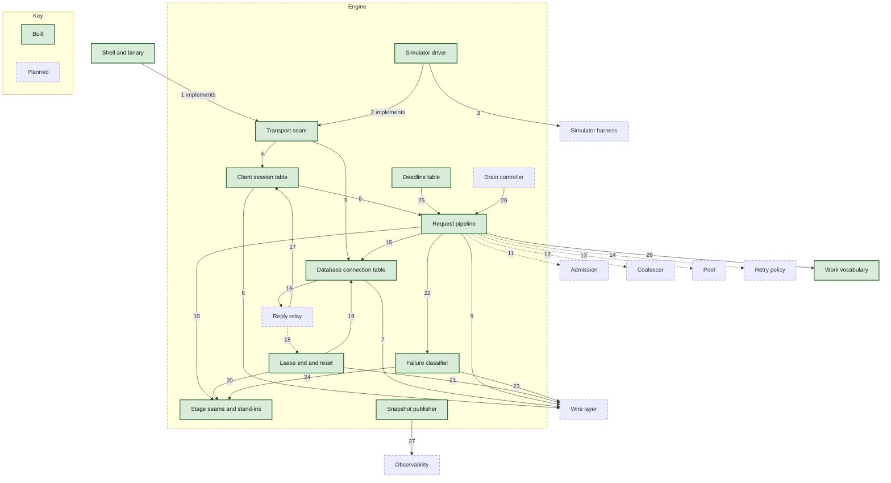

# C4 Level 3: Components: engine

**Built so far: chunks 0–6a. Dashed parts are planned.** In this diagram 12 of 21 elements and 23 of 28 relationships are built. Model: diagram `component-engine` in [model.json](model.json). Source of this page: [gen.py](gen.py).

The engine is where the seams meet. Below it, the transport seam has two implementations. Above it, the pipeline calls each core through a small stage interface, so a core can be replaced by a pass-through. That is how each scenario's ablation run is made. Chunk 6 built the walking skeleton: the whole path of a request, with a stand-in at every stage whose core is not built yet. As a result, the arrows to admission, the coalescer, the pool, and the retry policy are still dashed.

A solid box or arrow is built; a dashed one is planned. An arrow points to the supplier. An arrow marked "implements" means the source implements the target's interface; every other arrow means "uses".

## Elements

| Element | Kind | Status | What it is |
| --- | --- | --- | --- |
| Transport seam | component | built (chunk 6) | The engine's contract with its driver, as plain events and actions (no Go interface). Events in: accepted, bytes arrived, bytes written, write refused, closed, dial failed, TLS result, timer, publish. Actions out: write, close, start TLS, pause and resume reading, open a database connection, wake at a time, publish. Knows no protocol; its read rule (exactly 8 bytes of a new client, one unprocessed read per connection) keeps bytes from crossing a TLS upgrade. Two implementations: TCP in the shell, simulated streams in proxysim. |
| Client session table | component | built (chunk 6) | One entry per client connection: its wire state machines, tenant, phase (startup, idle, queued, active, holding a connection), transaction status, the single request it may have inside the proxy, a bounded input buffer and the count of reply bytes not yet written. Caps the clients connected and the clients in startup. |
| Database connection table | component | built (chunk 6) | One entry per database connection: its wire state machine, the query-cycle tracker, its phase (dialing, startup, idle, lent, resetting) and who holds it. So far it also keeps the fixed set full itself: opens the configured number at start, one dial at a time, and dials again after a loss, after a short delay when the connect failed (the pool decides this from chunk 7). |
| Request pipeline | component | built (chunk 6) | The fixed order every request takes: classify, reject list, draining, breaker, rate gate, coalesce, queue, lease, forward, release. Each stage is counted as passed or refused, and each refusal is answered with its error-contract row. A queued request has a wait deadline. Statements inside an open transaction skip from the reject list straight to forward on the connection the client already holds. |
| Stage seams and stand-ins | component | built (chunk 6) | The small interfaces the pipeline calls: classifier, breaker, rate gate, coalescer, queue, pool, release policy, retry policy. Also the implementations used until each core lands: a breaker that is always closed, a rate gate that always allows, no coalescing, one bounded first-come queue, a fixed set of connections, reset after every lease, retry off. The engine's config can replace any of them. |
| Lease end and reset | component | built (chunk 6) | A lease ends when a reply ends with status idle; while the status is in-transaction or failed the client keeps its connection. At release the policy answers reset, lend as is, or close (close when the status is not idle or bytes are left unread). The reset is DISCARD ALL sent as the proxy's own Query: the connection is lent again only after exactly that tag and status idle, with nothing after them, inside the reset deadline. Anything else closes it, counted by reason. Nothing of the reset's reply reaches a client. |
| Reply relay | component | planned | Streams database messages to the client (or to every waiter of a shared read) as they arrive, through a bounded buffer per client, with back pressure in both directions: reading the database connection is paused while the client is behind, reading the client while its request is in progress. ErrorResponse and ReadyForQuery are held whole, so a FATAL from the database becomes an error-contract reply. Never sends a short reply that looks complete. **So far:** Built in chunk 6 (internal/proxy: relay, relayEvents and relayed in lease.go; writeClient and the pauses in client.go): all of it for the one client of a reply. Not built: the fan-out to every waiter of a shared read (chunk 11). |
| Failure classifier | component | built (chunk 6) | For every failure records whether the request may have reached the database (no only when the driver reports that its first write was refused with zero bytes accepted) and picks the error-contract row: 08006 for a safe read or when nothing reached, 08007 otherwise, FATAL 08006 when a transaction lost its connection, and a close with no message once part of the reply was sent. Hands the fact to the retry seam. |
| Deadline table | component | built (chunk 6) | Every wait the engine has, as deadlines on the clock passed in with each event: one heap, and the next wake-up time returned as an action. Timers due at or before an event's time fire before the event is processed, so whatever arrives at the instant of its deadline is late. |
| Drain controller | component | planned | Sequences shutdown: stop admitting, finish transactions in progress within a bound, close idle connections, exit. **So far:** Built in chunk 6 (internal/proxy: the EvDraining input, gates in lease.go, Shutdown in engine.go): while the draining input is on, new work from a client outside a transaction is refused with 53M05 and that client is closed after the reply (unit-tested; nothing in the binary sets it yet); and a plain stop that closes every client and connection. Not built: the sequence — finish transactions in progress within a bound, close idle connections, exit (chunk 13). |
| Snapshot publisher | component | built (chunk 6) | Snapshot(): the engine's counters as one plain struct — clients, requests by stage and outcome, replies by row, leases, resets, relay, connections, three histograms — with its conservation check, beside the wire, classifier and reply snapshots the engine holds. On a publish event the engine returns a publish action; its driver then has the collector read the snapshots, between events. |
| Simulator driver | component, test code | built (chunk 6) | internal/proxy/proxysim. The engine on the simulator: accepts and dials on simulated streams, keeps the same read rule as the shell, plays the simulated TLS handshake on both legs, reports writes and refused writes, and registers the engine's invariants, quiesce check and state with the simulator. Its World builds the simulator, the network, the fake Postgres and the engine for a scenario. |
| Shell and binary | neighbouring container | built (chunk 6) | cmd/mini-gateway and internal/shell. The binary (-config, -check, -verifier) and the goroutine shell: the client listener, one reader and one writer goroutine per connection, one bounded mailbox into the engine's goroutine, a bounded write queue per connection, a deadline on every socket operation, TLS on both legs with crypto/tls (it reads exactly the 8 bytes of a client's first packet, upgrades the socket when the engine says so and buffers nothing across the upgrade), the admin listener on its own port, the collector with its JSON, Prometheus and CSV adapters, and signal handling: SIGTERM or SIGINT stops the process (a plain stop so far; the graceful drain is chunk 13). Makes no decisions: it posts events to the engine and performs the actions the engine returns. |
| Simulator harness | neighbouring container | planned | internal/sim and its sub-packages simnet, simtls, fakepg, workload, world, simtest and simtoy; internal/testclient; internal/randdist; cmd/mgsim; scripts/tier-r.sh. A deterministic single-threaded world: virtual clock, simulated byte streams, a simulated TLS handshake, a fake Postgres, simulated clients, scenarios with a driver interface, faults, replay. Its fake Postgres is checked against a real Postgres 17. Test code; built before any proxy code. **So far:** Built in chunks 1, 2 and 4: every component drawn here — the kernel (internal/sim), simnet, simtest, the toy protocol (simtoy), cmd/mgsim, the fake Postgres, the simulated clients, the test client, the simulated TLS handshake (simtls), the scenario world with its five direct baselines (clients straight at the fake, no proxy) and the fidelity runner, and scripts/tier-r.sh. Since chunk 6 the engine runs on it, through the engine's own test package internal/proxy/proxysim. Not built: no synthetic workload drives the cores (no core exists yet). |
| Wire layer | neighbouring container | planned | internal/pgwire. Everything that knows Postgres: framing, both session state machines, the query-cycle tracker, the SQL lexer, the statement classifier with its courtesy reject list, the safe-shape recogniser that decides sharing, the error contract, the wire snapshot. The only product package allowed to import pgproto3. Its test packages pgwiretest, wireworld and clsworld run this code in the simulator. **So far:** Built in chunks 4 and 5 (internal/pgwire): every component drawn here except the codec boundary. Chunk 4: the framer, the hand-written message coding, both session machines, the SCRAM-SHA-256 functions, the two trackers, the startup FATAL replies, the wire snapshot, and the test packages pgwiretest and wireworld. Chunk 5: the SQL lexer, the reject list, the statement classifier, the safe-shape recogniser, the error table with its reply builders, and the test package clsworld. Chunk 6: the engine drives this code, and the client session machine takes every FATAL from the error table (three startup rows added). Not built: the codec boundary (no file in the package imports pgproto3; the reply builders code their messages by hand). Nothing produces outcomes yet. |
| Admission | neighbouring container | planned | internal/admission. Rate gate, per-tenant queues with two selectable queue rules, adaptive LIFO, round-robin dispatcher with shares that bind under saturation, adaptive concurrency limit. |
| Coalescer | neighbouring container | planned | internal/coalesce. Identical statements share one database read: in auto mode those the wire layer marks as fitting the safe shape, in hinted mode those carrying the client's mark. Never writes. |
| Pool | neighbouring container | planned | internal/pool. Hard-capped database connections, creation limiter, leases per transaction, the one breaker, the dirty-connection table. |
| Retry policy | neighbouring container | planned | internal/retry. A policy interface. Off by default; the other policy retries once, only when nothing reached the database, within a 10% budget. |
| Observability | neighbouring container | planned | internal/obs and its sub-packages; test/analysis; scripts/csv-assert.sh; scripts/report.sh. Snapshot conventions (the one raw export), integer histogram, metric registry, collector, the adapter interface and its adapters (Prometheus text, JSON, CSV flush, log line, OTLP push), fleet merge, health, the SQL assertions over flushed files, and the story report over the same files. **So far:** Built in chunks 1, 3, 4, 5 and 6: everything except the OTLP push adapter (chunk 15) and the health rules for shedding, an open breaker, the limit's floor and draining (chunk 7 on). Since chunk 6 the shell creates a collector in the real process, with the engine, wire and classifier sources, and serves the outputs over HTTP. The binary attaches the JSON, Prometheus and CSV adapters; the log-line adapter is attached only by the scenario flush harness. Chunk 6a: the story report, and the load generator's metrics in the catalog. |
| Work vocabulary | neighbouring container | built (chunk 5) | internal/work. Small plain types the cores are written against: tenant, unit of work with its class, reject reason and sharing flags, share key and its scope, outcome, refusal. Carries no Postgres type and imports only the standard library. This is the extension seam for a second protocol. |

## Relationships

| # | From | To | Status | What | How |
| --- | --- | --- | --- | --- | --- |
| 1 | Shell and binary | Transport seam | built | Implements it with TCP sockets; posts events through one bounded mailbox | Go, interface implementation |
| 2 | Simulator driver | Transport seam | built | Implements it with simulated byte streams on the simulator's event loop | Go, interface implementation |
| 3 | Simulator driver | Simulator harness | built | Runs on the simulator's loop, byte streams and simulated TLS handshake; starts the fake Postgres | Go, test code |
| 4 | Transport seam | Client session table | built | Client bytes and connection events | Go |
| 5 | Transport seam | Database connection table | built | Database bytes and connection events | Go |
| 6 | Client session table | Wire layer | built | Client session machine; client query-phase tracker; the discard-until-Sync rule | Go |
| 7 | Database connection table | Wire layer | built | Database session machine; query-cycle tracker | Go |
| 8 | Client session table | Request pipeline | built | One work unit at a time per client | Go |
| 9 | Request pipeline | Wire layer | built | Statement classifier: Query text in, work unit out | Go |
| 10 | Request pipeline | Stage seams and stand-ins | built | Calls each stage through its interface | Go |
| 11 | Request pipeline | Admission | planned | Gate, queue, dispatch, limit | Go |
| 12 | Request pipeline | Coalescer | planned | Join or lead a shared read | Go |
| 13 | Request pipeline | Pool | planned | Lend, release, breaker state, dirty connections | Go |
| 14 | Request pipeline | Retry policy | planned | May this failure be retried | Go |
| 15 | Request pipeline | Database connection table | built | Forwards the statement on the lent connection | Go |
| 16 | Database connection table | Reply relay | built | Reply messages and the end-of-reply status byte | Go |
| 17 | Reply relay | Client session table | built | Reply bytes for each recipient | Go |
| 18 | Reply relay | Lease end and reset | planned | The reply ended, with its status byte | Go |
| 19 | Lease end and reset | Database connection table | built | Writes the reset on the connection; makes it idle or closes it | Go |
| 20 | Lease end and reset | Stage seams and stand-ins | built | Asks the release policy; returns the connection to the pool seam | Go |
| 21 | Lease end and reset | Wire layer | built | Encodes the reset's Query; frames its reply | Go |
| 22 | Request pipeline | Failure classifier | built | Every refusal and failure | Go |
| 23 | Failure classifier | Wire layer | built | Builds the error reply for its contract row | Go |
| 24 | Failure classifier | Stage seams and stand-ins | built | Hands each failure, with its reached fact, to the retry policy | Go |
| 25 | Deadline table | Request pipeline | built | A deadline was reached | Go |
| 26 | Drain controller | Request pipeline | built | Sets the draining input | Go |
| 27 | Snapshot publisher | Observability | built | Uses the histogram, the gauge and the conservation check; the engine source mapping reads its snapshot | Go, plain structs |
| 28 | Request pipeline | Work vocabulary | built | Passes work units and outcomes between stages | Go types |
