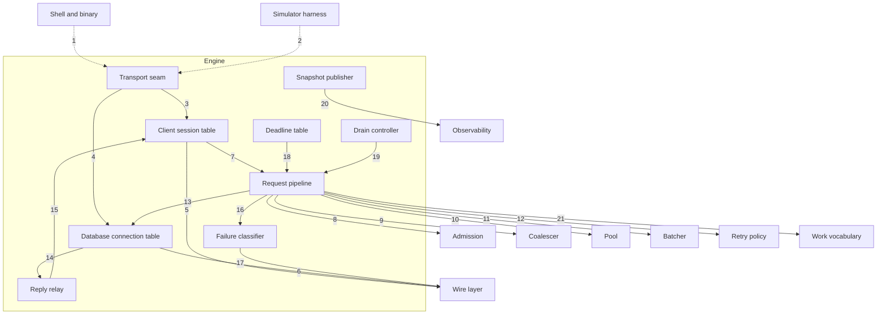

# C4 Level 3: Components: engine

**Target architecture (planned). Nothing in this diagram is built yet.** Model: diagram `component-engine` in [model.json](model.json). Source of this page: [gen.py](gen.py).

The engine is where the seams meet. The transport seam below it has two implementations. The pipeline above calls each core through a small stage interface, so a core can be replaced by a pass-through (which is how each scenario's ablation run is made).

A dashed arrow means "implements"; a solid arrow means "uses" and points to the supplier.

## Elements

| Element | Kind | What it is |
| --- | --- | --- |
| Transport seam | component | Dialer and byte-stream connection events and actions: open, bytes in, bytes out, closed. Knows no protocol. Two implementations: TCP in the shell, simulated streams in the harness. |
| Client session table | component | One entry per client connection: its wire state machine, tenant, transaction state, the single request it may have inside the proxy, and its bounded reply buffer. |
| Database connection table | component | One entry per database connection: its wire state machine, the query-cycle tracker, and who holds it. |
| Request pipeline | component | The fixed order every request takes, each stage a small interface: classify, reject list, draining, breaker, rate gate, coalesce, queue, lease, forward, release. Statements inside an open transaction skip from classify straight to forward on the connection the client already holds. |
| Reply relay | component | Streams database messages to the client (or to every waiter of a shared read) through bounded buffers, with back pressure in both directions. Never sends a short reply that looks complete. |
| Failure classifier | component | For every failure records whether any byte reached the database, and picks the error-contract row. |
| Deadline table | component | Every wait in the timeout budget, as deadlines on the injected clock; returns the next wake-up time as an action. |
| Drain controller | component | Sequences shutdown: stop admitting, finish transactions in progress within a bound, close idle connections, exit. |
| Snapshot publisher | component | Collects every component's Snapshot() between events and hands the copy to the collector. |
| Shell and binary | neighbouring container | cmd/mini-gateway and internal/shell. Listeners, one reader and one writer goroutine per connection, bounded mailboxes, a deadline on every socket operation, the admin listener on its own port, signal handling. Makes no decisions: it posts events to the engine and performs the actions the engine returns. |
| Simulator harness | neighbouring container | internal/sim, internal/sim/simnet, fakepg, workload, simtest, cmd/mgsim. A deterministic single-threaded world: virtual clock, simulated byte streams, a fake Postgres, simulated clients, faults, replay. Test code; built before any proxy code. |
| Wire layer | neighbouring container | internal/pgwire. Everything that knows Postgres: framing, both session state machines, the query-cycle tracker, the statement classifier, the error contract. The only product package that imports pgproto3. |
| Admission | neighbouring container | internal/admission. Rate gate, per-tenant queues with two selectable queue rules, adaptive LIFO, round-robin dispatcher with shares that bind under saturation, adaptive concurrency limit. |
| Coalescer | neighbouring container | internal/coalesce. Identical provably-read-only statements share one database read. Never writes. |
| Pool | neighbouring container | internal/pool. Hard-capped database connections, creation limiter, leases per transaction, the one breaker, the dirty-connection table. |
| Batcher | neighbouring container | internal/batch. Timer-free: when a connection frees up, eligible queued single statements go out in one write. Off by default. |
| Retry policy | neighbouring container | internal/retry. A policy interface. Off by default; the other policy retries once, only when nothing reached the database, within a 10% budget. |
| Observability | neighbouring container | internal/obs. Snapshot conventions (the one raw export), integer histogram, collector, the adapter interface and its adapters (Prometheus text, JSON, CSV flush, log line, OTLP push), fleet merge, health. |
| Work vocabulary | neighbouring container | internal/work. Small plain types the cores are written against: tenant, unit of work and its class, share key, batchable flag, outcome. Carries no Postgres type. This is the extension seam for a second protocol. |

## Relationships

| # | From | To | What | How |
| --- | --- | --- | --- | --- |
| 1 | Shell and binary | Transport seam | Implements it with TCP sockets; posts events through bounded mailboxes | Go, interface implementation |
| 2 | Simulator harness | Transport seam | Implements it with simulated byte streams on the event loop | Go, interface implementation |
| 3 | Transport seam | Client session table | Client bytes and connection events | Go |
| 4 | Transport seam | Database connection table | Database bytes and connection events | Go |
| 5 | Client session table | Wire layer | Client session machine; statement classifier | Go |
| 6 | Database connection table | Wire layer | Database session machine; query-cycle tracker | Go |
| 7 | Client session table | Request pipeline | One work unit at a time per client | Go |
| 8 | Request pipeline | Admission | Gate, queue, dispatch, limit | Go |
| 9 | Request pipeline | Coalescer | Join or lead a shared read | Go |
| 10 | Request pipeline | Pool | Lend, release, breaker state, dirty connections | Go |
| 11 | Request pipeline | Batcher | Batch for a free connection | Go |
| 12 | Request pipeline | Retry policy | May this failure be retried | Go |
| 13 | Request pipeline | Database connection table | Forwards the statement on the lent connection | Go |
| 14 | Database connection table | Reply relay | Reply messages and the end-of-reply status byte | Go |
| 15 | Reply relay | Client session table | Reply bytes for each recipient | Go |
| 16 | Request pipeline | Failure classifier | Every refusal and failure | Go |
| 17 | Failure classifier | Wire layer | Builds the error reply for its contract row | Go |
| 18 | Deadline table | Request pipeline | A deadline was reached | Go |
| 19 | Drain controller | Request pipeline | Sets the draining input | Go |
| 20 | Snapshot publisher | Observability | Hands over the instance snapshot | Go, plain structs |
| 21 | Request pipeline | Work vocabulary | Passes work units and outcomes between stages | Go types |
