# C4 Level 3: Components: wire layer

**Built so far: chunks 0–4. Dashed parts are planned.** In this diagram 12 of 20 elements and 24 of 36 relationships are built. Model: diagram `component-wire` in [model.json](model.json). Source of this page: [gen.py](gen.py).

pgproto3 gives message structs and nothing else. The framer, the session machines, SCRAM, transaction tracking, classification and error mapping are ours. Everything here is a pure state machine that accepts bytes in any fragments. Chunk 4 built the sessions: the machines and trackers code their few messages by hand, so no file in the package imports pgproto3 yet; the codec boundary comes with the reply builders. No engine exists yet, so a startup-only test proxy drives the machines in the simulator, between simulated clients and the fake Postgres.

A solid box or arrow is built; a dashed one is planned. An arrow points to the supplier.

```mermaid
flowchart TB
  N_ENGINE["Engine"]:::planned
  N_WORK["Work vocabulary"]:::planned
  N_SIM["Simulator harness"]:::planned
  PGPROTO3[["pgproto3 (from pgx/v5)"]]:::built
  PG[("Postgres")]:::planned
  subgraph SCOPE["Wire layer"]
    W_FRAMER["Framer"]:::built
    W_MSGS["Message coding"]:::built
    W_CODEC["Codec boundary"]:::planned
    W_CLIENT["Client session machine"]:::built
    W_BACKEND["Database session machine"]:::built
    W_CYCLE["Query-cycle tracker"]:::built
    W_FRONT["Client query-phase tracker"]:::built
    W_SCRAM["SCRAM-SHA-256 functions"]:::built
    W_FATAL["Startup FATAL replies"]:::built
    W_SNAPSHOT["Wire snapshot"]:::built
    W_LEXER["SQL lexer"]:::planned
    W_CLASSIFIER["Statement classifier"]:::planned
    W_ERRORS["Error contract and reply builders"]:::planned
    W_HARNESS["Startup-only test proxy and startup fidelity runner"]:::built
    W_WORLD["Wire scenarios"]:::built
  end
  N_ENGINE -.->|1| W_CLIENT
  N_ENGINE -.->|2| W_BACKEND
  N_ENGINE -.->|3| W_CYCLE
  N_ENGINE -.->|4| W_FRONT
  N_ENGINE -.->|5| W_CLASSIFIER
  N_ENGINE -.->|6| W_ERRORS
  W_CLIENT -->|7| W_FRAMER
  W_BACKEND -->|8| W_FRAMER
  W_CYCLE -->|9| W_FRAMER
  W_FRONT -->|10| W_FRAMER
  W_CLIENT -->|11| W_MSGS
  W_BACKEND -->|12| W_MSGS
  W_CLIENT -->|13| W_FATAL
  W_BACKEND -->|14| W_FATAL
  W_CYCLE -->|15| W_FATAL
  W_CLIENT -->|16| W_SCRAM
  W_BACKEND -->|17| W_SCRAM
  W_CLIENT -->|18| W_SNAPSHOT
  W_BACKEND -->|19| W_SNAPSHOT
  W_CYCLE -->|20| W_SNAPSHOT
  W_FRONT -->|21| W_SNAPSHOT
  W_ERRORS -.->|22| W_CODEC
  W_CODEC -.->|23| W_FRAMER
  W_CODEC -.->|24| PGPROTO3
  W_CLASSIFIER -.->|25| W_LEXER
  W_CLASSIFIER -.->|26| N_WORK
  W_CYCLE -.->|27| N_WORK
  W_HARNESS -->|28| W_CLIENT
  W_HARNESS -->|29| W_BACKEND
  W_HARNESS -->|30| W_CYCLE
  W_HARNESS -->|31| W_FRONT
  W_HARNESS -->|32| W_SNAPSHOT
  W_HARNESS -->|33| N_SIM
  W_WORLD -->|34| W_HARNESS
  W_WORLD -->|35| N_SIM
  W_HARNESS -->|36| PG
  subgraph KEY["Key"]
    KEY_BUILT["Built"]:::built
    KEY_PLANNED["Planned"]:::planned
  end
  classDef built fill:#d9ecd9,stroke:#2e6b34,stroke-width:2px,color:#1c1e21
  classDef planned stroke-width:1px,stroke-dasharray:6 4
  style SCOPE stroke-dasharray:6 4
```

## Elements

| Element | Kind | Status | What it is |
| --- | --- | --- | --- |
| Framer | component | built (chunk 4) | Ours. Cuts a byte stream into messages (type byte, 4-byte length, body) whatever the fragmentation, down to one byte at a time; also the untyped packets before startup. Enforces a maximum message size and refuses an oversized message from its header alone. Can skip the bodies of chosen message types instead of buffering them. |
| Message coding | component | built (chunk 4) | Ours, written by hand, no pgproto3. Appends each message the session machines write (TLS and startup packets, authentication, parameter status, key data, ready, query, terminate, cancel) and parses the startup packet and its parameters. |
| Codec boundary | component | planned | The only product code that touches pgproto3: encodes message structs to bytes for the reply builders. pgproto3's own blocking reader is not used. The session machines and the trackers do not pass through it; they use the hand-written message coding. |
| Client session machine | component | built (chunk 4) | Client-facing, startup only: events in, actions out. Runs the exchange before startup: answers a TLS request S or N by client_tls.mode and asks its driver to start TLS (at most one upgrade; a byte before the handshake result is a violation), answers a GSS encryption request N. Reads the startup message, refuses plaintext when TLS is required, negotiates protocol 3.x down to 3.0, finds the tenant by user, runs SCRAM-SHA-256 (server side; trust only as a named test setting; an unknown user gets the wrong-password reply), sends the parameter set and proxy-issued key data, recognises cancel requests. Every failed startup ends under one reason. Consumes no byte after ready. |
| Database session machine | component | built (chunk 4) | Database-facing, startup only: events in, actions out. Sends a TLS request first when backend_tls.mode asks for one (an N answer is a connect failure; a byte after S before the handshake result is a violation), then startup, SCRAM-SHA-256 (client side, never -PLUS), collects server parameters and key data, reaches ready. Every failed startup ends in one class (TLS refused or failed, authentication, too many connections, server FATAL, violation, deadline, connection lost). |
| Query-cycle tracker | component | built (chunk 4) | Follows a reply to its ReadyForQuery, reports the transaction status byte (idle, in transaction, failed), flags an unsolicited ParameterStatus (the connection is now dirty) and any protocol surprise, including a stream that ends without its marker. Never buffers row data. Unknown but well-framed message types are reported and passed through. |
| Client query-phase tracker | component | built (chunk 4) | Reads the client's bytes after login. Reports each Query (body copied, bounded), Terminate, and every extended-protocol message as one to refuse; any other message type is a violation. |
| SCRAM-SHA-256 functions | component | built (chunk 4) | Pure functions on the standard library: verifier, key derivation, nonce, the GS2 header rule, and the server and client sides of the exchange with bounded messages. Shared with the simulator's fake Postgres and simulated clients. |
| Startup FATAL replies | component | built (chunk 4) | The replies the session machines make themselves during startup: an ErrorResponse with severity, SQLSTATE and message, the old-format error for a protocol 2 client, and NegotiateProtocolVersion. Also parses the severity and SQLSTATE of an ErrorResponse from the database. The error contract takes the replies over when it lands. |
| Wire snapshot | component | built (chunk 4) | The wire layer's counters as one plain struct, per side: startups begun, completed, in progress and failed by reason; pre-startup requests by kind and answer; TLS handshakes by version and failure; plaintext refused; authentication failures by cause; messages and bytes each way; violations; oversized messages; what the trackers saw. Its check: begun = completed + failed + in startup, on each side. |
| SQL lexer | component | planned | Tokens only: strings, escape strings, dollar quotes, comments, identifiers; splits a message into statements. Not a parser. |
| Statement classifier | component | planned | Turns a statement into a work unit: rejected (session-level feature), transaction control, provably read-only, shareable with its key. Conservative: what it cannot tokenise is never shared. |
| Error contract and reply builders | component | planned | One table: each refusal and failure, its SQLSTATE, whether anything reached the database, whether a write may have applied. Builds the ErrorResponse and the correct end marker. docs/error-contract.md is generated from it. |
| Startup-only test proxy and startup fidelity runner | component, test code | built (chunk 4) | internal/pgwire/pgwiretest. A proxy for tests on simulated streams: the two session machines back to back, one database connection per client, no pool; after login it relays queries and replies through both trackers. A database startup failure reaches the client as FATAL 08006. Also the startup fidelity runner: one script (TLS answers, SCRAM, protocol versions) played against the fake Postgres and compared with Postgres 17's transcript, recorded for CI or live in tier R. |
| Wire scenarios | component, test code | built (chunk 4) | internal/pgwire/pgwiretest/wireworld. 19 named scenarios with their exact checks: the test proxy between simulated clients and the fake Postgres, plaintext and TLS, one-byte delivery, and one startup fault each on the client side (TLS stall, bad hello, smuggled bytes, second TLS request, plaintext refused, wrong password, unknown user) or the database side (silence, connect stall, garbage, reset, connection limit, TLS refused, bad certificate, handshake stall). Each failure must be counted under its one reason within its deadline. |
| Engine | neighbouring container | planned | internal/proxy. One single-threaded, sans-I/O state machine per instance: events in, actions out. Holds the client and database connection tables and the request pipeline with its stage seams. The simulator and the shell drive this same code. |
| Work vocabulary | neighbouring container | planned | internal/work. Small plain types the cores are written against: tenant, unit of work and its class, share key, outcome. Carries no Postgres type. This is the extension seam for a second protocol. |
| Simulator harness | neighbouring container | planned | internal/sim and its sub-packages simnet, simtls, fakepg, workload, world, simtest and simtoy; internal/testclient; internal/randdist; cmd/mgsim; scripts/tier-r.sh. A deterministic single-threaded world: virtual clock, simulated byte streams, a simulated TLS handshake, a fake Postgres, simulated clients, scenarios with a driver interface, faults, replay. Its fake Postgres is checked against a real Postgres 17. Test code; built before any proxy code. **So far:** Built in chunks 1, 2 and 4: every component drawn here — the kernel (internal/sim), simnet, simtest, the toy protocol (simtoy), cmd/mgsim, the fake Postgres, the simulated clients, the test client, the simulated TLS handshake (simtls), the scenario world with its five direct baselines (clients straight at the fake, no proxy) and the fidelity runner, and scripts/tier-r.sh. Not built: no engine exists yet, so the harness drives the fake Postgres, the toy protocol and the wire layer's startup-only test proxy; nothing implements the engine's transport seam, and no synthetic workload drives the cores. |
| pgproto3 (from pgx/v5) | softwareSystem, external | built (chunk 2) | Go package github.com/jackc/pgx/v5/pgproto3: Postgres wire message structs with Encode and Decode. The one external dependency, used for message encoding only. |
| Postgres | softwareSystem, external | planned | One ordinary Postgres server. Sees at most the fleet's connection budget, all logged in as one role. |

## Relationships

| # | From | To | Status | What | How |
| --- | --- | --- | --- | --- | --- |
| 1 | Engine | Client session machine | planned | Client bytes and events in; actions out, until the client is ready | Go |
| 2 | Engine | Database session machine | planned | Database bytes and events in; actions out, until the connection is ready | Go |
| 3 | Engine | Query-cycle tracker | planned | Reply bytes in; status and message boundaries out | Go |
| 4 | Engine | Client query-phase tracker | planned | Client bytes after login in; queries and terminate out | Go |
| 5 | Engine | Statement classifier | planned | Statement text in; work unit out | Go |
| 6 | Engine | Error contract and reply builders | planned | Contract row in; reply bytes out | Go |
| 7 | Client session machine | Framer | built | Cuts the client's startup packets and messages | Go |
| 8 | Database session machine | Framer | built | Cuts the server's startup messages | Go |
| 9 | Query-cycle tracker | Framer | built | Message boundaries; row bodies skipped, not buffered | Go |
| 10 | Client query-phase tracker | Framer | built | Message boundaries; extended-protocol bodies skipped | Go |
| 11 | Client session machine | Message coding | built | Parses the startup packet; encodes its replies | Go |
| 12 | Database session machine | Message coding | built | Encodes the TLS request, the startup message and the SASL responses | Go |
| 13 | Client session machine | Startup FATAL replies | built | Builds each refusal it sends | Go |
| 14 | Database session machine | Startup FATAL replies | built | Reads the SQLSTATE of a server error during startup | Go |
| 15 | Query-cycle tracker | Startup FATAL replies | built | Reads the severity and SQLSTATE of an ErrorResponse | Go |
| 16 | Client session machine | SCRAM-SHA-256 functions | built | Server side of the exchange | Go |
| 17 | Database session machine | SCRAM-SHA-256 functions | built | Client side of the exchange | Go |
| 18 | Client session machine | Wire snapshot | built | Counts client startups, requests, handshakes and failures | Go |
| 19 | Database session machine | Wire snapshot | built | Counts database startups, TLS answers and failures by class | Go |
| 20 | Query-cycle tracker | Wire snapshot | built | Counts replies, ready by status, errors and unsolicited messages | Go |
| 21 | Client query-phase tracker | Wire snapshot | built | Counts queries seen, terminates and extended messages refused | Go |
| 22 | Error contract and reply builders | Codec boundary | planned | Encode ErrorResponse and ReadyForQuery | Go |
| 23 | Codec boundary | Framer | planned | Framed message bodies | Go |
| 24 | Codec boundary | pgproto3 (from pgx/v5) | planned | Message structs: Encode, Decode | Go import |
| 25 | Statement classifier | SQL lexer | planned | Tokens and statement boundaries | Go |
| 26 | Statement classifier | Work vocabulary | planned | Produces work units | Go types |
| 27 | Query-cycle tracker | Work vocabulary | planned | Produces outcomes | Go types |
| 28 | Startup-only test proxy and startup fidelity runner | Client session machine | built | Drives one per client connection, with the simulated handshake and a startup deadline | Go, test code |
| 29 | Startup-only test proxy and startup fidelity runner | Database session machine | built | Drives one per database connection, opened after the client is authenticated | Go, test code |
| 30 | Startup-only test proxy and startup fidelity runner | Query-cycle tracker | built | Relays each reply through it | Go, test code |
| 31 | Startup-only test proxy and startup fidelity runner | Client query-phase tracker | built | Relays each client message through it | Go, test code |
| 32 | Startup-only test proxy and startup fidelity runner | Wire snapshot | built | Registers its conservation check as a simulator invariant | Go, test code |
| 33 | Startup-only test proxy and startup fidelity runner | Simulator harness | built | Listens and dials on simulated streams; plays the simulated TLS handshake; the fidelity runner dials the fake Postgres | Go, test code |
| 34 | Wire scenarios | Startup-only test proxy and startup fidelity runner | built | Builds one test proxy per scenario and reads its wire snapshot | Go, test code |
| 35 | Wire scenarios | Simulator harness | built | Starts the fake Postgres and the simulated clients; injects the scenario's fault | Go, test code |
| 36 | Startup-only test proxy and startup fidelity runner | Postgres | built | Tier R: plays the startup fidelity script against two Postgres 17 servers, ssl off and ssl on with SCRAM; on request rewrites the recording CI replays | scripts/tier-r.sh, Docker, go test |
