# C4 Level 3: Components: wire layer

**Built so far: chunks 0–6. Dashed parts are planned.** In this diagram 20 of 23 elements and 49 of 52 relationships are built. Model: diagram `component-wire` in [model.json](model.json). Source of this page: [gen.py](gen.py).

pgproto3 gives message structs and nothing else. The framer, the session machines, SCRAM, transaction tracking, classification and error mapping are ours. Everything here is a pure state machine or a pure function. Chunk 4 built the sessions. Chunk 5 built the classifier and the contracts: session safety does not depend on reading SQL (the pool will reset every connection after every lease), so the reject list is a courtesy, and what may be shared is decided by a recogniser that does not use the lexer. The machines, the trackers and the reply builders code their messages by hand, so no file in the package imports pgproto3 and the codec boundary has no caller yet. Since chunk 6 the engine drives this code. The two test proxies remain as the wire layer's own scenarios in the simulator, between simulated clients and the fake Postgres.

A solid box or arrow is built; a dashed one is planned. An arrow points to the supplier.

```mermaid
flowchart TB
  N_ENGINE["Engine"]:::planned
  N_WORK["Work vocabulary"]:::built
  N_SIM["Simulator harness"]:::planned
  PGPROTO3[["pgproto3 (from pgx/v5)"]]:::built
  PG[("Postgres")]:::built
  subgraph SCOPE["Wire layer"]
    W_FRAMER["Framer"]:::built
    W_MSGS["Message coding"]:::built
    W_CODEC["Codec boundary"]:::planned
    W_CLIENT["Client session machine"]:::built
    W_BACKEND["Database session machine"]:::built
    W_CYCLE["Query-cycle tracker"]:::built
    W_FRONT["Client query-phase tracker"]:::built
    W_SCRAM["SCRAM-SHA-256 functions"]:::built
    W_FATAL["Startup FATAL replies"]:::built
    W_SNAPSHOT["Wire snapshot"]:::built
    W_LEXER["SQL lexer"]:::built
    W_REJECTS["Reject list"]:::built
    W_CLASSIFIER["Statement classifier"]:::built
    W_SHARE["Safe-shape recogniser"]:::built
    W_ERRORS["Error contract and reply builders"]:::built
    W_HARNESS["Startup-only test proxy and startup fidelity runner"]:::built
    W_WORLD["Wire scenarios"]:::built
    W_CLSWORLD["Classifier scenarios"]:::built
  end
  N_ENGINE -->|1| W_CLIENT
  N_ENGINE -->|2| W_BACKEND
  N_ENGINE -->|3| W_CYCLE
  N_ENGINE -->|4| W_FRONT
  N_ENGINE -->|5| W_CLASSIFIER
  N_ENGINE -->|6| W_ERRORS
  N_ENGINE -->|7| W_FRAMER
  N_ENGINE -->|8| W_SNAPSHOT
  N_ENGINE -->|9| W_MSGS
  W_CLIENT -->|10| W_FRAMER
  W_BACKEND -->|11| W_FRAMER
  W_CYCLE -->|12| W_FRAMER
  W_FRONT -->|13| W_FRAMER
  W_CLIENT -->|14| W_MSGS
  W_BACKEND -->|15| W_MSGS
  W_CLIENT -->|16| W_FATAL
  W_BACKEND -->|17| W_FATAL
  W_CYCLE -->|18| W_FATAL
  W_CLIENT -->|19| W_SCRAM
  W_BACKEND -->|20| W_SCRAM
  W_CLIENT -->|21| W_SNAPSHOT
  W_BACKEND -->|22| W_SNAPSHOT
  W_CYCLE -->|23| W_SNAPSHOT
  W_FRONT -->|24| W_SNAPSHOT
  W_ERRORS -->|25| W_MSGS
  W_CODEC -.->|26| W_FRAMER
  W_CODEC -.->|27| PGPROTO3
  W_CLASSIFIER -->|28| W_LEXER
  W_CLASSIFIER -->|29| W_REJECTS
  W_CLASSIFIER -->|30| W_SHARE
  W_CLASSIFIER -->|31| N_WORK
  W_REJECTS -->|32| N_WORK
  W_ERRORS -->|33| N_WORK
  W_CYCLE -.->|34| N_WORK
  W_HARNESS -->|35| W_CLIENT
  W_HARNESS -->|36| W_BACKEND
  W_HARNESS -->|37| W_CYCLE
  W_HARNESS -->|38| W_FRONT
  W_HARNESS -->|39| W_SNAPSHOT
  W_HARNESS -->|40| N_SIM
  W_WORLD -->|41| W_HARNESS
  W_WORLD -->|42| N_SIM
  W_HARNESS -->|43| PG
  W_CLSWORLD -->|44| W_CLASSIFIER
  W_CLSWORLD -->|45| W_ERRORS
  W_CLSWORLD -->|46| W_REJECTS
  W_CLSWORLD -->|47| W_FRONT
  W_CLSWORLD -->|48| W_FRAMER
  W_CLSWORLD -->|49| W_MSGS
  W_CLSWORLD -->|50| W_SNAPSHOT
  W_CLSWORLD -->|51| N_SIM
  W_SHARE -->|52| PG
  subgraph KEY["Key"]
    KEY_BUILT["Built"]:::built
    KEY_PLANNED["Planned"]:::planned
  end
  classDef built fill:#d9ecd9,stroke:#2e6b34,stroke-width:2px,color:#1c1e21
  classDef planned stroke-width:1px,stroke-dasharray:6 4
  style SCOPE stroke-dasharray:6 4
```

## Elements

| Element | Kind | Status | What it is |
| --- | --- | --- | --- |
| Framer | component | built (chunk 4) | Ours. Cuts a byte stream into messages (type byte, 4-byte length, body) whatever the fragmentation, down to one byte at a time; also the untyped packets before startup. Enforces a maximum message size and refuses an oversized message from its header alone. Can skip the bodies of chosen message types instead of buffering them. |
| Message coding | component | built (chunk 4) | Ours, written by hand, no pgproto3. Appends each message the session machines write (TLS and startup packets, authentication, parameter status, key data, ready, query, terminate, cancel) and parses the startup packet and its parameters. |
| Codec boundary | component | planned | The only product code that may touch pgproto3: message structs encoded and decoded in one place. pgproto3's own blocking reader is not used. Nothing passes through it so far: the session machines, the trackers and the reply builders all use the hand-written message coding. |
| Client session machine | component | built (chunk 4) | Client-facing, startup only: events in, actions out. Runs the exchange before startup: answers a TLS request S or N by client_tls.mode and asks its driver to start TLS (at most one upgrade; a byte before the handshake result is a violation), answers a GSS encryption request N. Reads the startup message, refuses plaintext when TLS is required, negotiates protocol 3.x down to 3.0, finds the tenant by user, runs SCRAM-SHA-256 (server side; trust only as a named test setting; an unknown user gets the wrong-password reply), sends the parameter set and proxy-issued key data, recognises cancel requests. Every failed startup ends under one reason. Consumes no byte after ready. |
| Database session machine | component | built (chunk 4) | Database-facing, startup only: events in, actions out. Sends a TLS request first when backend_tls.mode asks for one (an N answer is a connect failure; a byte after S before the handshake result is a violation), then startup, SCRAM-SHA-256 (client side, never -PLUS), collects server parameters and key data, reaches ready. Every failed startup ends in one class (TLS refused or failed, authentication, too many connections, server FATAL, violation, deadline, connection lost). |
| Query-cycle tracker | component | built (chunk 4) | Follows a reply to its ReadyForQuery, reports the transaction status byte (idle, in transaction, failed), flags an unsolicited ParameterStatus (the connection is now dirty) and any protocol surprise, including a stream that ends without its marker. Never buffers row data. Unknown but well-framed message types are reported and passed through. |
| Client query-phase tracker | component | built (chunk 4) | Reads the client's bytes after login. Reports each Query (body copied, bounded), Terminate, and every extended-protocol message as one to refuse; any other message type is a violation. |
| SCRAM-SHA-256 functions | component | built (chunk 4) | Pure functions on the standard library: verifier, key derivation, nonce, the GS2 header rule, and the server and client sides of the exchange with bounded messages. Shared with the simulator's fake Postgres and simulated clients. |
| Startup FATAL replies | component | built (chunk 4) | The replies the session machines make themselves during startup: an ErrorResponse with severity, SQLSTATE and message, the old-format error for a protocol 2 client, and NegotiateProtocolVersion. Also parses the severity and SQLSTATE of an ErrorResponse from the database. The client session machine names a row of the error table for every FATAL it writes and takes the code from that row; the encoders stay here. |
| Wire snapshot | component | built (chunk 4) | The wire layer's counters as one plain struct, per side: startups begun, completed, in progress and failed by reason; pre-startup requests by kind and answer; TLS handshakes by version and failure; plaintext refused; authentication failures by cause; messages and bytes each way; violations; oversized messages; what the trackers saw. Its check: begun = completed + failed + in startup, on each side. |
| SQL lexer | component | built (chunk 5) | Tokens only: words, quoted and Unicode identifiers, strings (escape, Unicode and bit strings, and a string continued across a newline, joined as Postgres does), dollar quotes, numbers, parameters, operators, punctuation, comments; anything else is a bad token. Not a parser. Linear time. |
| Reject list | component | built (chunk 5) | The courtesy list as one table: 16 reasons, each with the feature, why it cannot work under transaction pooling and an example, plus the transaction-scoped forms that are allowed. docs/reject-list.md is generated from it. Not a safety mechanism: no guarantee rests on it. |
| Statement classifier | component | built (chunk 5) | Turns one Query message into a work unit. Lexes it, splits it on semicolons and rejects the whole message when any statement uses a reject-list feature (first reason wins); otherwise the unit starts a lease, or continues one inside a transaction. Never refuses a message for being untokenisable: it is marked opaque and forwarded. Sets safe-read from the safe-shape recogniser, shareable (safe-read, outside a transaction, not rejected), hinted (the text begins with /* mg:share */) and the share key (exact text, tenant by config). Counts by class and reason in its own snapshot, with a conservation check. |
| Safe-shape recogniser | component | built (chunk 5) | Decides what may be shared, from the raw bytes alone: it uses neither the lexer nor the classifier and imports nothing. A text fits when it is at most 4,096 bytes of a small alphabet, starts with SELECT, has no word on the stop list, no time word in a string, and calls only functions on the allow-list. Allocates nothing. docs/safe-shape.md is generated from its tables. Stated limit: it cannot see a view, operator or row-level security policy that hides a side effect. |
| Error contract and reply builders | component | built (chunk 5) | One table of 23 rows: each refusal and failure, its reply form, its SQLSTATE, whether anything reached the database, whether a write may have applied, and what happens to the client connection. The reply builder appends the ErrorResponse and the correct end marker for a row and counts replies by row. The discard-until-Sync rule refuses extended-protocol messages. docs/error-contract.md is generated from the table. The engine sends the rows of the walking skeleton and the client session machine the startup rows; the rows of cores not built yet (breaker, rate gate and others) are not sent so far. |
| Startup-only test proxy and startup fidelity runner | component, test code | built (chunk 4) | internal/pgwire/pgwiretest. A proxy for tests on simulated streams: the two session machines back to back, one database connection per client, no pool; after login it relays queries and replies through both trackers. A database startup failure reaches the client as FATAL 08006. Also the startup fidelity runner: one script (TLS answers, SCRAM, protocol versions) played against the fake Postgres and compared with Postgres 17's transcript, recorded for CI or live in tier R. |
| Wire scenarios | component, test code | built (chunk 4) | internal/pgwire/pgwiretest/wireworld. 19 named scenarios with their exact checks: the test proxy between simulated clients and the fake Postgres, plaintext and TLS, one-byte delivery, and one startup fault each on the client side (TLS stall, bad hello, smuggled bytes, second TLS request, plaintext refused, wrong password, unknown user) or the database side (silence, connect stall, garbage, reset, connection limit, TLS refused, bad certificate, handshake stall). Each failure must be counted under its one reason within its deadline. |
| Classifier scenarios | component, test code | built (chunk 5) | internal/pgwire/pgwiretest/clsworld. Two named scenarios and a small test gateway on simulated streams: it relays startup to the fake Postgres (trust login, no session machines), classifies each Query, answers a rejected one and every extended-protocol message itself, and forwards the rest. Simulated clients send every reject-list feature, plain and in padded spellings. Checks: each gets 0A000, no rejected statement reaches the fake, and the session's search_path is unchanged. |
| Engine | neighbouring container | planned | internal/proxy. One single-threaded, sans-I/O state machine per instance: events in, actions out. Holds the client and database connection tables and the request pipeline with its stage seams. The simulator and the shell drive this same code; its test package proxysim is the simulator's driver. **So far:** Built in chunk 6 (internal/proxy, internal/proxy/proxysim): every component drawn here except two parts — the fan-out of a shared reply to its waiters (chunk 11) and the drain sequence (chunk 13). The stages that belong to cores not built yet run their stand-ins: a breaker that is always closed, a rate gate that always allows, no coalescing, one bounded first-come queue, a fixed set of connections, retry off. |
| Work vocabulary | neighbouring container | built (chunk 5) | internal/work. Small plain types the cores are written against: tenant, unit of work with its class, reject reason and sharing flags, share key and its scope, outcome, refusal. Carries no Postgres type and imports only the standard library. This is the extension seam for a second protocol. |
| Simulator harness | neighbouring container | planned | internal/sim and its sub-packages simnet, simtls, fakepg, workload, world, simtest and simtoy; internal/testclient; internal/randdist; cmd/mgsim; scripts/tier-r.sh. A deterministic single-threaded world: virtual clock, simulated byte streams, a simulated TLS handshake, a fake Postgres, simulated clients, scenarios with a driver interface, faults, replay. Its fake Postgres is checked against a real Postgres 17. Test code; built before any proxy code. **So far:** Built in chunks 1, 2 and 4: every component drawn here — the kernel (internal/sim), simnet, simtest, the toy protocol (simtoy), cmd/mgsim, the fake Postgres, the simulated clients, the test client, the simulated TLS handshake (simtls), the scenario world with its five direct baselines (clients straight at the fake, no proxy) and the fidelity runner, and scripts/tier-r.sh. Since chunk 6 the engine runs on it, through the engine's own test package internal/proxy/proxysim. Not built: no synthetic workload drives the cores (no core exists yet). |
| pgproto3 (from pgx/v5) | softwareSystem, external | built (chunk 2) | Go package github.com/jackc/pgx/v5/pgproto3: Postgres wire message structs with Encode and Decode. The one external dependency, used for message encoding only. |
| Postgres | softwareSystem, external | built (chunk 6) | One ordinary Postgres server. Sees at most the fleet's connection budget, all logged in as one role. |

## Relationships

| # | From | To | Status | What | How |
| --- | --- | --- | --- | --- | --- |
| 1 | Engine | Client session machine | built | Client bytes and events in; actions out, until the client is ready | Go |
| 2 | Engine | Database session machine | built | Database bytes and events in; actions out, until the connection is ready | Go |
| 3 | Engine | Query-cycle tracker | built | Reply bytes in; status and message boundaries out | Go |
| 4 | Engine | Client query-phase tracker | built | Client bytes after login in; queries and terminate out | Go |
| 5 | Engine | Statement classifier | built | Statement text in; work unit out | Go |
| 6 | Engine | Error contract and reply builders | built | Contract row in; reply bytes out | Go |
| 7 | Engine | Framer | built | Frames the reply of the reset it sends after every lease | Go |
| 8 | Engine | Wire snapshot | built | Keeps one set of wire counters for all its sessions and trackers | Go |
| 9 | Engine | Message coding | built | Encodes each Query it forwards, and the reset | Go |
| 10 | Client session machine | Framer | built | Cuts the client's startup packets and messages | Go |
| 11 | Database session machine | Framer | built | Cuts the server's startup messages | Go |
| 12 | Query-cycle tracker | Framer | built | Message boundaries; row bodies skipped, not buffered | Go |
| 13 | Client query-phase tracker | Framer | built | Message boundaries; extended-protocol bodies skipped | Go |
| 14 | Client session machine | Message coding | built | Parses the startup packet; encodes its replies | Go |
| 15 | Database session machine | Message coding | built | Encodes the TLS request, the startup message and the SASL responses | Go |
| 16 | Client session machine | Startup FATAL replies | built | Builds each refusal it sends | Go |
| 17 | Database session machine | Startup FATAL replies | built | Reads the SQLSTATE of a server error during startup | Go |
| 18 | Query-cycle tracker | Startup FATAL replies | built | Reads the severity and SQLSTATE of an ErrorResponse | Go |
| 19 | Client session machine | SCRAM-SHA-256 functions | built | Server side of the exchange | Go |
| 20 | Database session machine | SCRAM-SHA-256 functions | built | Client side of the exchange | Go |
| 21 | Client session machine | Wire snapshot | built | Counts client startups, requests, handshakes and failures | Go |
| 22 | Database session machine | Wire snapshot | built | Counts database startups, TLS answers and failures by class | Go |
| 23 | Query-cycle tracker | Wire snapshot | built | Counts replies, ready by status, errors and unsolicited messages | Go |
| 24 | Client query-phase tracker | Wire snapshot | built | Counts queries seen, terminates and extended messages refused | Go |
| 25 | Error contract and reply builders | Message coding | built | Encodes ErrorResponse and ReadyForQuery by hand | Go |
| 26 | Codec boundary | Framer | planned | Framed message bodies (no caller yet) | Go |
| 27 | Codec boundary | pgproto3 (from pgx/v5) | planned | Message structs: Encode, Decode | Go import |
| 28 | Statement classifier | SQL lexer | built | Tokens of the message; whether any was bad | Go |
| 29 | Statement classifier | Reject list | built | The reason of each refusal; the lists of session lock functions and lexing settings | Go |
| 30 | Statement classifier | Safe-shape recogniser | built | Raw text in; fits the safe shape or not | Go |
| 31 | Statement classifier | Work vocabulary | built | Produces work units with their reject reason and share key | Go types |
| 32 | Reject list | Work vocabulary | built | Names each rule by its reject reason | Go types |
| 33 | Error contract and reply builders | Work vocabulary | built | Maps a refusal to its row; records reached and write-applied as three-valued facts | Go types |
| 34 | Query-cycle tracker | Work vocabulary | planned | Produces outcomes | Go types |
| 35 | Startup-only test proxy and startup fidelity runner | Client session machine | built | Drives one per client connection, with the simulated handshake and a startup deadline | Go, test code |
| 36 | Startup-only test proxy and startup fidelity runner | Database session machine | built | Drives one per database connection, opened after the client is authenticated | Go, test code |
| 37 | Startup-only test proxy and startup fidelity runner | Query-cycle tracker | built | Relays each reply through it | Go, test code |
| 38 | Startup-only test proxy and startup fidelity runner | Client query-phase tracker | built | Relays each client message through it | Go, test code |
| 39 | Startup-only test proxy and startup fidelity runner | Wire snapshot | built | Registers its conservation check as a simulator invariant | Go, test code |
| 40 | Startup-only test proxy and startup fidelity runner | Simulator harness | built | Listens and dials on simulated streams; plays the simulated TLS handshake; the fidelity runner dials the fake Postgres | Go, test code |
| 41 | Wire scenarios | Startup-only test proxy and startup fidelity runner | built | Builds one test proxy per scenario and reads its wire snapshot | Go, test code |
| 42 | Wire scenarios | Simulator harness | built | Starts the fake Postgres and the simulated clients; injects the scenario's fault | Go, test code |
| 43 | Startup-only test proxy and startup fidelity runner | Postgres | built | Tier R: plays the startup fidelity script against two Postgres 17 servers, ssl off and ssl on with SCRAM; on request rewrites the recording CI replays | scripts/tier-r.sh, Docker, go test |
| 44 | Classifier scenarios | Statement classifier | built | Classifies every Query the clients send | Go, test code |
| 45 | Classifier scenarios | Error contract and reply builders | built | Builds each refusal; runs the discard-until-Sync rule on every client message | Go, test code |
| 46 | Classifier scenarios | Reject list | built | Takes every rule's example as a statement to send, plain and padded | Go, test code |
| 47 | Classifier scenarios | Client query-phase tracker | built | Reads the clients' messages through it | Go, test code |
| 48 | Classifier scenarios | Framer | built | Cuts the startup packet and the database's replies, to follow ReadyForQuery | Go, test code |
| 49 | Classifier scenarios | Message coding | built | Encodes the queries it forwards | Go, test code |
| 50 | Classifier scenarios | Wire snapshot | built | Keeps wire counters; statements sent is its count of queries seen | Go, test code |
| 51 | Classifier scenarios | Simulator harness | built | Starts the fake Postgres and the simulated clients on simulated streams | Go, test code |
| 52 | Safe-shape recogniser | Postgres | built | Tier R test: every corpus text that fits runs on a real Postgres 17 inside a read-only transaction, changes nothing and returns the same rows twice | go test, scripts/tier-r.sh, Docker |
