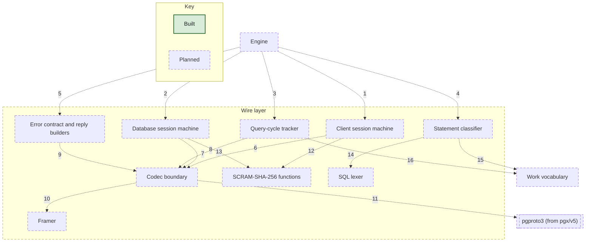

# C4 Level 3: Components: wire layer

**Built so far: chunks 0–1. Dashed parts are planned.** In this diagram 0 of 12 elements and 0 of 16 relationships are built. Model: diagram `component-wire` in [model.json](model.json). Source of this page: [gen.py](gen.py).

pgproto3 gives message structs and nothing else. The framer, the session machines, SCRAM, transaction tracking, classification and error mapping are ours. Everything here is a pure state machine that accepts bytes in any fragments.

A solid box or arrow is built; a dashed one is planned. An arrow points to the supplier.

## Elements

| Element | Kind | Status | What it is |
| --- | --- | --- | --- |
| Framer | component | planned | Ours. Cuts a byte stream into messages (type byte, 4-byte length, body) whatever the fragmentation, down to one byte at a time; enforces a maximum message size. |
| Codec boundary | component | planned | The only product code that touches pgproto3: decodes a framed body into a message struct and encodes structs to bytes. pgproto3's own blocking reader is not used. |
| Client session machine | component | planned | Client-facing. Runs the exchange before startup: answers a TLS request yes or no by config and asks the shell to upgrade the connection, answers a GSS encryption request no. Reads the startup message, finds the tenant by user, runs SCRAM-SHA-256 (server side; trust only as a named test setting), sends the parameter set and proxy-issued key data, recognises cancel requests, takes in one query at a time, handles terminate. |
| Database session machine | component | planned | Database-facing. Asks for TLS first when the config requires it, then startup, SCRAM-SHA-256 (client side), collects server parameters and key data, reaches ready. |
| Query-cycle tracker | component | planned | Follows a reply to its ReadyForQuery, reports the transaction status byte (idle, in transaction, failed), flags an unsolicited ParameterStatus (the connection is now dirty) and any protocol surprise. |
| SCRAM-SHA-256 functions | component | planned | Pure functions on the standard library. Shared with the simulator's fake Postgres and test clients. |
| SQL lexer | component | planned | Tokens only: strings, escape strings, dollar quotes, comments, identifiers; splits a message into statements. Not a parser. |
| Statement classifier | component | planned | Turns a statement into a work unit: rejected (session-level feature), transaction control, provably read-only, shareable with its key. Conservative: what it cannot tokenise is never shared. |
| Error contract and reply builders | component | planned | One table: each refusal and failure, its SQLSTATE, whether anything reached the database, whether a write may have applied. Builds the ErrorResponse and the correct end marker. docs/error-contract.md is generated from it. |
| Engine | neighbouring container | planned | internal/proxy. One single-threaded, sans-I/O state machine per instance: events in, actions out. Holds the client and database connection tables and the request pipeline with its stage seams. The simulator and the shell drive this same code. |
| Work vocabulary | neighbouring container | planned | internal/work. Small plain types the cores are written against: tenant, unit of work and its class, share key, outcome. Carries no Postgres type. This is the extension seam for a second protocol. |
| pgproto3 (from pgx/v5) | softwareSystem, external | planned | Go package github.com/jackc/pgx/v5/pgproto3: Postgres wire message structs with Encode and Decode. The one external dependency, used for message encoding only. |

## Relationships

| # | From | To | Status | What | How |
| --- | --- | --- | --- | --- | --- |
| 1 | Engine | Client session machine | planned | Client bytes in; events and bytes out | Go |
| 2 | Engine | Database session machine | planned | Database bytes in; events and bytes out | Go |
| 3 | Engine | Query-cycle tracker | planned | Reply bytes in; status and message boundaries out | Go |
| 4 | Engine | Statement classifier | planned | Statement text in; work unit out | Go |
| 5 | Engine | Error contract and reply builders | planned | Contract row in; reply bytes out | Go |
| 6 | Client session machine | Codec boundary | planned | Decode and encode messages | Go |
| 7 | Database session machine | Codec boundary | planned | Decode and encode messages | Go |
| 8 | Query-cycle tracker | Codec boundary | planned | Decode message headers and status | Go |
| 9 | Error contract and reply builders | Codec boundary | planned | Encode ErrorResponse and ReadyForQuery | Go |
| 10 | Codec boundary | Framer | planned | Framed message bodies | Go |
| 11 | Codec boundary | pgproto3 (from pgx/v5) | planned | Message structs: Encode, Decode | Go import |
| 12 | Client session machine | SCRAM-SHA-256 functions | planned | Server side of the exchange | Go |
| 13 | Database session machine | SCRAM-SHA-256 functions | planned | Client side of the exchange | Go |
| 14 | Statement classifier | SQL lexer | planned | Tokens and statement boundaries | Go |
| 15 | Statement classifier | Work vocabulary | planned | Produces work units | Go types |
| 16 | Query-cycle tracker | Work vocabulary | planned | Produces outcomes | Go types |
