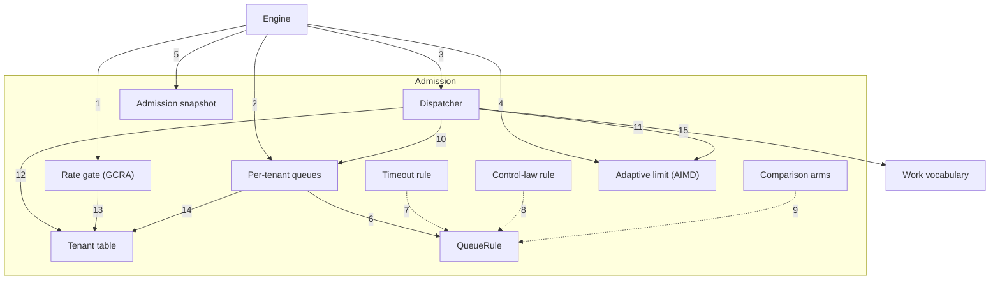

# C4 Level 3: Components: admission

**Target architecture (planned). Nothing in this diagram is built yet.** Model: diagram `component-admission` in [model.json](model.json). Source of this page: [gen.py](gen.py).

Order of decisions: gate, then queue, then dispatch under the limit. The two queue rules are equal, selectable implementations of one interface. Two control loops read two different signals: the queue rule reads queue wait, the adaptive limit reads database round-trip time.

A dashed arrow means "implements"; a solid arrow means "uses" and points to the supplier.

## Elements

| Element | Kind | What it is |
| --- | --- | --- |
| Rate gate (GCRA) | component | Optional outer gate, off by default: a per-tenant rate and burst in integer nanoseconds. Refuses before anything is queued. Rates are divided by the instance count. |
| Tenant table | component | State for tenants that are active now: queue, in-flight count, share, gate state. Created on first use, removed when all-zero, so memory follows active tenants. |
| Per-tenant queues | component | A fixed-capacity ring per tenant. Age is measured on the oldest item; expired items are swept from the head and answered at once; overflow sheds the head. Serves newest-first while the rule reports overload (adaptive LIFO). |
| QueueRule | component | The interface both shedding rules implement; chosen by config. |
| Timeout rule | component | Mode 1, from "Fail at Scale": one last-empty timestamp per queue; allowed wait is the short target while a standing queue exists, otherwise the interval. |
| Control-law rule | component | Mode 2, from the CoDel paper and RFC 8289: sojourn above target for an interval starts dropping; next drop after interval / sqrt(count), in integer arithmetic. |
| Comparison arms | component, test code | Simulator only: plain FIFO and folly's minimum-delay detector, for the head-to-head table. |
| Dispatcher | component | Chooses whose request runs next: round robin across tenants with waiting work; a tenant's share binds only when the limit is reached; otherwise work-conserving. |
| Adaptive limit (AIMD) | component | One integer limit on concurrent leases. Cut by a tenth on a slow statement, a timeout or a connection failure; raised by one when busy. Bounded by a floor, the pool size, a maximum step and a minimum interval. Reads database round-trip time, never queue wait. |
| Admission snapshot | component | Snapshot(): per tenant and total — depth, oldest-item age, queue-wait histogram, rule state, LIFO switches, sheds by reason, in flight, share, limit and its changes, gate refusals. |
| Engine | neighbouring container | internal/proxy. One single-threaded, sans-I/O state machine per instance: events in, actions out. Holds the client and database connection tables and the request pipeline with its stage seams. The simulator and the shell drive this same code. |
| Work vocabulary | neighbouring container | internal/work. Small plain types the cores are written against: tenant, unit of work and its class, share key, batchable flag, outcome. Carries no Postgres type. This is the extension seam for a second protocol. |

## Relationships

| # | From | To | What | How |
| --- | --- | --- | --- | --- |
| 1 | Engine | Rate gate (GCRA) | May this request enter | Go |
| 2 | Engine | Per-tenant queues | Enqueue; sweep expired | Go |
| 3 | Engine | Dispatcher | Capacity freed: who runs next | Go |
| 4 | Engine | Adaptive limit (AIMD) | Statement time and outcome of each completion | Go |
| 5 | Engine | Admission snapshot | Snapshot() | Go |
| 6 | Per-tenant queues | QueueRule | Allowed wait; overloaded or not | Go |
| 7 | Timeout rule | QueueRule | Implements | Go, interface implementation |
| 8 | Control-law rule | QueueRule | Implements | Go, interface implementation |
| 9 | Comparison arms | QueueRule | Implement (simulator only) | Go, interface implementation |
| 10 | Dispatcher | Per-tenant queues | Pops the chosen tenant's next request | Go |
| 11 | Dispatcher | Adaptive limit (AIMD) | Reads the current limit | Go |
| 12 | Dispatcher | Tenant table | In-flight counts and shares | Go |
| 13 | Rate gate (GCRA) | Tenant table | Per-tenant gate state | Go |
| 14 | Per-tenant queues | Tenant table | Per-tenant queue | Go |
| 15 | Dispatcher | Work vocabulary | Work units and outcomes | Go types |
