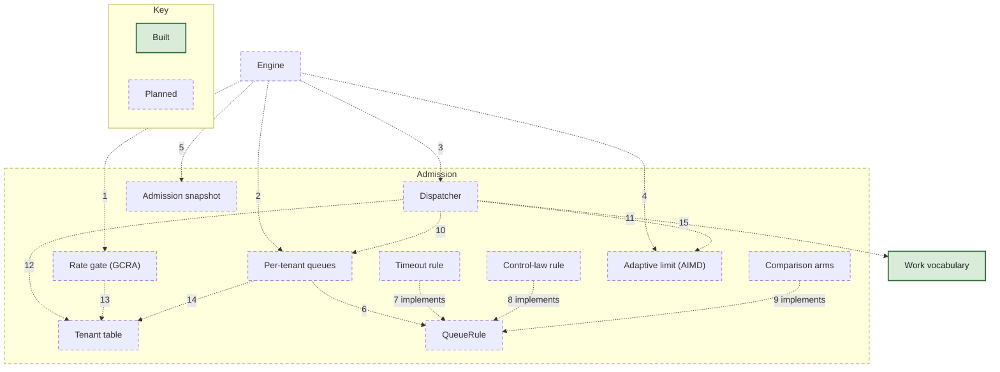

# C4 Level 3: Components: admission

**Built so far: chunks 0–6. Dashed parts are planned.** In this diagram 1 of 12 elements and 0 of 15 relationships are built. Model: diagram `component-admission` in [model.json](model.json). Source of this page: [gen.py](gen.py).

Order of decisions: gate, then queue, then dispatch under the limit. The two queue rules are equal, selectable implementations of one interface. Two control loops read two different signals: the queue rule reads queue wait, the adaptive limit reads database round-trip time.

A solid box or arrow is built; a dashed one is planned. An arrow points to the supplier. An arrow marked "implements" means the source implements the target's interface; every other arrow means "uses".

## Elements

| Element | Kind | Status | What it is |
| --- | --- | --- | --- |
| Rate gate (GCRA) | component | planned | Optional outer gate, off by default: a per-tenant rate and burst in integer nanoseconds. Refuses before anything is queued. Rates are divided by the instance count. |
| Tenant table | component | planned | State for tenants that are active now: queue, in-flight count, share, gate state. Created on first use, removed when all-zero, so memory follows active tenants. |
| Per-tenant queues | component | planned | A fixed-capacity ring per tenant. Age is measured on the oldest item; expired items are swept from the head and answered at once; overflow sheds the head. Serves newest-first while the rule reports overload (adaptive LIFO). |
| QueueRule | component | planned | The interface both shedding rules implement; chosen by config. |
| Timeout rule | component | planned | Mode 1, from "Fail at Scale": one last-empty timestamp per queue; allowed wait is the short target while a standing queue exists, otherwise the interval. |
| Control-law rule | component | planned | Mode 2, from the CoDel paper and RFC 8289: sojourn above target for an interval starts dropping; next drop after interval / sqrt(count), in integer arithmetic. |
| Comparison arms | component, test code | planned | Simulator only: plain FIFO and folly's minimum-delay detector, for the head-to-head table. |
| Dispatcher | component | planned | Chooses whose request runs next: round robin across tenants with waiting work; a tenant's share binds only when the limit is reached; otherwise work-conserving. |
| Adaptive limit (AIMD) | component | planned | One integer limit on concurrent leases. Cut by a tenth on a slow statement, a timeout or a connection failure; raised by one when busy. Bounded by a floor, the pool size, a maximum step and a minimum interval. Reads database round-trip time, never queue wait. |
| Admission snapshot | component | planned | Snapshot(): per tenant and total — depth, oldest-item age, queue-wait histogram, rule state, LIFO switches, sheds by reason, in flight, share, limit and its changes, gate refusals. |
| Engine | neighbouring container | planned | internal/proxy. One single-threaded, sans-I/O state machine per instance: events in, actions out. Holds the client and database connection tables and the request pipeline with its stage seams. The simulator and the shell drive this same code; its test package proxysim is the simulator's driver. **So far:** Built in chunk 6 (internal/proxy, internal/proxy/proxysim): every component drawn here except two parts — the fan-out of a shared reply to its waiters (chunk 11) and the drain sequence (chunk 13). The stages that belong to cores not built yet run their stand-ins: a breaker that is always closed, a rate gate that always allows, no coalescing, one bounded first-come queue, a fixed set of connections, retry off. |
| Work vocabulary | neighbouring container | built (chunk 5) | internal/work. Small plain types the cores are written against: tenant, unit of work with its class, reject reason and sharing flags, share key and its scope, outcome, refusal. Carries no Postgres type and imports only the standard library. This is the extension seam for a second protocol. |

## Relationships

| # | From | To | Status | What | How |
| --- | --- | --- | --- | --- | --- |
| 1 | Engine | Rate gate (GCRA) | planned | May this request enter | Go |
| 2 | Engine | Per-tenant queues | planned | Enqueue; sweep expired | Go |
| 3 | Engine | Dispatcher | planned | Capacity freed: who runs next | Go |
| 4 | Engine | Adaptive limit (AIMD) | planned | Statement time and outcome of each completion | Go |
| 5 | Engine | Admission snapshot | planned | Snapshot() | Go |
| 6 | Per-tenant queues | QueueRule | planned | Allowed wait; overloaded or not | Go |
| 7 | Timeout rule | QueueRule | planned | Implements | Go, interface implementation |
| 8 | Control-law rule | QueueRule | planned | Implements | Go, interface implementation |
| 9 | Comparison arms | QueueRule | planned | Implement (simulator only) | Go, interface implementation |
| 10 | Dispatcher | Per-tenant queues | planned | Pops the chosen tenant's next request | Go |
| 11 | Dispatcher | Adaptive limit (AIMD) | planned | Reads the current limit | Go |
| 12 | Dispatcher | Tenant table | planned | In-flight counts and shares | Go |
| 13 | Rate gate (GCRA) | Tenant table | planned | Per-tenant gate state | Go |
| 14 | Per-tenant queues | Tenant table | planned | Per-tenant queue | Go |
| 15 | Dispatcher | Work vocabulary | planned | Work units and outcomes | Go types |
