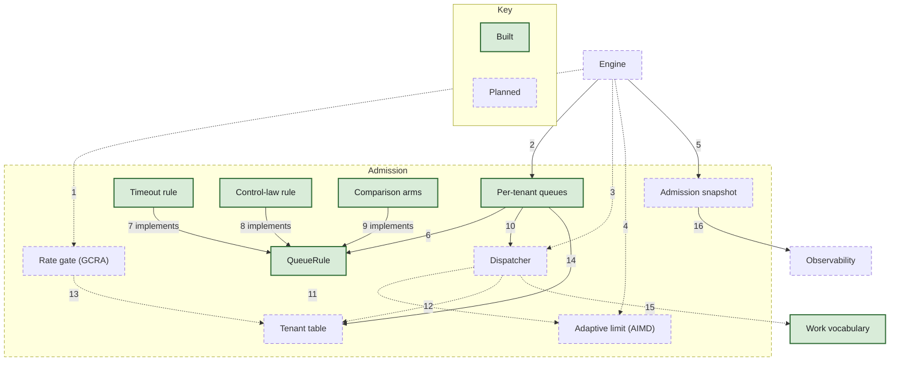

# C4 Level 3: Components: admission

**Built so far: chunks 0–6a and chunk 8 (chunk 7 has not landed yet). Dashed parts are planned.** In this diagram 6 of 13 elements and 9 of 16 relationships are built. Model: diagram `component-admission` in [model.json](model.json). Source of this page: [gen.py](gen.py).

Decisions run in order: gate, then queue, then dispatch under the limit. The two queue rules are equal, selectable implementations of one interface. Two control loops read two different signals: the queue rule reads queue wait, and the adaptive limit reads database round-trip time. Chunk 8 built the queues, both rules, the comparison arms, and the seam the dispatcher plugs into, with one default that serves the tenant whose head is oldest. The gate, the limit, round robin, and shares are planned. The core takes a tenant as a string and a request as an integer id, so nothing in it imports the work vocabulary yet.

A solid box or arrow is built; a dashed one is planned. An arrow points to the supplier. An arrow marked "implements" means the source implements the target's interface; every other arrow means "uses".

## Elements

| Element | Kind | Status | What it is |
| --- | --- | --- | --- |
| Rate gate (GCRA) | component | planned | Optional outer gate, off by default: a per-tenant rate and burst in integer nanoseconds. Refuses before anything is queued. Rates are divided by the instance count. |
| Tenant table | component | planned | State for tenants that are active now: queue, in-flight count, share, gate state. Created on first use, removed when all-zero, so memory follows active tenants. **So far:** Built in chunk 8 (internal/admission: tenantFor, dropQuiet, evictEmpty and statsFor in queues.go; tenant.go): one entry per tenant with a queue (its ring, rule state, LIFO state and load gauge), created on first use and removed after 16 quiet intervals, its ring reused. At most queue.max_tenants entries: at the cap an empty queue is evicted for a new tenant, and if none is empty the arrival is shed. A tenant's counters outlive its entry, for at most 4,096 tenants; later ones are counted as other. Not built: in-flight count and share (chunk 9), gate state (chunk 10). |
| Per-tenant queues | component | built (chunk 8) | A fixed-capacity ring per tenant, under one total capacity. Age is measured on the oldest item; expired items are swept from the head, at every operation and at the core's own next deadline, and answered at once. A full ring sheds its head, not the arrival; a full total sheds the oldest request of all. Serves newest-first while the rule reports overload (adaptive LIFO), and oldest-first again once the rule has reported no overload for a hold time. Keeps folly's minimum-delay figure as a load gauge, 0 to 100. |
| QueueRule | component | built (chunk 8) | The interface both shedding rules implement; chosen by config (queue.rule: timeout or control-law), per instance. |
| Timeout rule | component | built (chunk 8) | Mode 1, from "Fail at Scale": one last-empty timestamp per queue; allowed wait is the short target while a standing queue exists, otherwise the interval. It is evaluated at the instant, on the oldest item, so the first burst after idle gets the interval. |
| Control-law rule | component | built (chunk 8) | Mode 2, from the CoDel paper and RFC 8289: sojourn above target for an interval starts dropping; next drop after interval / sqrt(count), in integer arithmetic (an exact floor). Its checks run at every queue operation and at the core's next deadline, not only at a pop; a drop sheds the oldest request. |
| Comparison arms | component, test code | built (chunk 8) | Plain FIFO and folly's minimum-delay detector, for the head-to-head table. Only tests and the simulator can select them: the config file's parser accepts neither. |
| Dispatcher | component | planned | Chooses whose request runs next: round robin across tenants with waiting work; a tenant's share binds only when the limit is reached; otherwise work-conserving. **So far:** Built in chunk 8 (internal/admission: Dispatcher, OldestFirst and SetDispatcher in queues.go): the interface the queues ask at each pop, and one default that picks the tenant whose head is oldest. Not built: round robin and shares (chunk 9), the limit they bind under (chunk 10). |
| Adaptive limit (AIMD) | component | planned | One integer limit on concurrent leases. Cut by a tenth on a slow statement, a timeout or a connection failure; raised by one when busy. Bounded by a floor, the pool size, a maximum step and a minimum interval. Reads database round-trip time, never queue wait. |
| Admission snapshot | component | planned | Snapshot(): per tenant and total — depth, capacity, oldest-item age, queue-wait histogram, rule state, LIFO switches, sheds by reason, the load gauge, in flight, share, limit and its changes, gate refusals. **So far:** Built in chunk 8 (internal/admission: snapshot.go): per tenant and total — depth, capacity, oldest-item age, queue-wait histogram, rule state, LIFO state and switches, sheds by reason, the load gauge, shedding — with a conservation check (pushes = served + shed + removed + queued). Not built: in flight and share (chunk 9), the limit and its changes, gate refusals (chunk 10). |
| Engine | neighbouring container | planned | internal/proxy. One single-threaded, sans-I/O state machine per instance: events in, actions out. Holds the client and database connection tables and the request pipeline with its stage seams. The simulator and the shell drive this same code; its test package proxysim is the simulator's driver. **So far:** Built in chunk 6 (internal/proxy, internal/proxy/proxysim): every component drawn here except two parts — the fan-out of a shared reply to its waiters (chunk 11) and the drain sequence (chunk 13). Chunk 8 put the admission queues behind the queue seam (admission.go). The stages that belong to cores not landed yet run their stand-ins: a breaker that is always closed, a rate gate that always allows, no coalescing, a fixed set of connections, retry off. |
| Work vocabulary | neighbouring container | built (chunk 5) | internal/work. Small plain types the cores are written against: tenant, unit of work with its class, reject reason and sharing flags, share key and its scope, outcome, refusal. Carries no Postgres type and imports only the standard library. This is the extension seam for a second protocol. |
| Observability | neighbouring container | planned | internal/obs and its sub-packages; test/analysis; scripts/csv-assert.sh; scripts/report.sh; scripts/admission-head-to-head.sh. Snapshot conventions (the one raw export), integer histogram, metric registry, collector, the adapter interface and its adapters (Prometheus text, JSON, CSV flush, log line, OTLP push), fleet merge, health, the SQL assertions over flushed files, and the story report and the admission head-to-head table over the same files. **So far:** Built in chunks 1, 3, 4, 5, 6 and 8: everything except the OTLP push adapter (chunk 15) and the health rules for an open breaker, the limit's floor and draining. Since chunk 6 the shell creates a collector in the real process, with the engine, wire and classifier sources, and serves the outputs over HTTP. The binary attaches the JSON, Prometheus and CSV adapters; the log-line adapter is attached only by the scenario flush harness. Chunk 6a: the story report, and the load generator's metrics in the catalog. Chunk 8: the admission source with the health rule for shedding, and the head-to-head table. |

## Relationships

| # | From | To | Status | What | How |
| --- | --- | --- | --- | --- | --- |
| 1 | Engine | Rate gate (GCRA) | planned | May this request enter | Go |
| 2 | Engine | Per-tenant queues | built | Enqueue, pop, remove; sweep expired; take the shed requests and the next deadline | Go |
| 3 | Engine | Dispatcher | planned | Capacity freed: who runs next | Go |
| 4 | Engine | Adaptive limit (AIMD) | planned | Statement time and outcome of each completion | Go |
| 5 | Engine | Admission snapshot | built | Snapshot() | Go |
| 6 | Per-tenant queues | QueueRule | built | Allowed wait; overloaded or not | Go |
| 7 | Timeout rule | QueueRule | built | Implements | Go, interface implementation |
| 8 | Control-law rule | QueueRule | built | Implements | Go, interface implementation |
| 9 | Comparison arms | QueueRule | built | Implement (simulator only) | Go, interface implementation |
| 10 | Per-tenant queues | Dispatcher | built | At each pop: which tenant's queue is served next | Go |
| 11 | Dispatcher | Adaptive limit (AIMD) | planned | Reads the current limit | Go |
| 12 | Dispatcher | Tenant table | planned | In-flight counts and shares | Go |
| 13 | Rate gate (GCRA) | Tenant table | planned | Per-tenant gate state | Go |
| 14 | Per-tenant queues | Tenant table | built | Per-tenant queue | Go |
| 15 | Dispatcher | Work vocabulary | planned | Work units and outcomes | Go types |
| 16 | Admission snapshot | Observability | built | Uses the gauge, the histogram and the conservation check; the admission source mapping reads the snapshot | Go, plain structs |
