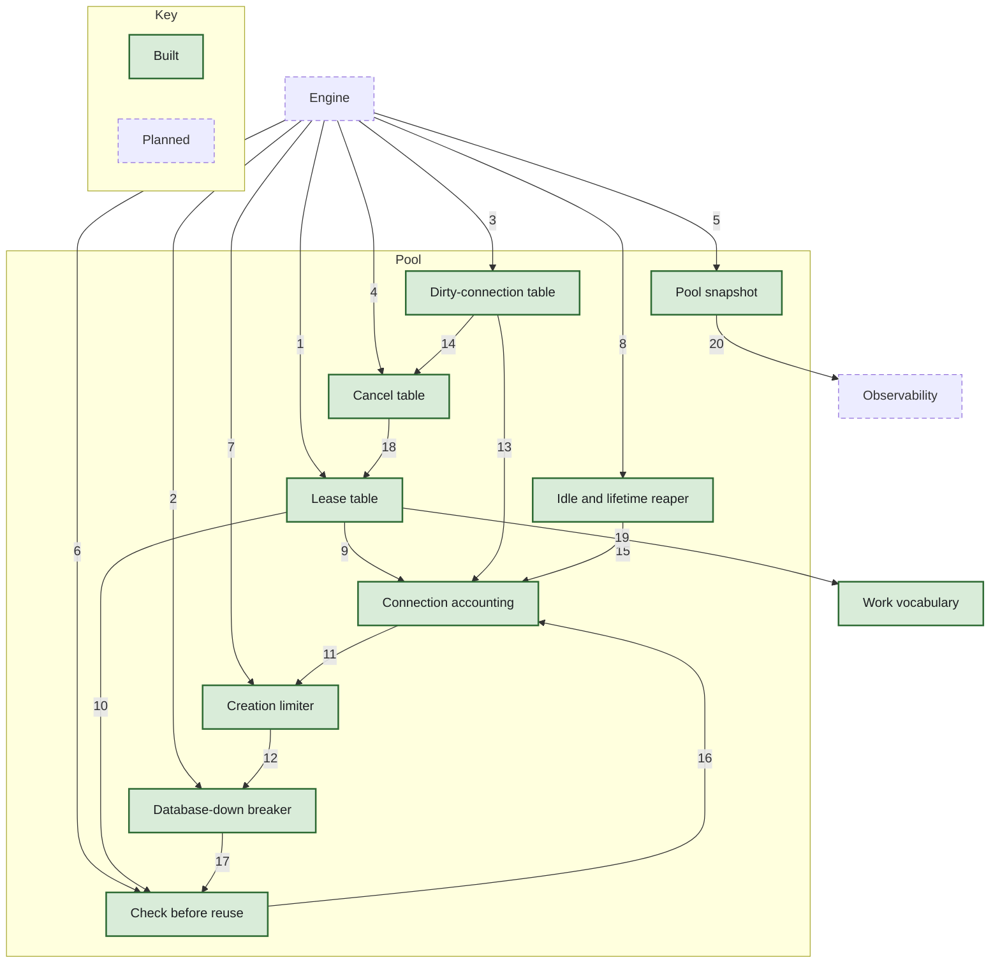

# C4 Level 3: Components: pool

**Built so far: chunks 0–9. Dashed parts are planned.** In this diagram 10 of 12 elements and 20 of 20 relationships are built. Model: diagram `component-pool` in [model.json](model.json). Source of this page: [gen.py](gen.py).

A request never waits inside the pool: a checkout either lends a connection or is refused, and the request stays in the engine's queue. The pool enforces the cap, controls the creation rate, and lends a connection only when it is idle, clean, and not in doubt. Chunk 7 built all of it as one deterministic state machine, the type Pool; the components drawn here are its parts, not separate types. It does no I/O: the engine performs the actions it returns and reports each result, and one engine timer wakes it at its next deadline.

A solid box or arrow is built; a dashed one is planned. An arrow points to the supplier.

## Elements

| Element | Kind | Status | What it is |
| --- | --- | --- | --- |
| Connection accounting | component | built (chunk 7) | Every database connection is connecting, idle, checking, lent, cleaning or resetting; a closed one is forgotten in the step that issues its close. Invariant: open + connecting never exceeds the cap, which is pool.connections or, when that is omitted, the fleet budget divided by the instance count (rounded down, never zero). |
| Creation limiter | component | built (chunk 7) | Opens connections only on demand: while more requests wait than connections are idle or being prepared. No prefill. Caps concurrent connects and the rate of new connections (consecutive dials at least 1/rate apart; the rate is the fleet's divided by the instance count), so a storm or a cold start cannot flood the database. The breaker's trial dial and the redials after a mass death pass through it too. |
| Lease table | component | built (chunk 7) | Checkout and release. Lends the most recently used idle connection, and never one in doubt. A checkout that cannot lend is refused, so a request never waits inside the pool. Two release policies: always resets after every lease; on-switch tags the connection with its tenant, prefers a connection last held by the same tenant and lends it as is, and resets one that must switch tenants, at checkout. With the re-seed on, every reset carries a new random seed. The engine decides when a lease ends (the status byte) and holds the idle-in-transaction deadline; the pool is told how the lease ended. |
| Check before reuse | component | built (chunk 7) | An idle connection that is suspect, or idle for the check-after-idle time or longer, is sent an empty query before it is lent, off the request path and under its own short deadline; a failed check closes it and costs no client. The suspect rule: any connection-class failure marks every other connection suspect, and only a passed check clears the mark. At most four checks start per checkout. |
| Database-down breaker | component | built (chunk 7) | The one circuit breaker. Counts consecutive connection-class failures only (a failed dial, bytes on an idle connection, the loss of a connection in use); never SQL errors, a polite close of an idle connection, or a failed check that is not its trial. Open: requests are refused at once, no dial is made, and the queued requests are refused. Half-open after a set time: requests are admitted and wait behind exactly one trial — a dial, or a check of an idle connection when the pool is at its cap — sent only when work wants it. A failed trial opens it again. |
| Dirty-connection table | component | built (chunk 7) | What to do with a connection whose lease did not end clean (client gone, idle in a transaction, a statement or write deadline): cancel a statement still running and drain its reply, roll back an open transaction, reset, and wait for the cancel to finish, all inside the clean-up deadline; reuse only after every step succeeded, otherwise close. A lost connection or one with unread bytes is closed. Destroy on doubt. |
| Idle and lifetime reaper | component | built (chunk 7) | Closes a connection that has been idle past its idle timeout, or that is idle and older than its lifetime. Each connection draws its own two limits at dial time, spread by the jitter (10% either way by default), so connections made together do not expire together. Also ends a check, a reset or a clean-up at its deadline. Deadlines fire at equality: what arrives at its deadline is late. |
| Cancel table | component | built (chunk 7) | A client's cancel is accepted only for a lent connection, and the table's own cancels come from the dirty-connection table. Each goes out on a second connection that is outside the cap; at most a set number are in flight. A connection is not lent again until its cancel has finished, and one whose cancel never reported is closed at its next return. The engine, not the pool, maps a client's key data to the connection it holds. |
| Pool snapshot | component | built (chunk 7) | Snapshot(): the caps; open, connecting, idle, lent, checking, cleaning, resetting and suspect, with peaks; dials, failures and waits for the creation rate; closes by reason; checkouts, exhaustion events, lends as is, tenant switches; lease ends and dirty-table outcomes by kind; resets by cause and outcome, re-seeds; checks by result; cancels; breaker state, transitions, trials and failures; lease-time and idle-age histograms. Its check holds the cap and the conservation laws (every dial, checkout, check and cancel ends in exactly one outcome). |
| Engine | neighbouring container | planned | internal/proxy. One single-threaded, sans-I/O state machine per instance: events in, actions out. Holds the client and database connection tables and the request pipeline with its stage seams. The simulator and the shell drive this same code; its test package proxysim is the simulator's driver. **So far:** Built in chunk 6 (internal/proxy, internal/proxy/proxysim): every component drawn here except two parts — the fan-out of a shared reply to its waiters (chunk 11) and the drain sequence (chunk 13). Chunk 7 put the pool core behind the pool, breaker and release seams (corepool.go) and chunk 8 the admission queues behind the queue seam (admission.go). Chunk 9 installed the fair dispatcher on those queues and reports every lease start and end to it (fairness.go). The stages that belong to cores not built yet run their stand-ins: a rate gate that always allows, no coalescing, retry off. |
| Work vocabulary | neighbouring container | built (chunk 5) | internal/work. Small plain types the cores are written against: tenant, unit of work with its class, reject reason and sharing flags, share key and its scope, outcome, refusal. Carries no Postgres type and imports only the standard library. This is the extension seam for a second protocol. |
| Observability | neighbouring container | planned | internal/obs and its sub-packages; test/analysis; scripts/csv-assert.sh; scripts/report.sh; scripts/admission-head-to-head.sh. Snapshot conventions (the one raw export), integer histogram, metric registry, collector, the adapter interface and its adapters (Prometheus text, JSON, CSV flush, log line, OTLP push), fleet merge, health, the SQL assertions over flushed files, and the story report and the admission head-to-head table over the same files. **So far:** Built in chunks 1, 3, 4, 5, 6, 7, 8 and 9: everything except the OTLP push adapter (chunk 15) and the health rules for the limit's floor and draining. Since chunk 6 the shell creates a collector in the real process, with the engine, wire and classifier sources, and serves the outputs over HTTP. The binary attaches the JSON, Prometheus and CSV adapters; the log-line adapter is attached only by the scenario flush harness. Chunk 6a: the story report, and the load generator's metrics in the catalog. Chunk 7: the pool source with the health rule for the breaker. Chunk 8: the admission source with the health rule for shedding, and the head-to-head table. Chunk 9: the fairness metrics in the admission source, totals and per tenant, with no new health rule. |

## Relationships

| # | From | To | Status | What | How |
| --- | --- | --- | --- | --- | --- |
| 1 | Engine | Lease table | built | Checkout for a tenant; release, with how the lease ended | Go |
| 2 | Engine | Database-down breaker | built | Asks at the gate whether a request may enter; reports failed dials and lost connections; is told to refuse the queued requests when it opens | Go |
| 3 | Engine | Dirty-connection table | built | A lease that did not end clean; the result of each clean-up step | Go |
| 4 | Engine | Cancel table | built | A client's cancel for the connection it holds; a cancel connection finished | Go |
| 5 | Engine | Pool snapshot | built | Snapshot() | Go |
| 6 | Engine | Check before reuse | built | Performs the check; reports its result | Go |
| 7 | Engine | Creation limiter | built | How many requests wait; performs the dial and reports opened or failed | Go |
| 8 | Engine | Idle and lifetime reaper | built | A tick at the pool's next deadline | Go |
| 9 | Lease table | Connection accounting | built | Idle to lent and back | Go |
| 10 | Lease table | Check before reuse | built | Before a lend: must this connection be checked first | Go |
| 11 | Connection accounting | Creation limiter | built | May another connection be opened now | Go |
| 12 | Creation limiter | Database-down breaker | built | No dial while open; when half-open, the one trial dial | Go |
| 13 | Dirty-connection table | Connection accounting | built | Reuse or close | Go |
| 14 | Dirty-connection table | Cancel table | built | Cancel a statement still running | Go |
| 15 | Idle and lifetime reaper | Connection accounting | built | Close idle and old connections | Go |
| 16 | Check before reuse | Connection accounting | built | Idle to checking and back, or close | Go |
| 17 | Database-down breaker | Check before reuse | built | At the cap, the half-open trial is a check | Go |
| 18 | Cancel table | Lease table | built | Only a lent connection is cancelled; none with a cancel in flight is lent | Go |
| 19 | Lease table | Work vocabulary | built | The tenant id: the tag of a connection's last holder | Go types |
| 20 | Pool snapshot | Observability | built | Uses the gauge and the histogram; the pool source mapping reads the snapshot | Go, plain structs |
