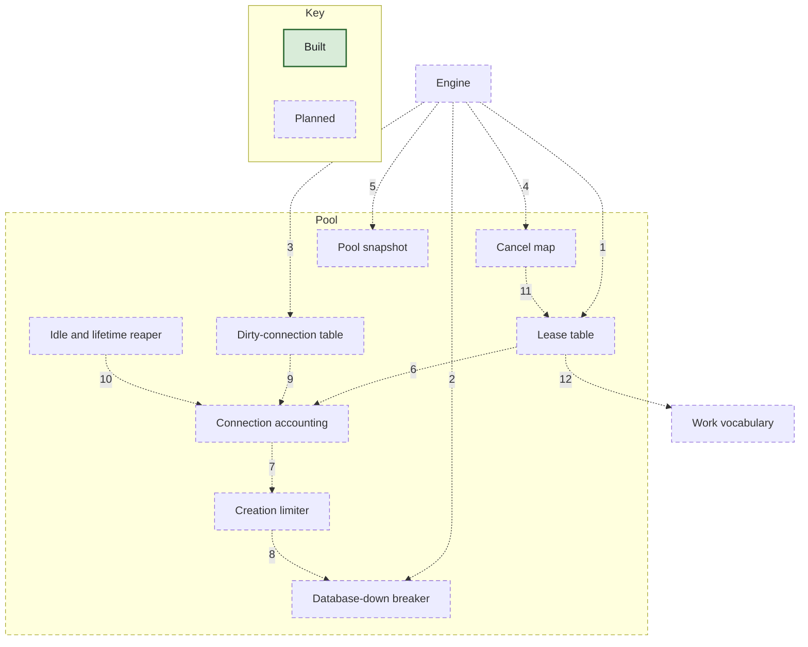

# C4 Level 3: Components: pool

**Built so far: chunks 0–4. Dashed parts are planned.** In this diagram 0 of 10 elements and 0 of 12 relationships are built. Model: diagram `component-pool` in [model.json](model.json). Source of this page: [gen.py](gen.py).

A request never waits inside the pool: the dispatcher releases it only when a lease is available. The pool's job is the cap, the creation rate, and never lending a connection that is not idle and clean.

A solid box or arrow is built; a dashed one is planned. An arrow points to the supplier.

## Elements

| Element | Kind | Status | What it is |
| --- | --- | --- | --- |
| Connection accounting | component | planned | Every database connection is connecting, idle, lent or closing. Invariant: open + connecting never exceeds the pool size, which is the fleet budget divided by the instance count. |
| Creation limiter | component | planned | Caps concurrent connects and the rate of new connections, so a storm or a cold start cannot flood the database. |
| Lease table | component | planned | Lends a connection for one transaction: held while the status byte says in-transaction or failed, released on idle. Enforces the idle-in-transaction deadline. |
| Database-down breaker | component | planned | The one circuit breaker. Counts connection-class failures only, never SQL errors. Open: requests are refused at once and no dial is made. Half-open: one trial connect. |
| Dirty-connection table | component | planned | What to do with a connection whose client vanished or that surprised us: cancel, wait a bounded time, roll back, then reuse only if it is idle and clean; otherwise close. Destroy on doubt. |
| Idle and lifetime reaper | component | planned | Closes idle and old connections, with jitter so they do not all expire together; checks a long-idle connection before reuse. |
| Cancel map | component | planned | Maps proxy-issued key data to the connection a client currently holds, so a client's cancel request reaches its own statement and no one else's. Caps concurrent cancels. |
| Pool snapshot | component | planned | Snapshot(): open, idle, lent, connecting, creation rate, closes by reason, exhaustion events, breaker state and transitions, dirty-table outcomes, lease-time histogram. |
| Engine | neighbouring container | planned | internal/proxy. One single-threaded, sans-I/O state machine per instance: events in, actions out. Holds the client and database connection tables and the request pipeline with its stage seams. The simulator and the shell drive this same code. |
| Work vocabulary | neighbouring container | planned | internal/work. Small plain types the cores are written against: tenant, unit of work and its class, share key, outcome. Carries no Postgres type. This is the extension seam for a second protocol. |

## Relationships

| # | From | To | Status | What | How |
| --- | --- | --- | --- | --- | --- |
| 1 | Engine | Lease table | planned | Lend to a work unit; release on outcome | Go |
| 2 | Engine | Database-down breaker | planned | Reports connect and connection failures; asks whether to fail fast | Go |
| 3 | Engine | Dirty-connection table | planned | Client vanished, deadline passed, or protocol surprise | Go |
| 4 | Engine | Cancel map | planned | Client cancel request | Go |
| 5 | Engine | Pool snapshot | planned | Snapshot() | Go |
| 6 | Lease table | Connection accounting | planned | Idle to lent and back | Go |
| 7 | Connection accounting | Creation limiter | planned | May another connection be opened now | Go |
| 8 | Creation limiter | Database-down breaker | planned | Is the database marked down | Go |
| 9 | Dirty-connection table | Connection accounting | planned | Reuse or close | Go |
| 10 | Idle and lifetime reaper | Connection accounting | planned | Close idle and old connections | Go |
| 11 | Cancel map | Lease table | planned | Finds the lent connection | Go |
| 12 | Lease table | Work vocabulary | planned | Work units and outcomes (released clean, still held, dirty) | Go types |
