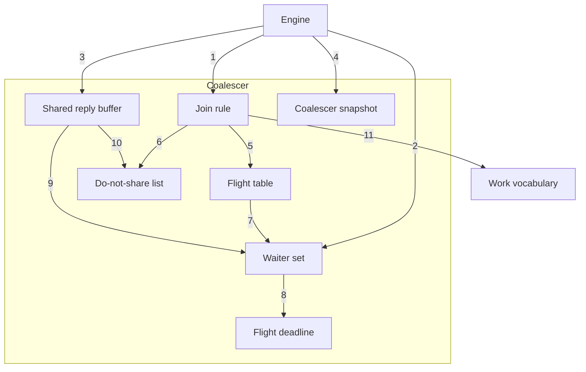

# C4 Level 3: Components: coalescer

**Target architecture (planned). Nothing in this diagram is built yet.** Model: diagram `component-coalescer` in [model.json](model.json). Source of this page: [gen.py](gen.py).

Followers take no queue slot and no connection. The leader passes through admission like any request.

## Elements

| Element | Kind | What it is |
| --- | --- | --- |
| Join rule | component | Decides whether a shareable request leads a new read or joins one. Strict (default): never join a read already running on the database — join the next one, which starts when the running one ends. Relaxed: join the running read. |
| Flight table | component | In-flight and pending shared reads, keyed by the exact statement text. At most one read per key is on the database at a time. Entries are removed on completion. |
| Waiter set | component | The callers of one flight, counted. Capped. A caller that leaves gets its own error and does not disturb the rest. |
| Flight deadline | component | The flight runs under its own deadline, not any caller's. The database work is cancelled only when the last waiter has left. |
| Shared reply buffer | component | The reply's message bytes, stored once and capped; each recipient gets them with its own end marker. Errors are shared too. |
| Do-not-share list | component | Keys whose reply was too large to share. Bounded and expiring. |
| Coalescer snapshot | component | Snapshot(): flights, hits, waiters per flight, cancellations, overflows by cap, shared errors, table size. |
| Engine | neighbouring container | internal/proxy. One single-threaded, sans-I/O state machine per instance: events in, actions out. Holds the client and database connection tables and the request pipeline with its stage seams. The simulator and the shell drive this same code. |
| Work vocabulary | neighbouring container | internal/work. Small plain types the cores are written against: tenant, unit of work and its class, share key, outcome. Carries no Postgres type. This is the extension seam for a second protocol. |

## Relationships

| # | From | To | What | How |
| --- | --- | --- | --- | --- |
| 1 | Engine | Join rule | A shareable work unit arrived | Go |
| 2 | Engine | Waiter set | A waiter left | Go |
| 3 | Engine | Shared reply buffer | Reply bytes; reply complete or failed | Go |
| 4 | Engine | Coalescer snapshot | Snapshot() | Go |
| 5 | Join rule | Flight table | Look up or create the flight | Go |
| 6 | Join rule | Do-not-share list | Is this key barred from sharing | Go |
| 7 | Flight table | Waiter set | Adds the caller | Go |
| 8 | Waiter set | Flight deadline | Last waiter gone: cancel | Go |
| 9 | Shared reply buffer | Waiter set | Fans the reply out | Go |
| 10 | Shared reply buffer | Do-not-share list | Reply over the cap | Go |
| 11 | Join rule | Work vocabulary | Reads the share key of a work unit | Go types |
