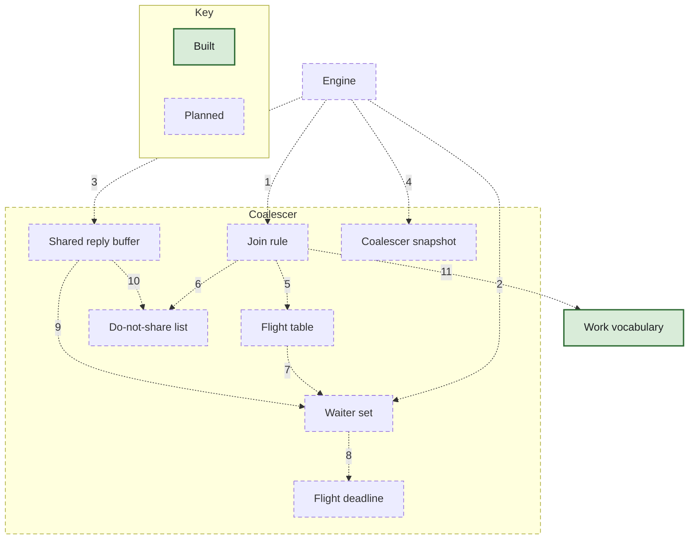

# C4 Level 3: Components: coalescer

**Built so far: chunks 0–6a. Dashed parts are planned.** In this diagram 1 of 9 elements and 0 of 11 relationships are built. Model: diagram `component-coalescer` in [model.json](model.json). Source of this page: [gen.py](gen.py).

Followers take no queue slot and no connection. The leader passes through admission like any request.

A solid box or arrow is built; a dashed one is planned. An arrow points to the supplier.

## Elements

| Element | Kind | Status | What it is |
| --- | --- | --- | --- |
| Join rule | component | planned | Decides whether a shareable request leads a new read or joins one. Strict (default): never join a read already running on the database — join the next one, which starts when the running one ends. Relaxed: join the running read. |
| Flight table | component | planned | In-flight and pending shared reads, keyed by the exact statement text. At most one read per key is on the database at a time. Entries are removed on completion. |
| Waiter set | component | planned | The callers of one flight, counted. Capped. A caller that leaves gets its own error and does not disturb the rest. |
| Flight deadline | component | planned | The flight runs under its own deadline, not any caller's. The database work is cancelled only when the last waiter has left. |
| Shared reply buffer | component | planned | The reply's message bytes, stored once and capped; each recipient gets them with its own end marker. Errors are shared too. |
| Do-not-share list | component | planned | Keys whose reply was too large to share. Bounded and expiring. |
| Coalescer snapshot | component | planned | Snapshot(): flights, hits, waiters per flight, cancellations, overflows by cap, shared errors, table size. |
| Engine | neighbouring container | planned | internal/proxy. One single-threaded, sans-I/O state machine per instance: events in, actions out. Holds the client and database connection tables and the request pipeline with its stage seams. The simulator and the shell drive this same code; its test package proxysim is the simulator's driver. **So far:** Built in chunk 6 (internal/proxy, internal/proxy/proxysim): every component drawn here except two parts — the fan-out of a shared reply to its waiters (chunk 11) and the drain sequence (chunk 13). The stages that belong to cores not built yet run their stand-ins: a breaker that is always closed, a rate gate that always allows, no coalescing, one bounded first-come queue, a fixed set of connections, retry off. |
| Work vocabulary | neighbouring container | built (chunk 5) | internal/work. Small plain types the cores are written against: tenant, unit of work with its class, reject reason and sharing flags, share key and its scope, outcome, refusal. Carries no Postgres type and imports only the standard library. This is the extension seam for a second protocol. |

## Relationships

| # | From | To | Status | What | How |
| --- | --- | --- | --- | --- | --- |
| 1 | Engine | Join rule | planned | A shareable work unit arrived | Go |
| 2 | Engine | Waiter set | planned | A waiter left | Go |
| 3 | Engine | Shared reply buffer | planned | Reply bytes; reply complete or failed | Go |
| 4 | Engine | Coalescer snapshot | planned | Snapshot() | Go |
| 5 | Join rule | Flight table | planned | Look up or create the flight | Go |
| 6 | Join rule | Do-not-share list | planned | Is this key barred from sharing | Go |
| 7 | Flight table | Waiter set | planned | Adds the caller | Go |
| 8 | Waiter set | Flight deadline | planned | Last waiter gone: cancel | Go |
| 9 | Shared reply buffer | Waiter set | planned | Fans the reply out | Go |
| 10 | Shared reply buffer | Do-not-share list | planned | Reply over the cap | Go |
| 11 | Join rule | Work vocabulary | planned | Reads the share key of a work unit | Go types |
