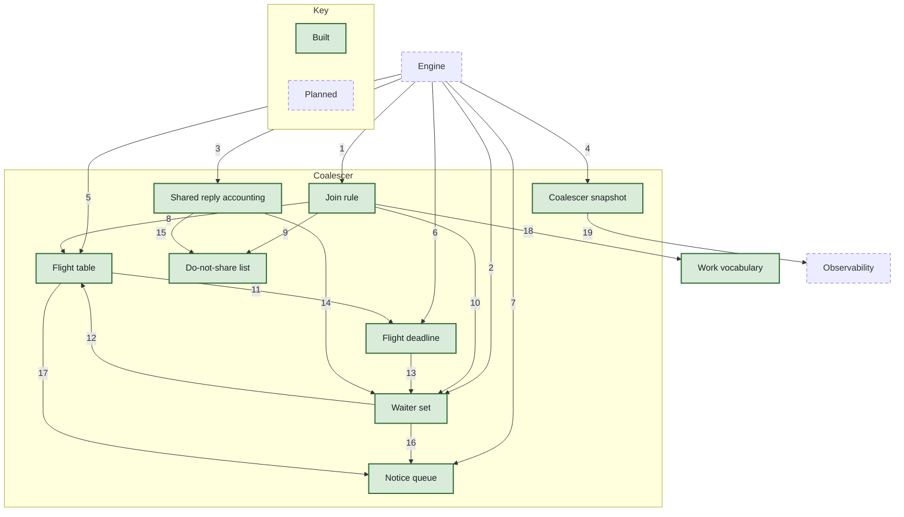

# C4 Level 3: Components: coalescer

**Built so far: chunks 0–9 and chunks 11 and 12 (chunk 10 has not landed yet). Dashed parts are planned.** In this diagram 9 of 11 elements and 19 of 19 relationships are built. Model: diagram `component-coalescer` in [model.json](model.json). Source of this page: [gen.py](gen.py).

Followers take no queue slot and no connection. The owner of a flight passes through admission like any request. Chunk 11 built all of it as one deterministic state machine, the type Table; the components drawn here are its parts, not separate types. It does no I/O and holds no reply bytes: the engine stores the reply, reports each step and acts on the notices the core queues (the coalescer adapter on the engine diagram), and one engine timer wakes it at its next deadline. Three cases are outside the one-read-per-key rule, each counted: a cancelled read still finishing on the database, a key on the do-not-share list, and a new key at a full table. Flights are per instance, so N instances can run N reads of one hot key.

A solid box or arrow is built; a dashed one is planned. An arrow points to the supplier.

## Elements

| Element | Kind | Status | What it is |
| --- | --- | --- | --- |
| Join rule | component | built (chunk 11) | Join(): the verdict for one request. A request is eligible in auto mode when its work unit is marked shareable, in hinted mode when it is marked hinted; the rule reads those flags and the share key, never SQL. An eligible request leads a new flight, follows a flight, holds (leads a flight that waits behind the read already running for its key), passes on unshared, or is refused. Strict (default): never join a read already running on the database — follow the flight held behind it, or start that held flight. Relaxed: join the running read. A key on the do-not-share list passes unshared, and so does a new key when the table is full. |
| Flight table | component | built (chunk 11) | Flights by key: the tenant of the share key (empty when the key scope is all tenants) and the exact statement text, coded so that no two different pairs give one key. A key has at most a current flight (waiting for a connection, or running) and one held flight behind it, so of the flights the coalescer owns at most one per key is on the database at a time. At most coalesce.max_flights keys (1,024 by default). When the current flight ends, the held one takes its place and the engine is told to start it; a key is removed with its last flight. |
| Waiter set | component | built (chunk 11) | The callers of one flight: the owner, whose request runs the read, and the followers. Counted, and capped at coalesce.max_waiters (1,024 by default, the owner included); a caller past the cap is refused. A follower that leaves is taken off and does not disturb the rest; the engine gives it its own error. When the owner leaves and followers remain, the newest follower becomes the owner (a handoff). When the last waiter leaves, the flight ends at once and the engine cancels the database work. At one instant the order of events decides: a leave applied before the result gets nothing of it. |
| Flight deadline | component | built (chunk 11) | Each flight has its own deadline, fixed at its creation (timeouts.statement after it) and independent of every caller. Flights are listed in creation order, so the next deadline is the first one. At the deadline the flight ends and every waiter is told once; a result at that instant is late. A held flight can expire before it starts. A deadline past the largest instant saturates. Shutdown ends every flight the same way. |
| Shared reply accounting | component | built (chunk 11) | The reply bytes are stored once, in the engine; the core counts them against coalesce.max_reply_bytes (64 KiB by default). Past the cap, or when the reply ends leaving a transaction open, the flight stops sharing: its followers are refused, its owner alone gets the reply, and the key goes on the do-not-share list. When the flight ends, every waiter still on it is told once: the reply, or the shared error of a failed flight. An error reply from the database is shared like any reply. |
| Do-not-share list | component | built (chunk 11) | Keys whose reply was too large to share or left a transaction open. A request for a listed key passes on unshared. Bounded (coalesce.no_share_max, 256 by default; at the bound the oldest key is dropped) and expiring (coalesce.no_share_for, 10 s by default). |
| Notice queue | component | built (chunk 11) | The core does no I/O and calls nothing. What the engine must do next is queued as notices, one per waiter: give it the reply, the shared error or a refusal, start a held flight whose turn has come, or end the request of an expired flight's owner. The engine takes them after every call. |
| Coalescer snapshot | component | built (chunk 11) | Snapshot(): requests offered and not eligible, flights started, hits, refusals, passes by reason, flights held, promoted and sent, flight ends by outcome, shared errors, handoffs, waiter ends by outcome, overflows by cap, the do-not-share list's movements, gauges with peaks (waiting, flights, running, keys, stored bytes, listed keys), the waiters-per-flight histogram, hits per tenant (4,096 tenants, the rest as other) and, opt-in, the most offered keys. Its check holds four conservation laws (offers, waiters, flights, the list) and the caps; the quiesce check requires an empty table. |
| Engine | neighbouring container | planned | internal/proxy. One single-threaded, sans-I/O state machine per instance: events in, actions out. Holds the client and database connection tables and the request pipeline with its stage seams. The simulator and the shell drive this same code; its test package proxysim is the simulator's driver. **So far:** Built in chunk 6 (internal/proxy, internal/proxy/proxysim): every component drawn here except one part — the drain sequence (chunk 13). Chunk 7 put the pool core behind the pool, breaker and release seams (corepool.go) and chunk 8 the admission queues behind the queue seam (admission.go). Chunk 9 installed the fair dispatcher on those queues and reports every lease start and end to it (fairness.go). Chunk 12 put the retry policy behind the retry seam (retry.go); a granted retry re-enters at the queue stage. Chunk 11 put the flight table behind the coalescer seam (coalesce.go): the coalesce stage, the stored reply written to every waiter, and the join with chunks 9 and 12 (a flight is charged to the tenant its owner was queued under; a flight lost with nothing reached is retried once for the whole flight; a held flight promoted while the breaker is open is refused). The one stage whose core is not built yet runs its stand-in: a rate gate that always allows (chunk 10). |
| Work vocabulary | neighbouring container | built (chunk 5) | internal/work. Small plain types the cores are written against: tenant, unit of work with its class, reject reason and sharing flags, share key and its scope, outcome, refusal. Carries no Postgres type and imports only the standard library. This is the extension seam for a second protocol. |
| Observability | neighbouring container | planned | internal/obs and its sub-packages; test/analysis; scripts/csv-assert.sh; scripts/report.sh; scripts/admission-head-to-head.sh. Snapshot conventions (the one raw export), integer histogram, metric registry, collector, the adapter interface and its adapters (Prometheus text, JSON, CSV flush, log line, OTLP push), fleet merge, health, the SQL assertions over flushed files, and the story report and the admission head-to-head table over the same files. **So far:** Built in chunks 1, 3, 4, 5, 6, 7, 8, 9, 11 and 12: everything except the OTLP push adapter (chunk 15) and the health rules for the limit's floor and draining. Since chunk 6 the shell creates a collector in the real process, with the engine, wire and classifier sources, and serves the outputs over HTTP. The binary attaches the JSON, Prometheus and CSV adapters; the log-line adapter is attached only by the scenario flush harness. Chunk 6a: the story report, and the load generator's metrics in the catalog. Chunk 7: the pool source with the health rule for the breaker. Chunk 8: the admission source with the health rule for shedding, and the head-to-head table. Chunk 9: the fairness metrics in the admission source, totals and per tenant, with no new health rule. Chunk 12: the retry source and the engine's retry metrics, with no new health rule. Chunk 11: the coalescer source, the engine's coalesce metrics, and the health rule coalescer, which is always ok. |

## Relationships

| # | From | To | Status | What | How |
| --- | --- | --- | --- | --- | --- |
| 1 | Engine | Join rule | built | Offers each request's work unit at the coalesce stage | Go |
| 2 | Engine | Waiter set | built | A waiter left: its own cancel, or the client is gone | Go |
| 3 | Engine | Shared reply accounting | built | Reports the reply bytes it stored; the reply's end or the flight's failure | Go |
| 4 | Engine | Coalescer snapshot | built | Snapshot() | Go |
| 5 | Engine | Flight table | built | The flight's statement was written to the database: it is running | Go |
| 6 | Engine | Flight deadline | built | Asks for the next deadline and sweeps at it; shutdown | Go |
| 7 | Engine | Notice queue | built | Takes the notices after every call and acts on each | Go |
| 8 | Join rule | Flight table | built | Look up the key; create a flight or a held flight | Go |
| 9 | Join rule | Do-not-share list | built | Is this key barred from sharing | Go |
| 10 | Join rule | Waiter set | built | Adds the caller as a follower, or refuses it at the cap | Go |
| 11 | Flight table | Flight deadline | built | A new flight gets its deadline and its place in creation order | Go |
| 12 | Waiter set | Flight table | built | Last waiter gone: the flight ends | Go |
| 13 | Flight deadline | Waiter set | built | At the deadline every waiter of the flight is told once | Go |
| 14 | Shared reply accounting | Waiter set | built | At the end of the flight every waiter is told the outcome once; at the cap the followers are refused | Go |
| 15 | Shared reply accounting | Do-not-share list | built | Reply over the cap, or unshareable: list the key | Go |
| 16 | Waiter set | Notice queue | built | One notice per waiter told | Go |
| 17 | Flight table | Notice queue | built | A held flight's turn has come: start it | Go |
| 18 | Join rule | Work vocabulary | built | Reads the sharing flags and the share key of a work unit | Go types |
| 19 | Coalescer snapshot | Observability | built | Uses the gauge, the histogram and the conservation check; the coalescer source mapping reads the snapshot | Go, plain structs |
