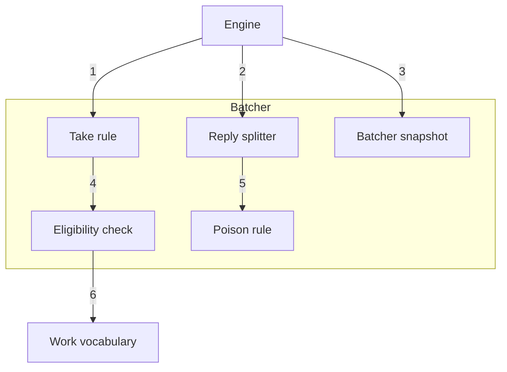

# C4 Level 3: Components: batcher

**Target architecture (planned). Nothing in this diagram is built yet.** Model: diagram `component-batcher` in [model.json](model.json). Source of this page: [gen.py](gen.py).

Batching here means writing several independent single-statement requests to one free connection in one write. It exists only where the classifier can prove it is safe, and it is off by default.

## Elements

| Element | Kind | What it is |
| --- | --- | --- |
| Take rule | component | When a connection frees up, takes what is already queued and eligible, up to a count and byte cap. One request with nothing else waiting goes alone at once. There is no timer. |
| Eligibility check | component | A request may be batched only if the classifier proved it is a single statement that is not transaction control, and its client is outside a transaction. |
| Reply splitter | component | Splits the replies in order at the end-of-reply markers and matches each to its requester. |
| Poison rule | component | If any end marker reports a status other than idle, the connection is closed and the remaining members get the may-have-been-applied error. |
| Batcher snapshot | component | Snapshot(): batch-size histogram, batched share, in-batch wait histogram, poison events, ineligible reasons. |
| Engine | neighbouring container | internal/proxy. One single-threaded, sans-I/O state machine per instance: events in, actions out. Holds the client and database connection tables and the request pipeline with its stage seams. The simulator and the shell drive this same code. |
| Work vocabulary | neighbouring container | internal/work. Small plain types the cores are written against: tenant, unit of work and its class, share key, batchable flag, outcome. Carries no Postgres type. This is the extension seam for a second protocol. |

## Relationships

| # | From | To | What | How |
| --- | --- | --- | --- | --- |
| 1 | Engine | Take rule | A connection is free and requests are waiting | Go |
| 2 | Engine | Reply splitter | Reply bytes of a batch | Go |
| 3 | Engine | Batcher snapshot | Snapshot() | Go |
| 4 | Take rule | Eligibility check | Is this request eligible | Go |
| 5 | Reply splitter | Poison rule | Status byte of each end marker | Go |
| 6 | Eligibility check | Work vocabulary | Reads the batchable flag of a work unit | Go types |
