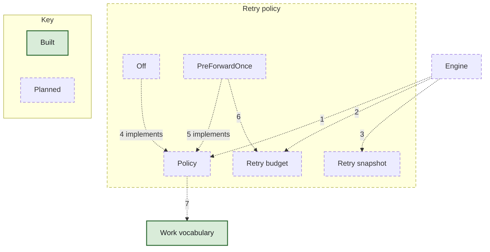

# C4 Level 3: Components: retry policy

**Built so far: chunks 0–9. Dashed parts are planned.** In this diagram 1 of 7 elements and 0 of 7 relationships are built. Model: diagram `component-retry` in [model.json](model.json). Source of this page: [gen.py](gen.py).

The default policy is Off. Failures after anything reached the database are never retried under any policy.

A solid box or arrow is built; a dashed one is planned. An arrow points to the supplier. An arrow marked "implements" means the source implements the target's interface; every other arrow means "uses".

## Elements

| Element | Kind | Status | What it is |
| --- | --- | --- | --- |
| Policy | component | planned | The interface the engine asks: given this failure — did anything reach the database, is the breaker open, how much of the deadline is left — may it be retried. |
| Off | component | planned | The default. Never retries. |
| PreForwardOnce | component | planned | Retries at most once, only when nothing reached the database, only within budget, never while the breaker is open, never holding a queue slot or a connection while it waits. |
| Retry budget | component | planned | An integer bucket: each first attempt deposits a tenth of a token, each retry takes one; capped, so credit expires. Retries stay at or below 10% of requests. |
| Retry snapshot | component | planned | Snapshot(): attempts, retries, budget level, deposits, withdrawals, exhaustions, refusals by reason. |
| Engine | neighbouring container | planned | internal/proxy. One single-threaded, sans-I/O state machine per instance: events in, actions out. Holds the client and database connection tables and the request pipeline with its stage seams. The simulator and the shell drive this same code; its test package proxysim is the simulator's driver. **So far:** Built in chunk 6 (internal/proxy, internal/proxy/proxysim): every component drawn here except two parts — the fan-out of a shared reply to its waiters (chunk 11) and the drain sequence (chunk 13). Chunk 7 put the pool core behind the pool, breaker and release seams (corepool.go) and chunk 8 the admission queues behind the queue seam (admission.go). Chunk 9 installed the fair dispatcher on those queues and reports every lease start and end to it (fairness.go). The stages that belong to cores not built yet run their stand-ins: a rate gate that always allows, no coalescing, retry off. |
| Work vocabulary | neighbouring container | built (chunk 5) | internal/work. Small plain types the cores are written against: tenant, unit of work with its class, reject reason and sharing flags, share key and its scope, outcome, refusal. Carries no Postgres type and imports only the standard library. This is the extension seam for a second protocol. |

## Relationships

| # | From | To | Status | What | How |
| --- | --- | --- | --- | --- | --- |
| 1 | Engine | Policy | planned | May this failure be retried | Go |
| 2 | Engine | Retry budget | planned | Deposit on each first attempt | Go |
| 3 | Engine | Retry snapshot | planned | Snapshot() | Go |
| 4 | Off | Policy | planned | Implements | Go, interface implementation |
| 5 | PreForwardOnce | Policy | planned | Implements | Go, interface implementation |
| 6 | PreForwardOnce | Retry budget | planned | Withdraw one token per retry | Go |
| 7 | Policy | Work vocabulary | planned | Reads the outcome's reached-the-database fact | Go types |
