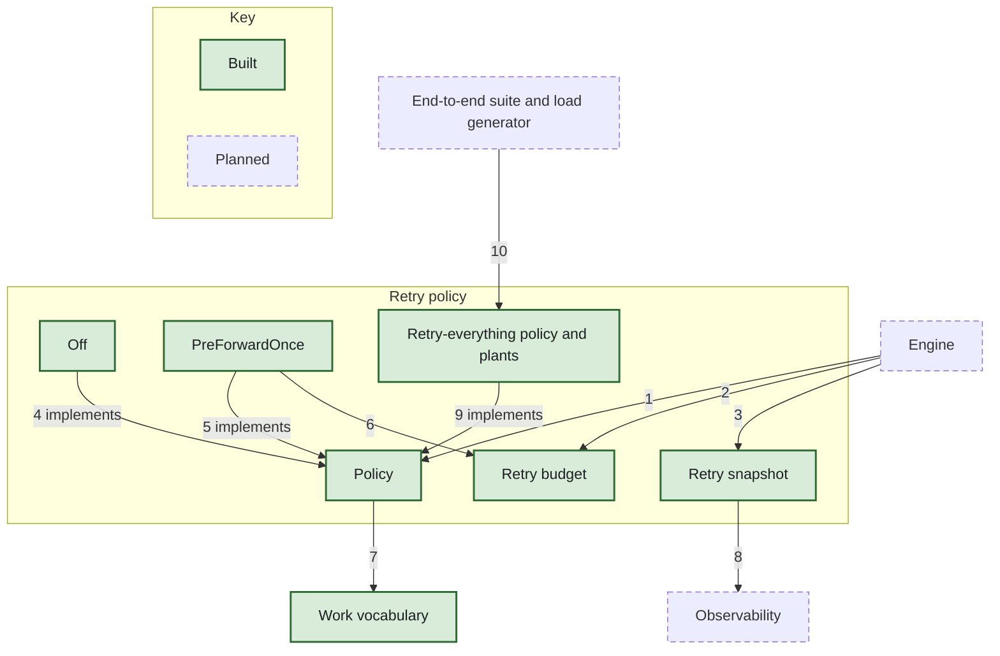

# C4 Level 3: Components: retry policy

**Built so far: chunks 0–9 and chunks 11 and 12 (chunk 10 has not landed yet). Dashed parts are planned.** In this diagram 7 of 10 elements and 10 of 10 relationships are built. Model: diagram `component-retry` in [model.json](model.json). Source of this page: [gen.py](gen.py).

The default policy is Off. A failure after anything reached the database, or inside a transaction, is never retried under either policy. Chunk 12 built all of it as one deterministic core: it does no I/O and keeps no clock, and the engine tells it of each first attempt and asks it about each failed statement. Where a granted retry waits, and what it holds while it waits, is the engine's part (the retry adapter on the engine diagram). The floor is divided by fleet.instances in the config; the cap is per instance.

A solid box or arrow is built; a dashed one is planned. An arrow points to the supplier. An arrow marked "implements" means the source implements the target's interface; every other arrow means "uses".

## Elements

| Element | Kind | Status | What it is |
| --- | --- | --- | --- |
| Policy | component | built (chunk 12) | The interface the engine calls: Attempt for each first attempt it forwards, Decide for each failed statement, Snapshot. A failure carries the facts a decision reads: did anything reach the database, is the request inside a transaction, which attempt this was, is the breaker open, is the instance draining, and the request's deadline. The answer is retry, or one refusal reason. |
| Off | component | built (chunk 12) | The default. Never retries: every failure offered is refused with the reason off. It still counts first attempts and offers. |
| PreForwardOnce | component | built (chunk 12) | Grants a retry only when all of these hold, checked in this order: the request has not been retried before, it is outside a transaction, nothing of it reached the database, the breaker is not open, the instance is not draining, the time is before the request's deadline (at the deadline is late), and the budget holds a whole token. Each refusal is counted under the first reason that applies. |
| Retry budget | component | built (chunk 12) | An integer bucket counted in tenths of a token. It starts at the floor (from the config file: retry.floor, 10 tokens by default, divided by fleet.instances). Each first attempt deposits one tenth; a retry withdraws ten, and only when ten are held. Deposits above the cap (retry.bucket_cap, 100 tokens per instance by default) are lost and counted as expired; stored credit does not expire with time. So from the start of a run ten times the retries is at most the first attempts plus the floor, and the largest burst of retries after a quiet period is the cap. |
| Retry snapshot | component | built (chunk 12) | Snapshot(): the policy in force, first attempts, failures offered, retries granted, refusals by reason (a refusal for budget is an exhaustion), the budget's level with its peak, its cap and floor, and the tenths deposited, withdrawn and expired. Its check holds the conservation laws (offered = retries + refusals; deposits = withdrawals + expired + level), the level within the cap, and the budget bound. |
| Retry-everything policy and plants | component, test code | built (chunk 12) | internal/retry/retrytest. A deliberately wrong policy for the ablation runs: it retries every failure, up to three times, whatever reached the database. The binary does not link it. Beside it the core has test-only plant bits (ignore the reached fact, no once bound, no withdrawal, no cap, ignore the breaker, withdraw first) that the config file can never set. |
| Engine | neighbouring container | planned | internal/proxy. One single-threaded, sans-I/O state machine per instance: events in, actions out. Holds the client and database connection tables and the request pipeline with its stage seams. The simulator and the shell drive this same code; its test package proxysim is the simulator's driver. **So far:** Built in chunk 6 (internal/proxy, internal/proxy/proxysim): every component drawn here except one part — the drain sequence (chunk 13). Chunk 7 put the pool core behind the pool, breaker and release seams (corepool.go) and chunk 8 the admission queues behind the queue seam (admission.go). Chunk 9 installed the fair dispatcher on those queues and reports every lease start and end to it (fairness.go). Chunk 12 put the retry policy behind the retry seam (retry.go); a granted retry re-enters at the queue stage. Chunk 11 put the flight table behind the coalescer seam (coalesce.go): the coalesce stage, the stored reply written to every waiter, and the join with chunks 9 and 12 (a flight is charged to the tenant its owner was queued under; a flight lost with nothing reached is retried once for the whole flight; a held flight promoted while the breaker is open is refused). The one stage whose core is not built yet runs its stand-in: a rate gate that always allows (chunk 10). |
| Work vocabulary | neighbouring container | built (chunk 5) | internal/work. Small plain types the cores are written against: tenant, unit of work with its class, reject reason and sharing flags, share key and its scope, outcome, refusal. Carries no Postgres type and imports only the standard library. This is the extension seam for a second protocol. |
| Observability | neighbouring container | planned | internal/obs and its sub-packages; test/analysis; scripts/csv-assert.sh; scripts/report.sh; scripts/admission-head-to-head.sh. Snapshot conventions (the one raw export), integer histogram, metric registry, collector, the adapter interface and its adapters (Prometheus text, JSON, CSV flush, log line, OTLP push), fleet merge, health, the SQL assertions over flushed files, and the story report and the admission head-to-head table over the same files. **So far:** Built in chunks 1, 3, 4, 5, 6, 7, 8, 9, 11 and 12: everything except the OTLP push adapter (chunk 15) and the health rules for the limit's floor and draining. Since chunk 6 the shell creates a collector in the real process, with the engine, wire and classifier sources, and serves the outputs over HTTP. The binary attaches the JSON, Prometheus and CSV adapters; the log-line adapter is attached only by the scenario flush harness. Chunk 6a: the story report, and the load generator's metrics in the catalog. Chunk 7: the pool source with the health rule for the breaker. Chunk 8: the admission source with the health rule for shedding, and the head-to-head table. Chunk 9: the fairness metrics in the admission source, totals and per tenant, with no new health rule. Chunk 12: the retry source and the engine's retry metrics, with no new health rule. Chunk 11: the coalescer source, the engine's coalesce metrics, and the health rule coalescer, which is always ok. |
| End-to-end suite and load generator | neighbouring container | planned | test/e2e; cmd/loadgen with internal/loadgen. Each scenario is written once and runs on the simulator (tier S) and on the real binary against a real Postgres (tier R), with the CSV flush on and SQL assertions over the files. Holds the engine's operation fuzz target and the canaries. The load generator is open-loop at a constant rate: every request has an intended send time that depends only on the rate, the duration and the seed, and it never waits for a reply before the next send. Operations, keys and payloads are drawn from the printed seed; two profiles, simple and errors. Latency is measured from the intended send time. Late and could-not-send requests are counted, and a SHORTFALL line with exit status 3 says when the achieved rate is below the target. Its own snapshot goes through a collector and the CSV flush. **So far:** Built in chunk 6 (test/e2e): the scenario harness — a scenario is written once as a Spec and runs in both tiers; 21 tier S scenarios, 14 tier R tests, the canaries and ablations, the operation fuzz target FuzzEngineOps, and make chaos (scripts/chaos.sh). Built in chunk 6a: the load generator (cmd/loadgen, internal/loadgen), all of what is said of it here; the seeded mgctl model test in both tiers; and a tier R test of the run targets. Built in chunk 8: the admission world with the head-to-head scenarios (four arms, three loads), anti-bufferbloat with recovery for both rules, the first burst after idle, two canaries, and a tier R overload test. Built in chunk 7: the pool scenarios (22, among them the hard cap under 1,000 clients, the reconnection storm, the database restart, silent mass death, cancel, and session state under each release policy); a relay that injects the path faults; their canaries and ablations; and five tier R pool tests. Built in chunk 9: the fairness scenarios — a noisy neighbour at 10× capacity beside a quiet tenant, 41 tenants with one flooder, a tenant holding transactions open, their canaries, and a tier R noisy-neighbour test. Built in chunk 12: the retry scenarios — the retry storm and a sweep with kills at every point of the conversation, each with the policy off, on, and the test-only retry-everything policy (the ablation: it applies writes twice); the storm with two tenants of unequal weight; and a tier R retry-storm test. Built in chunk 11: the coalescer scenarios (27, each with a replay and an ablation arm that must fail) — the hot key with 1,000 identical reads in both join modes, writes never shared, cancel 99 of 100, all cancel or vanish, read-your-own-write, the caps, a shared error, hinted mode, and the hot key under unequal tenant weights and with a retried flight; and six tier R coalescer tests (30 tier R tests in all). Not built: make bench (scripts/bench.sh answers "not built yet"; chunk 14). |

## Relationships

| # | From | To | Status | What | How |
| --- | --- | --- | --- | --- | --- |
| 1 | Engine | Policy | built | Offers each failed statement with its facts: may it be retried | Go |
| 2 | Engine | Retry budget | built | Reports each first attempt it forwards, which deposits a tenth of a token | Go |
| 3 | Engine | Retry snapshot | built | Snapshot() | Go |
| 4 | Off | Policy | built | Implements | Go, interface implementation |
| 5 | PreForwardOnce | Policy | built | Implements | Go, interface implementation |
| 6 | PreForwardOnce | Retry budget | built | Withdraws one token per retry; refuses when less than one is held | Go |
| 7 | Policy | Work vocabulary | built | The reached-the-database fact of a failure is the work vocabulary's three-valued type | Go types |
| 8 | Retry snapshot | Observability | built | Uses the gauge and the conservation check; the retry source mapping reads the snapshot | Go, plain structs |
| 9 | Retry-everything policy and plants | Policy | built | Implements | Go, test code, interface implementation |
| 10 | End-to-end suite and load generator | Retry-everything policy and plants | built | The ablation arm of each retry scenario runs the engine with it; the canaries set the plant bits | Go test |
