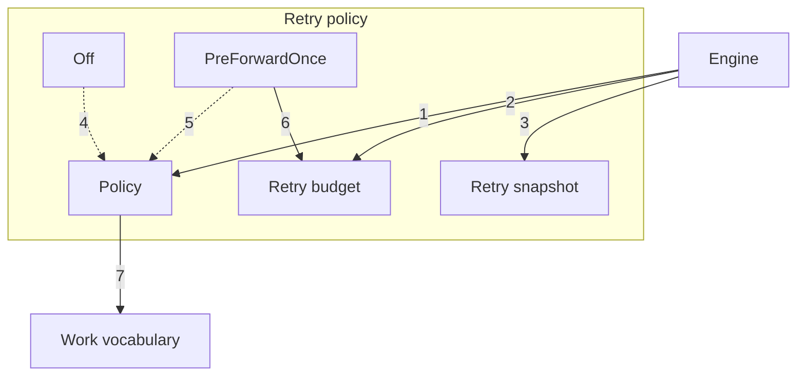

# C4 Level 3: Components: retry policy

**Target architecture (planned). Nothing in this diagram is built yet.** Model: diagram `component-retry` in [model.json](model.json). Source of this page: [gen.py](gen.py).

The default policy is Off. Failures after anything reached the database are never retried under any policy.

A dashed arrow means "implements"; a solid arrow means "uses" and points to the supplier.

## Elements

| Element | Kind | What it is |
| --- | --- | --- |
| Policy | component | The interface the engine asks: given this failure — did anything reach the database, is the breaker open, how much of the deadline is left — may it be retried. |
| Off | component | The default. Never retries. |
| PreForwardOnce | component | Retries at most once, only when nothing reached the database, only within budget, never while the breaker is open, never holding a queue slot or a connection while it waits. |
| Retry budget | component | An integer bucket: each first attempt deposits a tenth of a token, each retry takes one; capped, so credit expires. Retries stay at or below 10% of requests. |
| Retry snapshot | component | Snapshot(): attempts, retries, budget level, deposits, withdrawals, exhaustions, refusals by reason. |
| Engine | neighbouring container | internal/proxy. One single-threaded, sans-I/O state machine per instance: events in, actions out. Holds the client and database connection tables and the request pipeline with its stage seams. The simulator and the shell drive this same code. |
| Work vocabulary | neighbouring container | internal/work. Small plain types the cores are written against: tenant, unit of work and its class, share key, batchable flag, outcome. Carries no Postgres type. This is the extension seam for a second protocol. |

## Relationships

| # | From | To | What | How |
| --- | --- | --- | --- | --- |
| 1 | Engine | Policy | May this failure be retried | Go |
| 2 | Engine | Retry budget | Deposit on each first attempt | Go |
| 3 | Engine | Retry snapshot | Snapshot() | Go |
| 4 | Off | Policy | Implements | Go, interface implementation |
| 5 | PreForwardOnce | Policy | Implements | Go, interface implementation |
| 6 | PreForwardOnce | Retry budget | Withdraw one token per retry | Go |
| 7 | Policy | Work vocabulary | Reads the outcome's reached-the-database fact | Go types |
