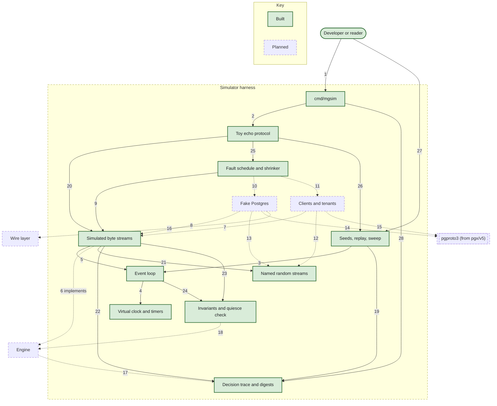

# C4 Level 3: Components: simulator harness

**Built so far: chunks 0–1. Dashed parts are planned.** In this diagram 11 of 16 elements and 16 of 28 relationships are built. Model: diagram `component-simulator` in [model.json](model.json). Source of this page: [gen.py](gen.py).

The harness owns the world around the engine. It implements the engine's transport seam, so the engine under test is the engine that ships. Several engines can run on one loop, which is how the three-instance scenarios are made. The kernel came first (chunk 1) and is proved on a toy echo protocol, because no engine and no fake Postgres exist yet.

A solid box or arrow is built; a dashed one is planned. An arrow points to the supplier. An arrow marked "implements" means the source implements the target's interface; every other arrow means "uses".

## Elements

| Element | Kind | Status | What it is |
| --- | --- | --- | --- |
| Event loop | component | built (chunk 1) | internal/sim. One thread, one heap ordered by (time, sequence). An event is a closure, or an opaque handler with an integer code. Step, run until a time, run until quiet. A step budget, typed stall errors (budget spent, time frozen, heap full) and a panic guard, each carrying the REPLAY line. |
| Virtual clock and timers | component | built (chunk 1) | internal/sim. 64-bit nanoseconds that saturate instead of overflowing. Cancellable timers: a cancel removes the event from the heap. A timer marked background does not count in the quiesce check. Time moves only when the loop moves it. |
| Named random streams | component | built (chunk 1) | internal/sim. One generator per (seed, label), so a new draw in one place does not shift any other. |
| Simulated byte streams | component | built (chunk 1) | internal/sim/simnet. Listeners and ordered byte connections with chosen fragmentation (down to one byte), latency per direction, a bounded send window (back pressure), half-close and reset. Its faults: reset, stall, half-open, half-close, chunk, refuse, dial stall, accept-then-silence, and clear. Its own snapshot. |
| Fake Postgres | component | planned | internal/sim/fakepg. Speaks the simple-query subset in real wire bytes; connection limit; transaction status; a small keyed table with a write log; service-time models; every database-side fault; its own snapshot. |
| Clients and tenants | component | planned | internal/sim/workload. Simulated clients: tenants, open-loop arrivals measured from intended send time, Zipf keys, transactions, disconnects, cancels, aggressive retries. |
| Fault schedule and shrinker | component | built (chunk 1) | internal/sim. Timed faults, each recorded in the trace when it is applied. A package registers the fault kinds it can apply. A schedule can be decoded from bytes for the fuzzer, and a delete-one-fault shrinker cuts a failing schedule down. Faults are injected only from outside the code under test. |
| Decision trace and digests | component | built (chunk 1) | internal/sim. Any actor appends a record (time, kind, four integers) in order; the last records are kept in a ring for failure reports. Two digests: one of the trace, one of final state as written by registered state writers. Same seed, same digests. |
| Invariants and quiesce check | component | built (chunk 1) | internal/sim. A package registers its checks. Invariants run after every event (or every Nth); the quiesce checks run at the end of a run: nothing in use, nothing in flight, no timer left. A failed check fails the run. |
| Seeds, replay, sweep | component | built (chunk 1) | internal/sim/simtest. The seed flag and variables, pinned seeds, the sweep over seeds, the run-twice check, the failure report with the trace tail and the REPLAY line. scripts/sweep.sh and scripts/fuzz.sh run the scenario tests and fuzz targets through it. |
| cmd/mgsim | component | built (chunk 1) | Lists the named scenarios; runs one from a seed outside go test, prints its digests (and the trace on request) and exits 1 with the REPLAY line when it fails. |
| Toy echo protocol | component | built (chunk 1) | internal/sim/simtoy. A line-echo client and server with a planted-bug switch, and eleven named scenarios that cover every network fault. Used only to test the harness itself. |
| Developer or reader | person | built (chunk 1) | Runs simulator scenarios from a seed, replays a failure from its printed REPLAY line, runs make test / chaos / bench. |
| Engine | neighbouring container | planned | internal/proxy. One single-threaded, sans-I/O state machine per instance: events in, actions out. Holds the client and database connection tables and the request pipeline with its stage seams. The simulator and the shell drive this same code. |
| Wire layer | neighbouring container | planned | internal/pgwire. Everything that knows Postgres: framing, both session state machines, the query-cycle tracker, the statement classifier, the error contract. The only product package that imports pgproto3. |
| pgproto3 (from pgx/v5) | softwareSystem, external | planned | Go package github.com/jackc/pgx/v5/pgproto3: Postgres wire message structs with Encode and Decode. The one external dependency, used for message encoding only. |

## Relationships

| # | From | To | Status | What | How |
| --- | --- | --- | --- | --- | --- |
| 1 | Developer or reader | cmd/mgsim | built | Runs a scenario with a seed | Command line |
| 2 | cmd/mgsim | Toy echo protocol | built | Looks up a scenario by name and runs it; the toy scenarios are the only ones so far | Go |
| 3 | Seeds, replay, sweep | Event loop | built | Runs a scenario twice from one seed | Go |
| 4 | Event loop | Virtual clock and timers | built | Advances time to the next event | Go |
| 5 | Simulated byte streams | Event loop | built | Schedules every delivery and notification as its own event | Go |
| 6 | Simulated byte streams | Engine | planned | Implements the engine's transport seam: bytes in, bytes out, opened, closed | Go, interface implementation |
| 7 | Clients and tenants | Simulated byte streams | planned | Opens client connections; sends and reads | Go |
| 8 | Fake Postgres | Simulated byte streams | planned | Accepts database connections; replies | Go |
| 9 | Fault schedule and shrinker | Simulated byte streams | built | Applies the network faults at their instants | Go |
| 10 | Fault schedule and shrinker | Fake Postgres | planned | Slow, kill, freeze, refuse, garbage | Go |
| 11 | Fault schedule and shrinker | Clients and tenants | planned | Disconnect, stop reading, retry storm | Go |
| 12 | Clients and tenants | Named random streams | planned | Arrivals, keys, tenants | Go |
| 13 | Fake Postgres | Named random streams | planned | Service times | Go |
| 14 | Fake Postgres | pgproto3 (from pgx/v5) | planned | Wire messages | Go import |
| 15 | Clients and tenants | pgproto3 (from pgx/v5) | planned | Wire messages | Go import |
| 16 | Fake Postgres | Wire layer | planned | Reuses the SCRAM functions | Go |
| 17 | Engine | Decision trace and digests | planned | Appends each decision | Go |
| 18 | Invariants and quiesce check | Engine | planned | Reads snapshots at every event and at the end | Go |
| 19 | Seeds, replay, sweep | Decision trace and digests | built | Compares the digests of the two runs; prints the trace tail on failure | Go |
| 20 | Toy echo protocol | Simulated byte streams | built | Echo over simulated streams, for the meta-tests | Go |
| 21 | Simulated byte streams | Named random streams | built | Latency and fragment sizes, one stream per connection and direction | Go |
| 22 | Simulated byte streams | Decision trace and digests | built | Appends dials, writes, deliveries, resets and closes; writes its state for the state digest | Go |
| 23 | Simulated byte streams | Invariants and quiesce check | built | Registers byte conservation and its quiesce check | Go |
| 24 | Event loop | Invariants and quiesce check | built | Runs the registered checks after every event | Go |
| 25 | Toy echo protocol | Fault schedule and shrinker | built | Scenario fault schedules; schedules decoded from fuzz input; shrinks a failing one | Go |
| 26 | Toy echo protocol | Seeds, replay, sweep | built | Its scenario tests sweep seeds and run every seed twice | Go test |
| 27 | Developer or reader | Seeds, replay, sweep | built | Runs seed sweeps and fuzz targets | scripts/sweep.sh, scripts/fuzz.sh, go test |
| 28 | cmd/mgsim | Decision trace and digests | built | Prints the digests and, on request, every trace record | Go |
