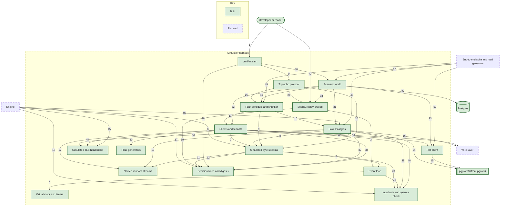

# C4 Level 3: Components: simulator harness

**Built so far: chunks 0–6. Dashed parts are planned.** In this diagram 19 of 22 elements and 50 of 50 relationships are built. Model: diagram `component-simulator` in [model.json](model.json). Source of this page: [gen.py](gen.py).

The harness owns the world around the engine. The engine's own test package, proxysim, implements the engine's transport seam on the simulated streams, so the engine under test is the engine that ships. Several engines can run on one loop, which is how the three-instance scenarios will be made. The kernel came first (chunk 1) and is proved on a toy echo protocol. Chunk 2 added the world the proxy stands in: the fake Postgres, the simulated clients and scenarios that run the clients straight at the fake. Chunk 4 added SCRAM login and the TLS request, answer and simulated handshake to the fake and the clients. Chunk 6 put the engine between the clients and the fake; the simulator packages themselves did not change, and the direct baselines are the control arms.

A solid box or arrow is built; a dashed one is planned. An arrow points to the supplier.

## Elements

| Element | Kind | Status | What it is |
| --- | --- | --- | --- |
| Event loop | component | built (chunk 1) | internal/sim. One thread, one heap ordered by (time, sequence). An event is a closure, or an opaque handler with an integer code. Step, run until a time, run until quiet. A step budget, typed stall errors (budget spent, time frozen, heap full) and a panic guard, each carrying the REPLAY line. |
| Virtual clock and timers | component | built (chunk 1) | internal/sim. 64-bit nanoseconds that saturate instead of overflowing. Cancellable timers: a cancel removes the event from the heap. A timer marked background does not count in the quiesce check. Time moves only when the loop moves it. |
| Named random streams | component | built (chunk 1) | internal/sim. One generator per (seed, label), so a new draw in one place does not shift any other. |
| Simulated byte streams | component | built (chunk 1) | internal/sim/simnet. Listeners and ordered byte connections with chosen fragmentation (down to one byte), latency per direction, a bounded send window (back pressure), half-close and reset. Its faults: reset, stall, half-open, half-close, chunk, refuse, dial stall, accept-then-silence, and clear. Its own snapshot. |
| Fake Postgres | component | built (chunk 4) | internal/sim/fakepg. Speaks the simple-query subset in real wire bytes with its own framer; login by trust or SCRAM-SHA-256; answers a TLS request S or N and plays the simulated handshake; a max_connections limit with Postgres's refusal; transaction status; a small keyed table with write, statement and transaction logs; service-time models and a capacity limit; cancel requests; every database-side fault (the TLS ones — answers N, a handshake that fails or stalls, a certificate that fails verification — are a setting that can change during a run, not fault kinds); its own snapshots. |
| Clients and tenants | component | built (chunk 4) | internal/sim/workload. Simulated clients grouped in tenants: open-loop arrivals (constant or Poisson) and closed-loop think time, latency measured from the intended send time, uniform, Zipf or fixed keys, transactions of several statements, retries with backoff; login by trust or SCRAM-SHA-256, with a TLS request first when the tenant asks; every client-side fault (the four TLS ones — stall after the request, bad hello, plaintext after the request, a second request — are a per-tenant setting); its own snapshot. A client sends one request at a time; later arrivals wait in its bounded backlog. Also a hand-driven client (Probe) for tests. |
| Test client | component | built (chunk 4) | internal/testclient. A Postgres client with no I/O: bytes in, messages out. Its own framer, a message codec, and a session machine (phase, status byte, key data, parameters) with trust login. It hands the data of each authentication message to its caller, which is how the simulated clients run SCRAM. Used by the simulated clients on simulated streams and by the tier R tests on TCP. |
| Simulated TLS handshake | component | built (chunk 4) | internal/sim/simtls. A handshake as an exchange with an outcome, not cryptography: a 16-byte client hello (or a bad one) and a 16-byte server reply that says completed with a TLS version, bad certificate, or alert. Models the outcome and the duration only. |
| Float generators | component | built (chunk 2) | internal/randdist. The only two functions that use floating point: exponential gaps for Poisson arrivals, and a Zipf generator. Kept outside internal/sim, where float syntax is forbidden. |
| Scenario world | component | built (chunk 2) | internal/sim/world. The scenario type; the driver interface (start, connect, inject, run, observe, stop) and its simulator implementation; five direct baselines with no proxy (500 connections, reconnect burst, 1,000 identical reads, open-loop overload, mixed transactions); the write-log and transaction checks; the fidelity runner, which plays one script against the fake and compares the transcript with Postgres 17's, recorded for CI or live in tier R. |
| Fault schedule and shrinker | component | built (chunk 1) | internal/sim. Timed faults, each recorded in the trace when it is applied. A package registers the fault kinds it can apply. A schedule can be decoded from bytes for the fuzzer, and a delete-one-fault shrinker cuts a failing schedule down. Faults are injected only from outside the code under test. |
| Decision trace and digests | component | built (chunk 1) | internal/sim. Any actor appends a record (time, kind, four integers) in order; the last records are kept in a ring for failure reports. Two digests: one of the trace, one of final state as written by registered state writers. Same seed, same digests. |
| Invariants and quiesce check | component | built (chunk 1) | internal/sim. A package registers its checks. Invariants run after every event (or every Nth); the quiesce checks run at the end of a run: nothing in use, nothing in flight, no timer left. A failed check fails the run. |
| Seeds, replay, sweep | component | built (chunk 1) | internal/sim/simtest. The seed flag and variables, pinned seeds, the sweep over seeds, the run-twice check, the failure report with the trace tail and the REPLAY line. scripts/sweep.sh and scripts/fuzz.sh run the scenario tests and fuzz targets through it. |
| cmd/mgsim | component | built (chunk 1) | Lists the named scenarios (toy and world); runs one from a seed outside go test, prints its digests (and the trace on request; for a world scenario also its result table) and exits 1 with the REPLAY line when it fails. |
| Toy echo protocol | component | built (chunk 1) | internal/sim/simtoy. A line-echo client and server with a planted-bug switch, and eleven named scenarios that cover every network fault. Used only to test the harness itself. |
| Developer or reader | person | built (chunk 1) | Runs simulator scenarios from a seed, replays a failure from its printed REPLAY line, runs make test / chaos / bench. |
| Engine | neighbouring container | planned | internal/proxy. One single-threaded, sans-I/O state machine per instance: events in, actions out. Holds the client and database connection tables and the request pipeline with its stage seams. The simulator and the shell drive this same code; its test package proxysim is the simulator's driver. **So far:** Built in chunk 6 (internal/proxy, internal/proxy/proxysim): every component drawn here except two parts — the fan-out of a shared reply to its waiters (chunk 11) and the drain sequence (chunk 13). The stages that belong to cores not built yet run their stand-ins: a breaker that is always closed, a rate gate that always allows, no coalescing, one bounded first-come queue, a fixed set of connections, retry off. |
| End-to-end suite and load generator | neighbouring container | planned | test/e2e and cmd/loadgen. Each scenario is written once and runs on the simulator (tier S) and on the real binary against a real Postgres (tier R), with the CSV flush on and SQL assertions over the files. Holds the engine's operation fuzz target and the canaries. The load generator is open-loop. **So far:** Built in chunk 6 (test/e2e): the scenario harness — a scenario is written once as a Spec and runs in tier S and tier R; 21 tier S scenarios, 14 tier R tests, the canaries and ablations, the operation fuzz target FuzzEngineOps, and make chaos (scripts/chaos.sh). Not built: cmd/loadgen, the open-loop load generator (chunk 6a), and make bench. |
| Wire layer | neighbouring container | planned | internal/pgwire. Everything that knows Postgres: framing, both session state machines, the query-cycle tracker, the SQL lexer, the statement classifier with its courtesy reject list, the safe-shape recogniser that decides sharing, the error contract, the wire snapshot. The only product package allowed to import pgproto3. Its test packages pgwiretest, wireworld and clsworld run this code in the simulator. **So far:** Built in chunks 4 and 5 (internal/pgwire): every component drawn here except the codec boundary. Chunk 4: the framer, the hand-written message coding, both session machines, the SCRAM-SHA-256 functions, the two trackers, the startup FATAL replies, the wire snapshot, and the test packages pgwiretest and wireworld. Chunk 5: the SQL lexer, the reject list, the statement classifier, the safe-shape recogniser, the error table with its reply builders, and the test package clsworld. Chunk 6: the engine drives this code, and the client session machine takes every FATAL from the error table (three startup rows added). Not built: the codec boundary (no file in the package imports pgproto3; the reply builders code their messages by hand). Nothing produces outcomes yet. |
| pgproto3 (from pgx/v5) | softwareSystem, external | built (chunk 2) | Go package github.com/jackc/pgx/v5/pgproto3: Postgres wire message structs with Encode and Decode. The one external dependency, used for message encoding only. |
| Postgres | softwareSystem, external | built (chunk 6) | One ordinary Postgres server. Sees at most the fleet's connection budget, all logged in as one role. |

## Relationships

| # | From | To | Status | What | How |
| --- | --- | --- | --- | --- | --- |
| 1 | Developer or reader | cmd/mgsim | built | Runs a scenario with a seed | Command line |
| 2 | cmd/mgsim | Toy echo protocol | built | Looks up a toy scenario by name and runs it | Go |
| 3 | Seeds, replay, sweep | Event loop | built | Runs a scenario twice from one seed | Go |
| 4 | Event loop | Virtual clock and timers | built | Advances time to the next event | Go |
| 5 | Simulated byte streams | Event loop | built | Schedules every delivery and notification as its own event | Go |
| 6 | Engine | Simulated byte streams | built | The engine's simulator driver (proxysim) implements the transport seam on these streams: listens, dials, reads, writes, closes | Go, test code |
| 7 | Clients and tenants | Simulated byte streams | built | Opens client connections; sends and reads | Go |
| 8 | Fake Postgres | Simulated byte streams | built | Accepts database connections; replies | Go |
| 9 | Fault schedule and shrinker | Simulated byte streams | built | Applies the network faults at their instants | Go |
| 10 | Fault schedule and shrinker | Fake Postgres | built | Applies the database fault kinds the fake registered: refuse, silence, slow, reset, garbage, kill, freeze, restart and more | Go |
| 11 | Fault schedule and shrinker | Clients and tenants | built | Applies the client fault kinds the workload registered: half a message, stop reading, disconnect, reconnect burst, cancel | Go |
| 12 | Clients and tenants | Named random streams | built | Arrivals, keys, request mix and retries, one stream each per client | Go |
| 13 | Fake Postgres | Named random streams | built | Service-time jitter, one stream per connection; cancel keys | Go |
| 14 | Fake Postgres | pgproto3 (from pgx/v5) | built | Wire messages | Go import |
| 15 | Test client | pgproto3 (from pgx/v5) | built | Wire messages | Go import |
| 16 | Fake Postgres | Wire layer | built | Reuses the SCRAM functions (server side) and the NegotiateProtocolVersion encoder | Go |
| 17 | Engine | Decision trace and digests | built | The engine's simulator driver appends a record for each connection it closes and writes the engine's counters for the state digest | Go, test code |
| 18 | Engine | Invariants and quiesce check | built | The engine's simulator driver registers the engine's invariants (snapshot conservation, one client per lent connection) and its quiesce check | Go, test code |
| 19 | Seeds, replay, sweep | Decision trace and digests | built | Compares the digests of the two runs; prints the trace tail on failure | Go |
| 20 | Toy echo protocol | Simulated byte streams | built | Echo over simulated streams, for the meta-tests | Go |
| 21 | Simulated byte streams | Named random streams | built | Latency and fragment sizes, one stream per connection and direction | Go |
| 22 | Simulated byte streams | Decision trace and digests | built | Appends dials, writes, deliveries, resets and closes; writes its state for the state digest | Go |
| 23 | Simulated byte streams | Invariants and quiesce check | built | Registers byte conservation and its quiesce check | Go |
| 24 | Event loop | Invariants and quiesce check | built | Runs the registered checks after every event | Go |
| 25 | Toy echo protocol | Fault schedule and shrinker | built | Scenario fault schedules; schedules decoded from fuzz input; shrinks a failing one | Go |
| 26 | Toy echo protocol | Seeds, replay, sweep | built | Its scenario tests sweep seeds and run every seed twice | Go test |
| 27 | Developer or reader | Seeds, replay, sweep | built | Runs seed sweeps and fuzz targets | scripts/sweep.sh, scripts/fuzz.sh, go test |
| 28 | cmd/mgsim | Decision trace and digests | built | Prints the digests and, on request, every trace record | Go |
| 29 | Clients and tenants | Test client | built | Every client frames, decodes and tracks its session with it | Go |
| 30 | Clients and tenants | Float generators | built | Poisson gaps and Zipf keys | Go |
| 31 | Scenario world | Fake Postgres | built | Starts the fake for a scenario; reads its snapshot and logs for the checks | Go |
| 32 | Scenario world | Clients and tenants | built | Starts the scenario's clients; reads their snapshot; the fidelity runner drives a Probe | Go |
| 33 | Scenario world | Test client | built | Turns the messages of a fidelity exchange into transcript tokens | Go |
| 34 | Scenario world | Seeds, replay, sweep | built | Its scenario tests run the pinned seeds and the sweep, every seed twice | Go test |
| 35 | Scenario world | Postgres | built | Tier R: plays the fidelity script and three baselines over TCP; on request rewrites the recorded transcript that CI replays | scripts/tier-r.sh, Docker, go test |
| 36 | cmd/mgsim | Scenario world | built | Looks up a world scenario by name, runs it and prints its result table | Go |
| 37 | Fake Postgres | Decision trace and digests | built | Appends accepts, statements, writes, cancels and fired faults; writes its state for the state digest | Go |
| 38 | Clients and tenants | Decision trace and digests | built | Appends arrivals, sends, completions and retries; writes its state for the state digest | Go |
| 39 | Fake Postgres | Invariants and quiesce check | built | Registers its conservation laws, the connection limit and its quiesce check | Go |
| 40 | Clients and tenants | Invariants and quiesce check | built | Registers request conservation per tenant and its quiesce check | Go |
| 41 | Scenario world | Fault schedule and shrinker | built | Scenario fault schedules; random schedules decoded from fuzz input | Go |
| 42 | Clients and tenants | Wire layer | built | Reuses the SCRAM functions (client side) | Go |
| 43 | Fake Postgres | Simulated TLS handshake | built | Reads the client hello; replies with the configured outcome | Go |
| 44 | Clients and tenants | Simulated TLS handshake | built | Sends the client hello, or a bad one; reads the reply | Go |
| 45 | Engine | Simulated TLS handshake | built | The engine's simulator driver plays the handshake on both legs: server for clients, client for the database | Go, test code |
| 46 | Engine | Fake Postgres | built | The simulator driver's World starts the fake as the engine's database | Go, test code |
| 47 | End-to-end suite and load generator | Scenario world | built | Implements the driver interface with the proxy between the clients and the fake, and runs a direct baseline through it | Go test |
| 48 | End-to-end suite and load generator | Fake Postgres | built | Tier S checks read the fake's statement and write logs: transaction integrity, session state, what ran after a fault | Go test |
| 49 | End-to-end suite and load generator | Fault schedule and shrinker | built | Scenario fault schedules; the operation fuzz target decodes its input into a timed operation list in the schedule's form | Go test |
| 50 | End-to-end suite and load generator | Test client | built | The scripted clients of both tiers frame, decode and track their session with it | Go test |
