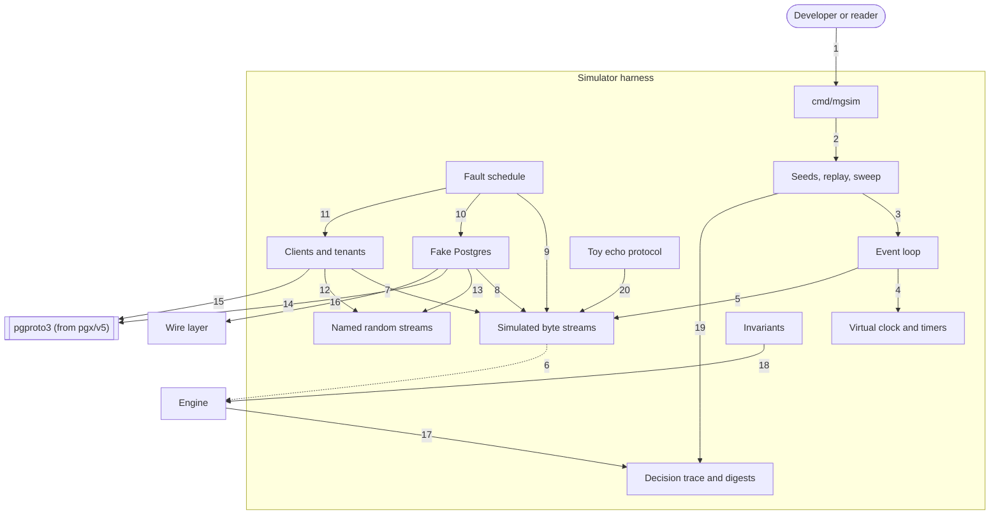

# C4 Level 3: Components: simulator harness

**Target architecture (planned). Nothing in this diagram is built yet.** Model: diagram `component-simulator` in [model.json](model.json). Source of this page: [gen.py](gen.py).

The harness owns the world around the engine. It implements the engine's transport seam, so the engine under test is the engine that ships. Several engines can run on one loop, which is how the three-instance scenarios are made.

A dashed arrow means "implements"; a solid arrow means "uses" and points to the supplier.

## Elements

| Element | Kind | What it is |
| --- | --- | --- |
| Event loop | component | One thread, one heap ordered by (time, sequence), opaque events. Step budget, stall errors, panic guard. |
| Virtual clock and timers | component | 64-bit nanoseconds, cancellable timers. Time moves only when the loop moves it. |
| Named random streams | component | One generator per (seed, label), so a new draw in one place does not shift any other. |
| Simulated byte streams | component | internal/sim/simnet. Ordered byte connections with chosen fragmentation (down to one byte), latency per direction, a bounded send window, half-close, reset, stall, half-open. |
| Fake Postgres | component | internal/sim/fakepg. Speaks the simple-query subset in real wire bytes; connection limit; transaction status; a small keyed table with a write log; service-time models; every database-side fault; its own snapshot. |
| Clients and tenants | component | internal/sim/workload. Simulated clients: tenants, open-loop arrivals measured from intended send time, Zipf keys, transactions, disconnects, cancels, aggressive retries. |
| Fault schedule | component | Timed faults recorded in the trace; decodable from bytes for the fuzzer; a delete-one-fault shrinker. Faults are injected only from outside the proxy code. |
| Decision trace and digests | component | Every decision (accepted, coalesced, shed, timed out) appended in order; separate digests for the trace and for final state. Same seed, same digests. |
| Invariants | component | Checked at every event: connection cap, conservation of requests. Checked at the end: quiesce (nothing in use, nothing queued, no flight, no timer). |
| Seeds, replay, sweep | component | internal/sim/simtest. Seed flags and pinned seeds, the run-twice check, sweeps, the REPLAY line printed on every failure. |
| cmd/mgsim | component | Runs a named scenario from a seed outside go test and prints the digests. |
| Toy echo protocol | component | A tiny protocol with a planted-bug switch, used only to test the harness itself. |
| Developer or reader | person | Runs simulator scenarios from a seed, replays a failure from its printed REPLAY line, runs make test / chaos / bench. |
| Engine | neighbouring container | internal/proxy. One single-threaded, sans-I/O state machine per instance: events in, actions out. Holds the client and database connection tables and the request pipeline with its stage seams. The simulator and the shell drive this same code. |
| Wire layer | neighbouring container | internal/pgwire. Everything that knows Postgres: framing, both session state machines, the query-cycle tracker, the statement classifier, the error contract. The only product package that imports pgproto3. |
| pgproto3 (from pgx/v5) | softwareSystem, external | Go package github.com/jackc/pgx/v5/pgproto3: Postgres wire message structs with Encode and Decode. The one external dependency, used for message encoding only. |

## Relationships

| # | From | To | What | How |
| --- | --- | --- | --- | --- |
| 1 | Developer or reader | cmd/mgsim | Runs a scenario with a seed | Command line |
| 2 | cmd/mgsim | Seeds, replay, sweep | Run, verify, report | Go |
| 3 | Seeds, replay, sweep | Event loop | Runs the scenario twice and compares digests | Go |
| 4 | Event loop | Virtual clock and timers | Advances time to the next event | Go |
| 5 | Event loop | Simulated byte streams | Delivers byte and connection events | Go |
| 6 | Simulated byte streams | Engine | Implements the engine's transport seam: bytes in, bytes out, opened, closed | Go, interface implementation |
| 7 | Clients and tenants | Simulated byte streams | Opens client connections; sends and reads | Go |
| 8 | Fake Postgres | Simulated byte streams | Accepts database connections; replies | Go |
| 9 | Fault schedule | Simulated byte streams | Stall, reset, fragment, half-open | Go |
| 10 | Fault schedule | Fake Postgres | Slow, kill, freeze, refuse, garbage | Go |
| 11 | Fault schedule | Clients and tenants | Disconnect, stop reading, retry storm | Go |
| 12 | Clients and tenants | Named random streams | Arrivals, keys, tenants | Go |
| 13 | Fake Postgres | Named random streams | Service times | Go |
| 14 | Fake Postgres | pgproto3 (from pgx/v5) | Wire messages | Go import |
| 15 | Clients and tenants | pgproto3 (from pgx/v5) | Wire messages | Go import |
| 16 | Fake Postgres | Wire layer | Reuses the SCRAM functions | Go |
| 17 | Engine | Decision trace and digests | Appends each decision | Go |
| 18 | Invariants | Engine | Reads snapshots at every event and at the end | Go |
| 19 | Seeds, replay, sweep | Decision trace and digests | Compares digests across runs | Go |
| 20 | Toy echo protocol | Simulated byte streams | Echo over simulated streams, for the meta-tests | Go |
