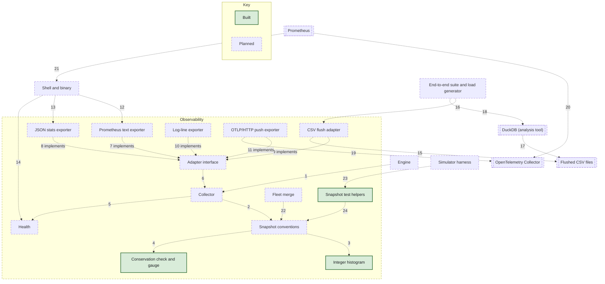

# C4 Level 3: Components: observability

**Built so far: chunks 0–2. Dashed parts are planned.** In this diagram 3 of 21 elements and 0 of 24 relationships are built. Model: diagram `component-observability` in [model.json](model.json). Source of this page: [gen.py](gen.py).

The hard rule: one common raw export, then the collector interface, then adapters. Components fill plain structs; the collector assembles them; every output form is an adapter that reads only what the collector publishes. No component knows about CSV, DuckDB, OTel or Prometheus, and adding an adapter touches no component. Two paths leave the process. The testing path: the CSV flush adapter writes files, and tests and DuckDB read them with nothing else running. The production path: the OTLP adapter pushes to an OpenTelemetry Collector, which Prometheus scrapes. DuckDB is an analysis tool over files, never a dependency of the proxy.

A solid box or arrow is built; a dashed one is planned. An arrow points to the supplier. An arrow marked "implements" means the source implements the target's interface; every other arrow means "uses".

## Elements

| Element | Kind | Status | What it is |
| --- | --- | --- | --- |
| Snapshot conventions | component | planned | The one common raw export. What every component's Snapshot() returns: a plain struct of monotonic counters and current gauges. No wall-clock time, no map order, no telemetry imports. Nothing else leaves a component. **So far:** Built in chunk 1: the Snapshotter interface, and the obstest check that a snapshot is a plain struct with no time and no map. Not built: the instance snapshot and the components that fill it (chunk 3 on). |
| Integer histogram | component | built (chunk 1) | Fixed array, fixed relative error, no allocation on record; record, merge, percentile. Out-of-range values are clamped and counted. |
| Conservation check and gauge | component | built (chunk 1) | A check that a total equals the sum of its parts (for example written = delivered + discarded + in flight); its error names each term and which side is higher. A gauge type that keeps a value and its peak. |
| Snapshot test helpers | component, test code | built (chunk 1) | internal/obs/obstest. Test plumbing: checks that a snapshot is a plain struct of integers (no time, no map), and that every counter in it moved in at least one test. |
| Collector | component | planned | Assembles one instance snapshot from the component snapshots, with instance id, build and config fingerprint. Keeps the last published copy; readers never wait on the engine. The only reader of component snapshots. |
| Adapter interface | component | planned | The one interface every output form implements: take the published instance snapshot, produce output. One conformance test for all adapters. Components cannot see past it, so none knows about CSV, DuckDB, OTel or Prometheus. |
| Fleet merge | component | planned | Merges instance snapshots: counters and gauges sum, histograms merge, ratios are recomputed, never averaged. |
| Health | component | planned | Three states: ok; degraded while shedding, while the breaker is open, at the limit's floor, or draining; failed only when this instance cannot work. A database outage is degraded. |
| Prometheus text exporter | component | planned | Low-cardinality labels and a bounded tenant label (configured tenants up to a cap, the rest as other). |
| JSON stats exporter | component | planned | The full snapshot, including every active tenant. |
| CSV flush adapter | component | planned | Flushes snapshots to disk at each publish and at the end of a run, in a stable versioned schema with unbounded per-tenant rows. The testing path: tests assert on the files with no Collector or Prometheus running. Bounded size; drop-and-count on a write error. |
| Log-line exporter | component | planned | One structured line per interval. |
| OTLP/HTTP push exporter | component | planned | The final adapter and the proxy's end of the production path. Hand-written on the standard library, no SDK. Cumulative sums, gauges, short-list histogram buckets, bounded tenant label. Bounded queue, timeout, drop-and-count when the Collector is down. Lands in the last build chunk and touches no component. |
| Engine | neighbouring container | planned | internal/proxy. One single-threaded, sans-I/O state machine per instance: events in, actions out. Holds the client and database connection tables and the request pipeline with its stage seams. The simulator and the shell drive this same code. |
| Shell and binary | neighbouring container | planned | cmd/mini-gateway and internal/shell. Listeners, one reader and one writer goroutine per connection, bounded mailboxes, a deadline on every socket operation, TLS on both legs with crypto/tls (it answers a client's TLS request, upgrades the socket and buffers nothing across the upgrade), the admin listener on its own port, signal handling. Makes no decisions: it posts events to the engine and performs the actions the engine returns. |
| End-to-end suite and load generator | neighbouring container | planned | test/e2e and cmd/loadgen. Each scenario is written once and runs on the simulator (tier S) and on the real binary against a real Postgres (tier R). The load generator is open-loop. |
| Simulator harness | neighbouring container | planned | internal/sim and its sub-packages simnet, fakepg, workload, world, simtest and simtoy; internal/testclient; internal/randdist; cmd/mgsim; scripts/tier-r.sh. A deterministic single-threaded world: virtual clock, simulated byte streams, a fake Postgres, simulated clients, scenarios with a driver interface, faults, replay. Its fake Postgres is checked against a real Postgres 17. Test code; built before any proxy code. **So far:** Built in chunks 1 and 2: the kernel (internal/sim), simnet, simtest, the toy protocol (simtoy), cmd/mgsim, the fake Postgres, the simulated clients, the test client, the scenario world with its five direct baselines (clients straight at the fake, no proxy) and the fidelity runner, and scripts/tier-r.sh. Not built: SCRAM login and the TLS faults in the fake and the clients (chunk 4). No engine exists yet, so the harness drives the fake Postgres and the toy protocol, and nothing implements the engine's transport seam. |
| Flushed CSV files | softwareSystem, external | planned | One directory per run on local disk: run.csv, metrics.csv, histograms.csv, schema version 1 (PLAN.md section 7.7). Same columns in every flush; every tenant has its own rows. Nothing has to be running to read them. |
| DuckDB (analysis tool) | softwareSystem, external | planned | The DuckDB command-line tool, run after a run by test and benchmark scripts and by hand. Reads the flushed files with read_csv and runs SQL assertions and report queries. Never imported, linked or started by the proxy. |
| OpenTelemetry Collector | softwareSystem, external | planned | Receives the proxy's OTLP/HTTP push, batches it and exposes the metrics on a Prometheus endpoint. Dev setup: docker-compose in deploy/obs-dev (chunk 15). |
| Prometheus | softwareSystem, external | planned | End of the production path. Scrapes the Collector; sees low-cardinality labels and the bounded tenant label only. Fleet totals are sums over the instance label. |

## Relationships

| # | From | To | Status | What | How |
| --- | --- | --- | --- | --- | --- |
| 1 | Engine | Collector | planned | Hands over every component's snapshot at each publish | Go, plain structs |
| 2 | Collector | Snapshot conventions | planned | Assembles the instance snapshot | Go |
| 3 | Snapshot conventions | Integer histogram | planned | Histograms inside snapshots | Go |
| 4 | Snapshot conventions | Conservation check and gauge | planned | Counters in a snapshot are checked for conservation; gauges keep their peak | Go |
| 5 | Collector | Health | planned | Derives the health state and its reasons | Go |
| 6 | Adapter interface | Collector | planned | Receives the last published snapshot; all an adapter can read | Go |
| 7 | Prometheus text exporter | Adapter interface | planned | Implements the adapter interface | Go, interface implementation |
| 8 | JSON stats exporter | Adapter interface | planned | Implements the adapter interface | Go, interface implementation |
| 9 | CSV flush adapter | Adapter interface | planned | Implements the adapter interface | Go, interface implementation |
| 10 | Log-line exporter | Adapter interface | planned | Implements the adapter interface | Go, interface implementation |
| 11 | OTLP/HTTP push exporter | Adapter interface | planned | Implements the adapter interface | Go, interface implementation |
| 12 | Shell and binary | Prometheus text exporter | planned | Admin listener serves /metrics | HTTP |
| 13 | Shell and binary | JSON stats exporter | planned | Admin listener serves /stats | HTTP |
| 14 | Shell and binary | Health | planned | Admin listener serves /health | HTTP |
| 15 | CSV flush adapter | Flushed CSV files | planned | Flushes rows at each publish and at the end of a run | Files, schema version 1 |
| 16 | End-to-end suite and load generator | CSV flush adapter | planned | Turns the flush on for every run; checks the final flush equals the snapshot | Go test |
| 17 | DuckDB (analysis tool) | Flushed CSV files | planned | Reads the files directly | read_csv, SQL |
| 18 | End-to-end suite and load generator | DuckDB (analysis tool) | planned | Runs SQL assertions and report queries after a run | scripts/csv-assert.sh |
| 19 | OTLP/HTTP push exporter | OpenTelemetry Collector | planned | Pushes metrics every interval | OTLP/HTTP JSON |
| 20 | Prometheus | OpenTelemetry Collector | planned | Scrapes the Collector's Prometheus endpoint | HTTP |
| 21 | Prometheus | Shell and binary | planned | Can scrape /metrics directly instead (no Collector) | HTTP admin port |
| 22 | Fleet merge | Snapshot conventions | planned | Merges snapshots from several instances | Go |
| 23 | Simulator harness | Snapshot test helpers | planned | Scenario tests check that snapshots are plain and that every counter moves | Go test |
| 24 | Snapshot test helpers | Snapshot conventions | planned | Checks a snapshot against the conventions | Go test |
