# C4 Level 3: Components: observability

**Built so far: chunks 0–6a. Dashed parts are planned.** In this diagram 26 of 34 elements and 69 of 72 relationships are built. Model: diagram `component-observability` in [model.json](model.json). Source of this page: [gen.py](gen.py).

The hard rule is one common raw export, then the collector interface, then adapters. Components fill plain structs, the collector assembles them, and every output form is an adapter that reads only what the collector publishes. No component knows about CSV, DuckDB, OTel, or Prometheus, and adding an adapter touches no component. Two paths leave the process. On the testing path, the CSV flush adapter writes files that tests and DuckDB read with nothing else running. On the production path, the OTLP adapter pushes to an OpenTelemetry Collector, which Prometheus scrapes. DuckDB is an analysis tool over files, never a dependency of the proxy. Chunk 3 built this spine before the proxy's components, starting with sources for the simulator's kernel, network, fake Postgres, and workload. Later chunks added the wire layer's snapshot (chunk 4, the first product source), the classifier's and reply builders' counters (chunk 5), and the engine with its shell (chunk 6). In the real process, the shell creates the collector and publishes; in the simulator, the scenario flush harness does. Chunk 6a added the story report over the flushed files, the load generator's own source, and a Prometheus in the dev stack that scrapes /metrics directly.

A solid box or arrow is built; a dashed one is planned. An arrow points to the supplier. An arrow marked "implements" means the source implements the target's interface; every other arrow means "uses".

```mermaid
flowchart TB
  N_ENGINE["Engine"]:::planned
  N_SHELL["Shell and binary"]:::built
  N_E2E["End-to-end suite and load generator"]:::planned
  N_MGCTL["Operator client (mgctl)"]:::built
  N_SIM["Simulator harness"]:::planned
  N_PGWIRE["Wire layer"]:::planned
  CSVFILES[["Flushed CSV files"]]:::built
  DUCKDB[["DuckDB (analysis tool)"]]:::built
  OTELCOL[["OpenTelemetry Collector"]]:::planned
  PROM[["Prometheus"]]:::planned
  subgraph SCOPE["Observability"]
    O_CONTRACT["Snapshot conventions"]:::built
    O_HIST["Integer histogram"]:::built
    O_CONSERVE["Conservation check and gauge"]:::built
    O_OBSTEST["Snapshot and adapter test helpers"]:::built
    O_REGISTRY["Metric registry"]:::built
    O_INSTANCE["Instance snapshot"]:::built
    O_DETAIL["Detail gate"]:::built
    O_COLLECTOR["Collector"]:::built
    O_ADAPTER["Adapter interface"]:::built
    O_MERGE["Fleet merge"]:::built
    O_HEALTH["Health"]:::planned
    O_PROM["Prometheus text exporter"]:::built
    O_JSON["JSON stats exporter"]:::built
    O_CSV["CSV flush adapter"]:::built
    O_LOG["Log-line exporter"]:::built
    O_OTLP["OTLP/HTTP push exporter"]:::planned
    O_SIMSRC["Simulator source mappings"]:::built
    O_WIRESRC["Wire source mapping"]:::built
    O_CLSSRC["Classifier source mapping"]:::built
    O_ENGINESRC["Engine source mapping"]:::built
    O_CATALOG["Metric catalog and schema document"]:::built
    O_SIMRUN["Scenario flush harness"]:::built
    O_ASSERT["SQL assertions and their runner"]:::built
    O_REPORT["Story report"]:::built
  end
  N_SHELL -->|1| O_COLLECTOR
  O_COLLECTOR -->|2| O_CONTRACT
  O_COLLECTOR -->|3| O_INSTANCE
  O_COLLECTOR -->|4| O_REGISTRY
  O_COLLECTOR -->|5| O_DETAIL
  O_CONTRACT -->|6| O_HIST
  O_CONTRACT -->|7| O_CONSERVE
  O_DETAIL -->|8| O_HIST
  O_INSTANCE -->|9| O_HIST
  O_COLLECTOR -->|10| O_HEALTH
  O_ADAPTER -->|11| O_COLLECTOR
  O_PROM -->|12 implements| O_ADAPTER
  O_JSON -->|13 implements| O_ADAPTER
  O_CSV -->|14 implements| O_ADAPTER
  O_LOG -->|15 implements| O_ADAPTER
  O_OTLP -.->|16 implements| O_ADAPTER
  O_PROM -->|17| O_REGISTRY
  O_LOG -->|18| O_REGISTRY
  N_SHELL -->|19| O_PROM
  N_SHELL -->|20| O_JSON
  N_SHELL -->|21| O_HEALTH
  O_CSV -->|22| CSVFILES
  N_E2E -->|23| O_CSV
  DUCKDB -->|24| CSVFILES
  N_E2E -->|25| O_ASSERT
  O_OTLP -.->|26| OTELCOL
  PROM -.->|27| OTELCOL
  PROM -->|28| N_SHELL
  O_MERGE -->|29| O_INSTANCE
  O_MERGE -->|30| O_REGISTRY
  N_SIM -->|31| O_OBSTEST
  O_OBSTEST -->|32| O_CONTRACT
  N_SIM -->|33| O_CONSERVE
  N_SIM -->|34| O_HIST
  O_SIMSRC -->|35| N_SIM
  O_SIMSRC -->|36| O_COLLECTOR
  O_WIRESRC -->|37| N_PGWIRE
  O_WIRESRC -->|38| O_COLLECTOR
  O_CLSSRC -->|39| N_PGWIRE
  O_CLSSRC -->|40| O_COLLECTOR
  O_ENGINESRC -->|41| N_ENGINE
  O_ENGINESRC -->|42| N_SHELL
  O_ENGINESRC -->|43| O_COLLECTOR
  O_ENGINESRC -->|44| O_WIRESRC
  O_ENGINESRC -->|45| O_CLSSRC
  O_ENGINESRC -->|46| O_HEALTH
  N_SHELL -->|47| O_CSV
  O_CATALOG -->|48| O_SIMSRC
  O_CATALOG -->|49| O_WIRESRC
  O_CATALOG -->|50| O_CLSSRC
  O_CATALOG -->|51| O_ENGINESRC
  O_CATALOG -->|52| O_CSV
  O_CATALOG -->|53| O_REGISTRY
  O_SIMRUN -->|54| N_SIM
  O_SIMRUN -->|55| O_COLLECTOR
  O_SIMRUN -->|56| O_SIMSRC
  O_SIMRUN -->|57| N_PGWIRE
  O_SIMRUN -->|58| O_WIRESRC
  O_SIMRUN -->|59| O_CLSSRC
  N_E2E -->|60| O_SIMRUN
  O_SIMRUN -->|61| O_CSV
  O_SIMRUN -->|62| O_PROM
  O_SIMRUN -->|63| O_JSON
  O_SIMRUN -->|64| O_ASSERT
  O_ASSERT -->|65| DUCKDB
  O_ASSERT -->|66| CSVFILES
  N_E2E -->|67| O_COLLECTOR
  O_CATALOG -->|68| N_E2E
  N_MGCTL -->|69| O_JSON
  O_REPORT -->|70| O_ASSERT
  O_REPORT -->|71| DUCKDB
  O_REPORT -->|72| CSVFILES
  subgraph KEY["Key"]
    KEY_BUILT["Built"]:::built
    KEY_PLANNED["Planned"]:::planned
  end
  classDef built fill:#d9ecd9,stroke:#2e6b34,stroke-width:2px,color:#1c1e21
  classDef planned stroke-width:1px,stroke-dasharray:6 4
  style SCOPE stroke-dasharray:6 4
```

## Elements

| Element | Kind | Status | What it is |
| --- | --- | --- | --- |
| Snapshot conventions | component | built (chunk 3) | The one common raw export. What every component's Snapshot() returns: a plain struct of monotonic counters and current gauges. No wall-clock time, no map order, no telemetry imports. Nothing else leaves a component; an import rule keeps components and the simulator from importing any adapter. |
| Integer histogram | component | built (chunk 1) | Fixed array, fixed relative error, no allocation on record; record, merge, percentile. Out-of-range values are clamped and counted. |
| Conservation check and gauge | component | built (chunk 1) | A check that a total equals the sum of its parts (for example written = delivered + discarded + in flight); its error names each term and which side is higher. A gauge type that keeps a value and its peak. |
| Snapshot and adapter test helpers | component, test code | built (chunk 1) | internal/obs/obstest. Test plumbing: checks that a snapshot is a plain struct of integers (no time, no map), and that every counter in it moved in at least one test. Also the conformance test every adapter must pass (values, labels, determinism, no kept reference, errors counted), its shared fixture, and the golden-file helper. |
| Metric registry | component | built (chunk 3) | Every exported metric is declared first: component, name, kind (counter, gauge, histogram), which of the four labels it has (tenant, outcome, reason, mode), unit, merge rule (sum, or max for a high-water mark), and whether it is a headline metric. Refuses a bad or repeated name and names that would clash in Prometheus. |
| Instance snapshot | component | built (chunk 3) | What the collector publishes and all an adapter gets: instance id, build, config fingerprint, publish sequence number, and sorted lists of points (integer values) and histogram points. No time, no map. |
| Detail gate | component | built (chunk 3) | The obs.detail setting. Off: the collector folds every tenant into one and drops histogram points, and a detail histogram holds no buckets (a record is one nil check). On: per-tenant rows and full histograms. |
| Collector | component | built (chunk 3) | Components register as sources: their metric declarations, their Snapshot and a mapping from it to points. At each publish it assembles one instance snapshot (with instance id, build and config fingerprint), refusing an undeclared, mistyped, duplicate or missing metric, and hands it to every attached adapter. Keeps the last published snapshot and gives out copies. Counts its own work (publishes, emit errors, export errors per adapter, CSV flushes and drops) as component obs. The only path from a component snapshot to an adapter. |
| Adapter interface | component | built (chunk 3) | The one interface every output form implements: a name, and take the published instance snapshot and produce output. A failed export is counted by the collector and never reaches the publisher. One conformance test for all adapters. Components cannot see past it, so none knows about CSV, DuckDB, OTel or Prometheus. |
| Fleet merge | component | built (chunk 3) | Merges instance snapshots: each metric by its declared rule (sum, or max for a high-water mark), histograms bucket by bucket. Refuses an undeclared metric, a kind or unit clash and an integer overflow. Ratios are never stored, so they are recomputed from the merged counts, never averaged. |
| Health | component | planned | Three states, the worst over a table of named rules, with a reason per rule and a JSON body. The collector rule: degraded before the first publish, and while the latest publish had metric errors or an adapter's export failed. Other rules: degraded while shedding, while the breaker is open, at the limit's floor, or draining; failed only when this instance cannot work (its client listener is down). A database outage is degraded. **So far:** Built in chunks 3 and 6. Chunk 3 (internal/obs: health.go): the three states, the rule table (overall state is the worst rule), the collector rule and the JSON body. Chunk 6: the rule database (internal/obs/enginesrc: degraded while no database connection is usable and the last connect failed) and the rule listener (internal/shell: failed while the client listener is down). Not built: the rules for shedding, an open breaker, the limit's floor and draining (chunk 7 on). |
| Prometheus text exporter | component | built (chunk 3) | internal/obs/promtext. Names mg_<component>_<metric>, low-cardinality labels and a bounded tenant label: configured tenants, or the first active ones, up to a cap; quiet tenants lose their slot; the rest are summed as other. Histograms are re-bucketed onto a short bound list. Holds the exposition-grammar checker the tests use. |
| JSON stats exporter | component | built (chunk 3) | internal/obs/jsonstats. The full snapshot, including every active tenant; it decodes back to an equal snapshot. |
| CSV flush adapter | component | built (chunk 3) | internal/obs/csvflush. Flushes snapshots to disk at each publish and at the end of a run, in a stable versioned schema with unbounded per-tenant rows. The testing path: tests assert on the files with no Collector or Prometheus running. Bounded size; drop-and-count at the cap, on a write error and on a full queue. Writes in the caller (simulator and tests) or through a bounded queue that never blocks the caller (real process). Holds the reader and the round-trip check: the final flush read back equals the snapshot. |
| Log-line exporter | component | built (chunk 3) | internal/obs/logline. One structured line per publish: sequence number, instance, build, config fingerprint and the headline metrics. At most 1,024 bytes. |
| OTLP/HTTP push exporter | component | planned | The final adapter and the proxy's end of the production path. Hand-written on the standard library, no SDK. Cumulative sums, gauges, short-list histogram buckets, bounded tenant label. Bounded queue, timeout, drop-and-count when the Collector is down. Lands in the last build chunk and touches no component. |
| Simulator source mappings | component, test code | built (chunk 3) | internal/obs/simsrc. The metric declarations and the snapshot-to-points mappings of the four simulator components that exist: the kernel, simnet, the fake Postgres (its authentication and TLS counters too) and the workload (its startup counters too). It lives here because the simulator packages are frozen; a later component writes the same two functions in its own package. |
| Wire source mapping | component | built (chunk 4) | internal/obs/wiresrc. The metric declarations of component wire and the mapping from the wire snapshot to points. The side is in the metric name (client_..., database_...); labels are reason, outcome and mode; every known label value is emitted, zero included; no tenant label. |
| Classifier source mapping | component | built (chunk 5) | internal/obs/clssrc. The metric declarations of component classifier and the mapping to points from three wire-layer snapshots: the classifier's (statements, by class, rejects by reason, opaque, safe-read, shareable, hinted, share keys), the reply builder's (replies by error-table row, failures) and the discard-until-Sync counters. All counters; every known label value is emitted, zero included; no tenant label. |
| Engine source mapping | component | built (chunk 6) | internal/obs/enginesrc. The metric declarations of component engine and the mapping to points from two snapshots: the engine's, and the shell's (mailbox depth and peak, goroutines, readers and writers, deadlines; names shell_...). Labels are outcome, reason and mode; no tenant label so far. Registers the engine's wire and classifier sources beside its own. Holds the health rule database: degraded while no database connection is usable and the last connect failed. |
| Metric catalog and schema document | component | built (chunk 3) | internal/obs/catalog. The registry of every source the product registers, with the load generator's metrics beside them, and the generator of docs/csv-schema.md (columns of the three files and every metric). Its test fails when the committed document differs from the code; scripts/gen-docs.sh regenerates or checks it. |
| Scenario flush harness | component, test code | built (chunk 6) | internal/obs/simrun. Runs a simulator world scenario, a wire scenario, a classifier scenario, or any run handed its simulator and sources (the end-to-end suite's tier S scenarios), with a collector that publishes on the virtual clock and with the CSV, JSON, Prometheus and log adapters attached, then checks every output against the final snapshot. Its tests run the five direct baselines, every wire scenario and both classifier scenarios twice per seed and compare the files byte for byte. |
| SQL assertions and their runner | component, test code | built (chunk 6) | scripts/csv-assert.sh and test/analysis. The runner finds run directories, checks them with guard.sql (schema version, no empty required field, one run id per directory, no empty run), loads views.sql and runs each assertion file; a returned row is a violation. Fails closed and never skips. The assertion files check the direct baselines' counts and, for each wire scenario, that startup failures by reason, TLS requests by answer and handshake failures equal what was injected and sent, and for the classifier scenarios that rejects equal the statements sent and the fake Postgres started only what was forwarded (nothing in the reject-only scenario). For the end-to-end scenarios of both tiers: conservation per instance, the resets against the leases ended and, where the scenario has a fault, error-contract replies by row = faults injected; in tier S also proxy completed = workload completed and replies by row = what the clients saw. |
| Story report | component, test code | built (chunk 6a) | scripts/report.sh and test/analysis/report; make report RUNS=<dirs> or SEEDS=N. Reads the flushed files of any set of runs and prints seven sections for people: what the runs prove, how the data was collected, the inputs, coverage (requests by outcome, replies by error-contract row, statements by class, the load generator's totals), every failed assertion in full, every oracle mismatch in full, and a verdict table that ends in one VERDICT line. Runs each scenario's assertion files and five built-in checks of the load generator's numbers. Fails closed; exits 1 on any failed check; the same runs give byte-identical output. The assertions stay the gate. |
| Engine | neighbouring container | planned | internal/proxy. One single-threaded, sans-I/O state machine per instance: events in, actions out. Holds the client and database connection tables and the request pipeline with its stage seams. The simulator and the shell drive this same code; its test package proxysim is the simulator's driver. **So far:** Built in chunk 6 (internal/proxy, internal/proxy/proxysim): every component drawn here except two parts — the fan-out of a shared reply to its waiters (chunk 11) and the drain sequence (chunk 13). The stages that belong to cores not built yet run their stand-ins: a breaker that is always closed, a rate gate that always allows, no coalescing, one bounded first-come queue, a fixed set of connections, retry off. |
| Shell and binary | neighbouring container | built (chunk 6) | cmd/mini-gateway and internal/shell. The binary (-config, -check, -verifier) and the goroutine shell: the client listener, one reader and one writer goroutine per connection, one bounded mailbox into the engine's goroutine, a bounded write queue per connection, a deadline on every socket operation, TLS on both legs with crypto/tls (it reads exactly the 8 bytes of a client's first packet, upgrades the socket when the engine says so and buffers nothing across the upgrade), the admin listener on its own port, the collector with its JSON, Prometheus and CSV adapters, and signal handling: SIGTERM or SIGINT stops the process (a plain stop so far; the graceful drain is chunk 13). Makes no decisions: it posts events to the engine and performs the actions the engine returns. |
| End-to-end suite and load generator | neighbouring container | planned | test/e2e; cmd/loadgen with internal/loadgen. Each scenario is written once and runs on the simulator (tier S) and on the real binary against a real Postgres (tier R), with the CSV flush on and SQL assertions over the files. Holds the engine's operation fuzz target and the canaries. The load generator is open-loop at a constant rate: every request has an intended send time that depends only on the rate, the duration and the seed, and it never waits for a reply before the next send. Operations, keys and payloads are drawn from the printed seed; two profiles, simple and errors. Latency is measured from the intended send time. Late and could-not-send requests are counted, and a SHORTFALL line with exit status 3 says when the achieved rate is below the target. Its own snapshot goes through a collector and the CSV flush. **So far:** Built in chunk 6 (test/e2e): the scenario harness — a scenario is written once as a Spec and runs in tier S and tier R; 21 tier S scenarios, 14 tier R tests, the canaries and ablations, the operation fuzz target FuzzEngineOps, and make chaos (scripts/chaos.sh). Built in chunk 6a: the load generator (cmd/loadgen, internal/loadgen with its runner live and its test fake loadgentest), all of what is said of it here; the seeded mgctl model test in both tiers; and a tier R test of the run targets (16 tier R tests now). Not built: make bench (scripts/bench.sh answers "not built yet"; chunk 14). |
| Operator client (mgctl) | neighbouring container | built (chunk 6a) | cmd/mgctl and internal/mgctl. A read-only client for a running gateway. Subcommands: health, stats (with -watch), metrics, tenants (the tenant-labelled points of the stats — none until a component exports a tenant label — and the configured tenant users), config show (instance, build, fingerprint and the capacity gauges; with a file, its effective settings and whether its fingerprint matches), config check (a file checked offline with the gateway's own validation), verifier (a tenant's SCRAM verifier from a password, which it never prints), and query (one statement through the proxy as a tenant: the rows, or the SQLSTATE with its error-contract row). Every admin request is a GET, so it changes nothing in a running gateway. Standard-library flag; the logic in internal/mgctl imports neither flag nor net/http. MGCTL_TRANSCRIPT=<file> writes a step log with passwords hidden. |
| Simulator harness | neighbouring container | planned | internal/sim and its sub-packages simnet, simtls, fakepg, workload, world, simtest and simtoy; internal/testclient; internal/randdist; cmd/mgsim; scripts/tier-r.sh. A deterministic single-threaded world: virtual clock, simulated byte streams, a simulated TLS handshake, a fake Postgres, simulated clients, scenarios with a driver interface, faults, replay. Its fake Postgres is checked against a real Postgres 17. Test code; built before any proxy code. **So far:** Built in chunks 1, 2 and 4: every component drawn here — the kernel (internal/sim), simnet, simtest, the toy protocol (simtoy), cmd/mgsim, the fake Postgres, the simulated clients, the test client, the simulated TLS handshake (simtls), the scenario world with its five direct baselines (clients straight at the fake, no proxy) and the fidelity runner, and scripts/tier-r.sh. Since chunk 6 the engine runs on it, through the engine's own test package internal/proxy/proxysim. Not built: no synthetic workload drives the cores (no core exists yet). |
| Wire layer | neighbouring container | planned | internal/pgwire. Everything that knows Postgres: framing, both session state machines, the query-cycle tracker, the SQL lexer, the statement classifier with its courtesy reject list, the safe-shape recogniser that decides sharing, the error contract, the wire snapshot. The only product package allowed to import pgproto3. Its test packages pgwiretest, wireworld and clsworld run this code in the simulator. **So far:** Built in chunks 4 and 5 (internal/pgwire): every component drawn here except the codec boundary. Chunk 4: the framer, the hand-written message coding, both session machines, the SCRAM-SHA-256 functions, the two trackers, the startup FATAL replies, the wire snapshot, and the test packages pgwiretest and wireworld. Chunk 5: the SQL lexer, the reject list, the statement classifier, the safe-shape recogniser, the error table with its reply builders, and the test package clsworld. Chunk 6: the engine drives this code, and the client session machine takes every FATAL from the error table (three startup rows added). Not built: the codec boundary (no file in the package imports pgproto3; the reply builders code their messages by hand). Nothing produces outcomes yet. |
| Flushed CSV files | softwareSystem, external | built (chunk 3) | One directory per run on local disk: run.csv, metrics.csv, histograms.csv, schema version 1 (PLAN.md section 7.7; columns in docs/csv-schema.md). Same columns in every flush; every tenant has its own rows; run.csv is written last, so a run without it did not finish. Nothing has to be running to read them. |
| DuckDB (analysis tool) | softwareSystem, external | built (chunk 3) | The DuckDB command-line tool (version family 1.5.x), run after a run by scripts/csv-assert.sh and by hand. Reads the flushed files with read_csv and runs SQL over them. Never imported, linked or started by the proxy. |
| OpenTelemetry Collector | softwareSystem, external | planned | Receives the proxy's OTLP/HTTP push, batches it and exposes the metrics on a Prometheus endpoint. Dev setup: docker-compose in deploy/obs-dev (chunk 15). |
| Prometheus | softwareSystem, external | planned | End of the production path. Scrapes the Collector; sees low-cardinality labels and the bounded tenant label only. Fleet totals are sums over the instance label. It can scrape an instance's /metrics directly instead, as the dev stack's Prometheus does. **So far:** Built in chunk 6a (deploy/dev): the dev stack starts a Prometheus v3.9.1 that scrapes the gateway's /metrics directly, every second. Not built: the production path through the Collector (chunk 15). |

## Relationships

| # | From | To | Status | What | How |
| --- | --- | --- | --- | --- | --- |
| 1 | Shell and binary | Collector | built | Creates it in the real process, attaches the JSON, Prometheus and (when obs.csv.dir is set) CSV adapters, and publishes when the engine returns a publish action: once per interval and at the stop | Go |
| 2 | Collector | Snapshot conventions | built | Calls every source's Snapshot and mapping at each publish | Go |
| 3 | Collector | Instance snapshot | built | Assembles, sorts and publishes one; keeps the last | Go |
| 4 | Collector | Metric registry | built | Checks every emitted point against its declaration | Go |
| 5 | Collector | Detail gate | built | Folds tenants and drops histogram points when detail is off | Go |
| 6 | Snapshot conventions | Integer histogram | built | Histograms inside snapshots | Go |
| 7 | Snapshot conventions | Conservation check and gauge | built | Counters in a snapshot are checked for conservation; gauges keep their peak | Go |
| 8 | Detail gate | Integer histogram | built | A detail histogram wraps one when detail is on | Go |
| 9 | Instance snapshot | Integer histogram | built | Histogram points carry its bucket lists | Go |
| 10 | Collector | Health | built | Evaluates the rule table on its last snapshot | Go |
| 11 | Adapter interface | Collector | built | Is attached to it and receives each published snapshot; all an adapter can read | Go |
| 12 | Prometheus text exporter | Adapter interface | built | Implements the adapter interface | Go, interface implementation |
| 13 | JSON stats exporter | Adapter interface | built | Implements the adapter interface | Go, interface implementation |
| 14 | CSV flush adapter | Adapter interface | built | Implements the adapter interface | Go, interface implementation |
| 15 | Log-line exporter | Adapter interface | built | Implements the adapter interface | Go, interface implementation |
| 16 | OTLP/HTTP push exporter | Adapter interface | planned | Implements the adapter interface | Go, interface implementation |
| 17 | Prometheus text exporter | Metric registry | built | Reads each metric's kind, unit and help text | Go |
| 18 | Log-line exporter | Metric registry | built | Reads which metrics are headline | Go |
| 19 | Shell and binary | Prometheus text exporter | built | Admin listener serves /metrics | HTTP |
| 20 | Shell and binary | JSON stats exporter | built | Admin listener serves /stats | HTTP |
| 21 | Shell and binary | Health | built | Admin listener serves /healthz; adds the rule listener (failed while the client listener is down) | HTTP |
| 22 | CSV flush adapter | Flushed CSV files | built | Flushes rows at each publish and at the end of a run | Files, schema version 1 |
| 23 | End-to-end suite and load generator | CSV flush adapter | built | Turns the flush on for every run in both tiers; checks the final flush equals the snapshot (tier R: reads the binary's files back and runs the round-trip check on them). The load generator flushes its own snapshot through the bounded queue | Go test, Go |
| 24 | DuckDB (analysis tool) | Flushed CSV files | built | Reads the files directly | read_csv, SQL |
| 25 | End-to-end suite and load generator | SQL assertions and their runner | built | Runs the SQL assertions over the run directories of every scenario, both tiers | scripts/chaos.sh, scripts/csv-assert.sh |
| 26 | OTLP/HTTP push exporter | OpenTelemetry Collector | planned | Pushes metrics every interval | OTLP/HTTP JSON |
| 27 | Prometheus | OpenTelemetry Collector | planned | Scrapes the Collector's Prometheus endpoint | HTTP |
| 28 | Prometheus | Shell and binary | built | Can scrape /metrics directly instead (no Collector) | HTTP admin port |
| 29 | Fleet merge | Instance snapshot | built | Merges the snapshots of several instances into one | Go |
| 30 | Fleet merge | Metric registry | built | Reads each metric's merge rule | Go |
| 31 | Simulator harness | Snapshot and adapter test helpers | built | Scenario tests check that snapshots are plain and that every counter moves | Go test |
| 32 | Snapshot and adapter test helpers | Snapshot conventions | built | Checks a snapshot against the conventions | Go test |
| 33 | Simulator harness | Conservation check and gauge | built | The fake Postgres and the workload keep gauges with peaks and check conservation | Go |
| 34 | Simulator harness | Integer histogram | built | The workload records latencies in it; the world checks read its snapshots | Go |
| 35 | Simulator source mappings | Simulator harness | built | Reads the snapshots of the kernel, simnet, the fake Postgres (both of its snapshots) and the workload | Go |
| 36 | Simulator source mappings | Collector | built | Registers one source per simulator component, with its metric declarations | Go |
| 37 | Wire source mapping | Wire layer | built | Reads the wire snapshot | Go |
| 38 | Wire source mapping | Collector | built | Gives it one source for component wire, with its metric declarations | Go |
| 39 | Classifier source mapping | Wire layer | built | Reads the classifier, reply-builder and discard-until-Sync snapshots | Go |
| 40 | Classifier source mapping | Collector | built | Gives it one source for component classifier, with its metric declarations | Go |
| 41 | Engine source mapping | Engine | built | Reads the engine snapshot and the wire, classifier and reply snapshots the engine holds | Go |
| 42 | Engine source mapping | Shell and binary | built | Reads the shell's counters through a function the shell hands over | Go |
| 43 | Engine source mapping | Collector | built | Registers the engine source (shell metrics included) and the engine's wire and classifier sources | Go |
| 44 | Engine source mapping | Wire source mapping | built | Takes the wire source for the engine's wire snapshot | Go |
| 45 | Engine source mapping | Classifier source mapping | built | Takes the classifier source for the engine's classifier and reply snapshots | Go |
| 46 | Engine source mapping | Health | built | Supplies the rule database | Go |
| 47 | Shell and binary | CSV flush adapter | built | The real process flushes through the bounded queue when obs.csv.dir is set | Go |
| 48 | Metric catalog and schema document | Simulator source mappings | built | Lists every metric it declares | Go |
| 49 | Metric catalog and schema document | Wire source mapping | built | Lists every metric it declares | Go |
| 50 | Metric catalog and schema document | Classifier source mapping | built | Lists every metric it declares | Go |
| 51 | Metric catalog and schema document | Engine source mapping | built | Lists every metric it declares | Go |
| 52 | Metric catalog and schema document | CSV flush adapter | built | Reads the column lists of the three files | Go |
| 53 | Metric catalog and schema document | Metric registry | built | Builds the full registry, the collector's own metrics included | Go |
| 54 | Scenario flush harness | Simulator harness | built | Runs a world scenario through the simulator driver; publishes from a timer on the virtual clock | Go |
| 55 | Scenario flush harness | Collector | built | Creates it, attaches the four adapters, publishes every 100 ms of virtual time (every 5 s and at the deadline check for a wire scenario) and at the end | Go |
| 56 | Scenario flush harness | Simulator source mappings | built | Takes the sources of the scenario's world | Go |
| 57 | Scenario flush harness | Wire layer | built | Builds and runs a wire scenario (wireworld) or a classifier scenario (clsworld) and checks it with the scenario's own assertions | Go |
| 58 | Scenario flush harness | Wire source mapping | built | Takes the wire source of the scenario's test proxy or test gateway | Go |
| 59 | Scenario flush harness | Classifier source mapping | built | Takes the classifier source of the scenario's test gateway | Go |
| 60 | End-to-end suite and load generator | Scenario flush harness | built | Tier S runs every scenario under it, with the engine's and the simulator's sources | Go test |
| 61 | Scenario flush harness | CSV flush adapter | built | Checks the final flush read back equals the final snapshot | Go |
| 62 | Scenario flush harness | Prometheus text exporter | built | Checks the text with the grammar checker | Go |
| 63 | Scenario flush harness | JSON stats exporter | built | Checks the document decodes to the final snapshot | Go |
| 64 | Scenario flush harness | SQL assertions and their runner | built | Its tests run the runner over the baseline runs and over planted bad runs | Go test |
| 65 | SQL assertions and their runner | DuckDB (analysis tool) | built | Runs the guard, the views and each assertion file | DuckDB CLI |
| 66 | SQL assertions and their runner | Flushed CSV files | built | Finds the run directories and checks the three headers | Bash |
| 67 | End-to-end suite and load generator | Collector | built | The load generator registers its own source (component loadgen), publishes once a second and at the end of the run | Go |
| 68 | Metric catalog and schema document | End-to-end suite and load generator | built | Lists every metric the load generator declares | Go |
| 69 | Operator client (mgctl) | JSON stats exporter | built | Decodes the /stats document back into a snapshot | Go |
| 70 | Story report | SQL assertions and their runner | built | Uses its guard and views, and runs each scenario's assertion files | Bash, SQL |
| 71 | Story report | DuckDB (analysis tool) | built | Runs the guard, the views, its section queries and every check | DuckDB CLI |
| 72 | Story report | Flushed CSV files | built | Finds the run directories and reads the three files of each | Bash, read_csv |
