# C4 Level 3: Components: observability

**Built so far: chunks 0–4. Dashed parts are planned.** In this diagram 21 of 30 elements and 43 of 53 relationships are built. Model: diagram `component-observability` in [model.json](model.json). Source of this page: [gen.py](gen.py).

The hard rule: one common raw export, then the collector interface, then adapters. Components fill plain structs; the collector assembles them; every output form is an adapter that reads only what the collector publishes. No component knows about CSV, DuckDB, OTel or Prometheus, and adding an adapter touches no component. Two paths leave the process. The testing path: the CSV flush adapter writes files, and tests and DuckDB read them with nothing else running. The production path: the OTLP adapter pushes to an OpenTelemetry Collector, which Prometheus scrapes. DuckDB is an analysis tool over files, never a dependency of the proxy. Chunk 3 built the spine before the proxy's components: so far the sources are the simulator's kernel, network, fake Postgres and workload and, since chunk 4, the wire layer's snapshot (the first product source), and the scenario flush harness is what publishes.

A solid box or arrow is built; a dashed one is planned. An arrow points to the supplier. An arrow marked "implements" means the source implements the target's interface; every other arrow means "uses".

```mermaid
flowchart TB
  N_ENGINE["Engine"]:::planned
  N_SHELL["Shell and binary"]:::planned
  N_E2E["End-to-end suite and load generator"]:::planned
  N_SIM["Simulator harness"]:::planned
  N_PGWIRE["Wire layer"]:::planned
  CSVFILES[["Flushed CSV files"]]:::built
  DUCKDB[["DuckDB (analysis tool)"]]:::built
  OTELCOL[["OpenTelemetry Collector"]]:::planned
  PROM[["Prometheus"]]:::planned
  subgraph SCOPE["Observability"]
    O_CONTRACT["Snapshot conventions"]:::built
    O_HIST["Integer histogram"]:::built
    O_CONSERVE["Conservation check and gauge"]:::built
    O_OBSTEST["Snapshot and adapter test helpers"]:::built
    O_REGISTRY["Metric registry"]:::built
    O_INSTANCE["Instance snapshot"]:::built
    O_DETAIL["Detail gate"]:::built
    O_COLLECTOR["Collector"]:::built
    O_ADAPTER["Adapter interface"]:::built
    O_MERGE["Fleet merge"]:::built
    O_HEALTH["Health"]:::planned
    O_PROM["Prometheus text exporter"]:::built
    O_JSON["JSON stats exporter"]:::built
    O_CSV["CSV flush adapter"]:::built
    O_LOG["Log-line exporter"]:::built
    O_OTLP["OTLP/HTTP push exporter"]:::planned
    O_SIMSRC["Simulator source mappings"]:::built
    O_WIRESRC["Wire source mapping"]:::built
    O_CATALOG["Metric catalog and schema document"]:::built
    O_SIMRUN["Scenario flush harness"]:::built
    O_ASSERT["SQL assertions and their runner"]:::built
  end
  N_ENGINE -.->|1| O_COLLECTOR
  O_COLLECTOR -->|2| O_CONTRACT
  O_COLLECTOR -->|3| O_INSTANCE
  O_COLLECTOR -->|4| O_REGISTRY
  O_COLLECTOR -->|5| O_DETAIL
  O_CONTRACT -->|6| O_HIST
  O_CONTRACT -->|7| O_CONSERVE
  O_DETAIL -->|8| O_HIST
  O_INSTANCE -->|9| O_HIST
  O_COLLECTOR -->|10| O_HEALTH
  O_ADAPTER -->|11| O_COLLECTOR
  O_PROM -->|12 implements| O_ADAPTER
  O_JSON -->|13 implements| O_ADAPTER
  O_CSV -->|14 implements| O_ADAPTER
  O_LOG -->|15 implements| O_ADAPTER
  O_OTLP -.->|16 implements| O_ADAPTER
  O_PROM -->|17| O_REGISTRY
  O_LOG -->|18| O_REGISTRY
  N_SHELL -.->|19| O_PROM
  N_SHELL -.->|20| O_JSON
  N_SHELL -.->|21| O_HEALTH
  O_CSV -->|22| CSVFILES
  N_E2E -.->|23| O_CSV
  DUCKDB -->|24| CSVFILES
  N_E2E -.->|25| O_ASSERT
  O_OTLP -.->|26| OTELCOL
  PROM -.->|27| OTELCOL
  PROM -.->|28| N_SHELL
  O_MERGE -->|29| O_INSTANCE
  O_MERGE -->|30| O_REGISTRY
  N_SIM -->|31| O_OBSTEST
  O_OBSTEST -->|32| O_CONTRACT
  N_SIM -->|33| O_CONSERVE
  N_SIM -->|34| O_HIST
  O_SIMSRC -->|35| N_SIM
  O_SIMSRC -->|36| O_COLLECTOR
  O_WIRESRC -->|37| N_PGWIRE
  O_WIRESRC -->|38| O_COLLECTOR
  O_CATALOG -->|39| O_SIMSRC
  O_CATALOG -->|40| O_WIRESRC
  O_CATALOG -->|41| O_CSV
  O_CATALOG -->|42| O_REGISTRY
  O_SIMRUN -->|43| N_SIM
  O_SIMRUN -->|44| O_COLLECTOR
  O_SIMRUN -->|45| O_SIMSRC
  O_SIMRUN -->|46| N_PGWIRE
  O_SIMRUN -->|47| O_WIRESRC
  O_SIMRUN -->|48| O_CSV
  O_SIMRUN -->|49| O_PROM
  O_SIMRUN -->|50| O_JSON
  O_SIMRUN -->|51| O_ASSERT
  O_ASSERT -->|52| DUCKDB
  O_ASSERT -->|53| CSVFILES
  subgraph KEY["Key"]
    KEY_BUILT["Built"]:::built
    KEY_PLANNED["Planned"]:::planned
  end
  classDef built fill:#d9ecd9,stroke:#2e6b34,stroke-width:2px,color:#1c1e21
  classDef planned stroke-width:1px,stroke-dasharray:6 4
  style SCOPE stroke-dasharray:6 4
```

## Elements

| Element | Kind | Status | What it is |
| --- | --- | --- | --- |
| Snapshot conventions | component | built (chunk 3) | The one common raw export. What every component's Snapshot() returns: a plain struct of monotonic counters and current gauges. No wall-clock time, no map order, no telemetry imports. Nothing else leaves a component; an import rule keeps components and the simulator from importing any adapter. |
| Integer histogram | component | built (chunk 1) | Fixed array, fixed relative error, no allocation on record; record, merge, percentile. Out-of-range values are clamped and counted. |
| Conservation check and gauge | component | built (chunk 1) | A check that a total equals the sum of its parts (for example written = delivered + discarded + in flight); its error names each term and which side is higher. A gauge type that keeps a value and its peak. |
| Snapshot and adapter test helpers | component, test code | built (chunk 1) | internal/obs/obstest. Test plumbing: checks that a snapshot is a plain struct of integers (no time, no map), and that every counter in it moved in at least one test. Also the conformance test every adapter must pass (values, labels, determinism, no kept reference, errors counted), its shared fixture, and the golden-file helper. |
| Metric registry | component | built (chunk 3) | Every exported metric is declared first: component, name, kind (counter, gauge, histogram), which of the four labels it has (tenant, outcome, reason, mode), unit, merge rule (sum, or max for a high-water mark), and whether it is a headline metric. Refuses a bad or repeated name and names that would clash in Prometheus. |
| Instance snapshot | component | built (chunk 3) | What the collector publishes and all an adapter gets: instance id, build, config fingerprint, publish sequence number, and sorted lists of points (integer values) and histogram points. No time, no map. |
| Detail gate | component | built (chunk 3) | The obs.detail setting. Off: the collector folds every tenant into one and drops histogram points, and a detail histogram holds no buckets (a record is one nil check). On: per-tenant rows and full histograms. |
| Collector | component | built (chunk 3) | Components register as sources: their metric declarations, their Snapshot and a mapping from it to points. At each publish it assembles one instance snapshot (with instance id, build and config fingerprint), refusing an undeclared, mistyped, duplicate or missing metric, and hands it to every attached adapter. Keeps the last published snapshot and gives out copies. Counts its own work (publishes, emit errors, export errors per adapter, CSV flushes and drops) as component obs. The only path from a component snapshot to an adapter. |
| Adapter interface | component | built (chunk 3) | The one interface every output form implements: a name, and take the published instance snapshot and produce output. A failed export is counted by the collector and never reaches the publisher. One conformance test for all adapters. Components cannot see past it, so none knows about CSV, DuckDB, OTel or Prometheus. |
| Fleet merge | component | built (chunk 3) | Merges instance snapshots: each metric by its declared rule (sum, or max for a high-water mark), histograms bucket by bucket. Refuses an undeclared metric, a kind or unit clash and an integer overflow. Ratios are never stored, so they are recomputed from the merged counts, never averaged. |
| Health | component | planned | Three states, the worst over a table of named rules, with a reason per rule and a JSON body. The collector rule: degraded before the first publish, and while the latest publish had metric errors or an adapter's export failed. Other rules: degraded while shedding, while the breaker is open, at the limit's floor, or draining; failed only when this instance cannot work. A database outage is degraded. **So far:** Built in chunk 3 (internal/obs: health.go): the three states, the rule table (overall state is the worst rule), the collector rule and the JSON body. Not built: the rules for shedding, an open breaker, the limit's floor, draining and a database outage, and any rule that gives failed (chunk 6 on). |
| Prometheus text exporter | component | built (chunk 3) | internal/obs/promtext. Names mg_<component>_<metric>, low-cardinality labels and a bounded tenant label: configured tenants, or the first active ones, up to a cap; quiet tenants lose their slot; the rest are summed as other. Histograms are re-bucketed onto a short bound list. Holds the exposition-grammar checker the tests use. |
| JSON stats exporter | component | built (chunk 3) | internal/obs/jsonstats. The full snapshot, including every active tenant; it decodes back to an equal snapshot. |
| CSV flush adapter | component | built (chunk 3) | internal/obs/csvflush. Flushes snapshots to disk at each publish and at the end of a run, in a stable versioned schema with unbounded per-tenant rows. The testing path: tests assert on the files with no Collector or Prometheus running. Bounded size; drop-and-count at the cap, on a write error and on a full queue. Writes in the caller (simulator and tests) or through a bounded queue that never blocks the caller (real process). Holds the reader and the round-trip check: the final flush read back equals the snapshot. |
| Log-line exporter | component | built (chunk 3) | internal/obs/logline. One structured line per publish: sequence number, instance, build, config fingerprint and the headline metrics. At most 1,024 bytes. |
| OTLP/HTTP push exporter | component | planned | The final adapter and the proxy's end of the production path. Hand-written on the standard library, no SDK. Cumulative sums, gauges, short-list histogram buckets, bounded tenant label. Bounded queue, timeout, drop-and-count when the Collector is down. Lands in the last build chunk and touches no component. |
| Simulator source mappings | component, test code | built (chunk 3) | internal/obs/simsrc. The metric declarations and the snapshot-to-points mappings of the four simulator components that exist: the kernel, simnet, the fake Postgres (its authentication and TLS counters too) and the workload (its startup counters too). It lives here because the simulator packages are frozen; a later component writes the same two functions in its own package. |
| Wire source mapping | component | built (chunk 4) | internal/obs/wiresrc. The metric declarations of component wire and the mapping from the wire snapshot to points. The side is in the metric name (client_..., database_...); labels are reason, outcome and mode; every known label value is emitted, zero included; no tenant label. |
| Metric catalog and schema document | component | built (chunk 3) | internal/obs/catalog. The registry of every source the product registers, and the generator of docs/csv-schema.md (columns of the three files and every metric). Its test fails when the committed document differs from the code; scripts/gen-docs.sh regenerates or checks it. |
| Scenario flush harness | component, test code | built (chunk 3) | internal/obs/simrun. Runs a simulator world scenario, or a wire scenario, with a collector that publishes on the virtual clock and with the CSV, JSON, Prometheus and log adapters attached, then checks every output against the final snapshot. Its tests run the five direct baselines and every wire scenario twice per seed and compare the files byte for byte. |
| SQL assertions and their runner | component, test code | built (chunk 3) | scripts/csv-assert.sh and test/analysis. The runner finds run directories, checks them with guard.sql (schema version, no empty required field, one run id per directory, no empty run), loads views.sql and runs each assertion file; a returned row is a violation. Fails closed and never skips. The assertion files check the direct baselines' counts and, for each wire scenario, that startup failures by reason, TLS requests by answer and handshake failures equal what was injected and sent. |
| Engine | neighbouring container | planned | internal/proxy. One single-threaded, sans-I/O state machine per instance: events in, actions out. Holds the client and database connection tables and the request pipeline with its stage seams. The simulator and the shell drive this same code. |
| Shell and binary | neighbouring container | planned | cmd/mini-gateway and internal/shell. Listeners, one reader and one writer goroutine per connection, bounded mailboxes, a deadline on every socket operation, TLS on both legs with crypto/tls (it answers a client's TLS request, upgrades the socket and buffers nothing across the upgrade), the admin listener on its own port, signal handling. Makes no decisions: it posts events to the engine and performs the actions the engine returns. |
| End-to-end suite and load generator | neighbouring container | planned | test/e2e and cmd/loadgen. Each scenario is written once and runs on the simulator (tier S) and on the real binary against a real Postgres (tier R). The load generator is open-loop. |
| Simulator harness | neighbouring container | planned | internal/sim and its sub-packages simnet, simtls, fakepg, workload, world, simtest and simtoy; internal/testclient; internal/randdist; cmd/mgsim; scripts/tier-r.sh. A deterministic single-threaded world: virtual clock, simulated byte streams, a simulated TLS handshake, a fake Postgres, simulated clients, scenarios with a driver interface, faults, replay. Its fake Postgres is checked against a real Postgres 17. Test code; built before any proxy code. **So far:** Built in chunks 1, 2 and 4: every component drawn here — the kernel (internal/sim), simnet, simtest, the toy protocol (simtoy), cmd/mgsim, the fake Postgres, the simulated clients, the test client, the simulated TLS handshake (simtls), the scenario world with its five direct baselines (clients straight at the fake, no proxy) and the fidelity runner, and scripts/tier-r.sh. Not built: no engine exists yet, so the harness drives the fake Postgres, the toy protocol and the wire layer's startup-only test proxy; nothing implements the engine's transport seam, and no synthetic workload drives the cores. |
| Wire layer | neighbouring container | planned | internal/pgwire. Everything that knows Postgres: framing, both session state machines, the query-cycle tracker, the statement classifier, the error contract, the wire snapshot. The only product package allowed to import pgproto3. Its test packages pgwiretest and wireworld run the session machines in the simulator. **So far:** Built in chunk 4 (internal/pgwire): the framer, the hand-written message coding, both session machines, the SCRAM-SHA-256 functions, the query-cycle tracker, the client query-phase tracker, the startup FATAL replies, the wire snapshot, and the test packages pgwiretest (startup-only proxy, startup fidelity runner) and wireworld (19 wire scenarios). Not built: the codec boundary (no file in the package imports pgproto3 yet), the SQL lexer, the statement classifier, the error contract and its reply builders (chunk 5). No engine exists yet, so only the test proxy drives the machines. |
| Flushed CSV files | softwareSystem, external | built (chunk 3) | One directory per run on local disk: run.csv, metrics.csv, histograms.csv, schema version 1 (PLAN.md section 7.7; columns in docs/csv-schema.md). Same columns in every flush; every tenant has its own rows; run.csv is written last, so a run without it did not finish. Nothing has to be running to read them. |
| DuckDB (analysis tool) | softwareSystem, external | built (chunk 3) | The DuckDB command-line tool (version family 1.5.x), run after a run by scripts/csv-assert.sh and by hand. Reads the flushed files with read_csv and runs SQL over them. Never imported, linked or started by the proxy. |
| OpenTelemetry Collector | softwareSystem, external | planned | Receives the proxy's OTLP/HTTP push, batches it and exposes the metrics on a Prometheus endpoint. Dev setup: docker-compose in deploy/obs-dev (chunk 15). |
| Prometheus | softwareSystem, external | planned | End of the production path. Scrapes the Collector; sees low-cardinality labels and the bounded tenant label only. Fleet totals are sums over the instance label. |

## Relationships

| # | From | To | Status | What | How |
| --- | --- | --- | --- | --- | --- |
| 1 | Engine | Collector | planned | Registers each component as a source and publishes once per interval | Go, plain structs |
| 2 | Collector | Snapshot conventions | built | Calls every source's Snapshot and mapping at each publish | Go |
| 3 | Collector | Instance snapshot | built | Assembles, sorts and publishes one; keeps the last | Go |
| 4 | Collector | Metric registry | built | Checks every emitted point against its declaration | Go |
| 5 | Collector | Detail gate | built | Folds tenants and drops histogram points when detail is off | Go |
| 6 | Snapshot conventions | Integer histogram | built | Histograms inside snapshots | Go |
| 7 | Snapshot conventions | Conservation check and gauge | built | Counters in a snapshot are checked for conservation; gauges keep their peak | Go |
| 8 | Detail gate | Integer histogram | built | A detail histogram wraps one when detail is on | Go |
| 9 | Instance snapshot | Integer histogram | built | Histogram points carry its bucket lists | Go |
| 10 | Collector | Health | built | Evaluates the rule table on its last snapshot | Go |
| 11 | Adapter interface | Collector | built | Is attached to it and receives each published snapshot; all an adapter can read | Go |
| 12 | Prometheus text exporter | Adapter interface | built | Implements the adapter interface | Go, interface implementation |
| 13 | JSON stats exporter | Adapter interface | built | Implements the adapter interface | Go, interface implementation |
| 14 | CSV flush adapter | Adapter interface | built | Implements the adapter interface | Go, interface implementation |
| 15 | Log-line exporter | Adapter interface | built | Implements the adapter interface | Go, interface implementation |
| 16 | OTLP/HTTP push exporter | Adapter interface | planned | Implements the adapter interface | Go, interface implementation |
| 17 | Prometheus text exporter | Metric registry | built | Reads each metric's kind, unit and help text | Go |
| 18 | Log-line exporter | Metric registry | built | Reads which metrics are headline | Go |
| 19 | Shell and binary | Prometheus text exporter | planned | Admin listener serves /metrics | HTTP |
| 20 | Shell and binary | JSON stats exporter | planned | Admin listener serves /stats | HTTP |
| 21 | Shell and binary | Health | planned | Admin listener serves /health | HTTP |
| 22 | CSV flush adapter | Flushed CSV files | built | Flushes rows at each publish and at the end of a run | Files, schema version 1 |
| 23 | End-to-end suite and load generator | CSV flush adapter | planned | Turns the flush on for every run; checks the final flush equals the snapshot | Go test |
| 24 | DuckDB (analysis tool) | Flushed CSV files | built | Reads the files directly | read_csv, SQL |
| 25 | End-to-end suite and load generator | SQL assertions and their runner | planned | Runs the SQL assertions after a run | scripts/csv-assert.sh |
| 26 | OTLP/HTTP push exporter | OpenTelemetry Collector | planned | Pushes metrics every interval | OTLP/HTTP JSON |
| 27 | Prometheus | OpenTelemetry Collector | planned | Scrapes the Collector's Prometheus endpoint | HTTP |
| 28 | Prometheus | Shell and binary | planned | Can scrape /metrics directly instead (no Collector) | HTTP admin port |
| 29 | Fleet merge | Instance snapshot | built | Merges the snapshots of several instances into one | Go |
| 30 | Fleet merge | Metric registry | built | Reads each metric's merge rule | Go |
| 31 | Simulator harness | Snapshot and adapter test helpers | built | Scenario tests check that snapshots are plain and that every counter moves | Go test |
| 32 | Snapshot and adapter test helpers | Snapshot conventions | built | Checks a snapshot against the conventions | Go test |
| 33 | Simulator harness | Conservation check and gauge | built | The fake Postgres and the workload keep gauges with peaks and check conservation | Go |
| 34 | Simulator harness | Integer histogram | built | The workload records latencies in it; the world checks read its snapshots | Go |
| 35 | Simulator source mappings | Simulator harness | built | Reads the snapshots of the kernel, simnet, the fake Postgres (both of its snapshots) and the workload | Go |
| 36 | Simulator source mappings | Collector | built | Registers one source per simulator component, with its metric declarations | Go |
| 37 | Wire source mapping | Wire layer | built | Reads the wire snapshot | Go |
| 38 | Wire source mapping | Collector | built | Gives it one source for component wire, with its metric declarations | Go |
| 39 | Metric catalog and schema document | Simulator source mappings | built | Lists every metric it declares | Go |
| 40 | Metric catalog and schema document | Wire source mapping | built | Lists every metric it declares | Go |
| 41 | Metric catalog and schema document | CSV flush adapter | built | Reads the column lists of the three files | Go |
| 42 | Metric catalog and schema document | Metric registry | built | Builds the full registry, the collector's own metrics included | Go |
| 43 | Scenario flush harness | Simulator harness | built | Runs a world scenario through the simulator driver; publishes from a timer on the virtual clock | Go |
| 44 | Scenario flush harness | Collector | built | Creates it, attaches the four adapters, publishes every 100 ms of virtual time (every 5 s and at the deadline check for a wire scenario) and at the end | Go |
| 45 | Scenario flush harness | Simulator source mappings | built | Takes the sources of the scenario's world | Go |
| 46 | Scenario flush harness | Wire layer | built | Builds and runs a wire scenario (wireworld) and checks it with the scenario's own assertions | Go |
| 47 | Scenario flush harness | Wire source mapping | built | Takes the wire source of the scenario's test proxy | Go |
| 48 | Scenario flush harness | CSV flush adapter | built | Checks the final flush read back equals the final snapshot | Go |
| 49 | Scenario flush harness | Prometheus text exporter | built | Checks the text with the grammar checker | Go |
| 50 | Scenario flush harness | JSON stats exporter | built | Checks the document decodes to the final snapshot | Go |
| 51 | Scenario flush harness | SQL assertions and their runner | built | Its tests run the runner over the baseline runs and over planted bad runs | Go test |
| 52 | SQL assertions and their runner | DuckDB (analysis tool) | built | Runs the guard, the views and each assertion file | DuckDB CLI |
| 53 | SQL assertions and their runner | Flushed CSV files | built | Finds the run directories and checks the three headers | Bash |
