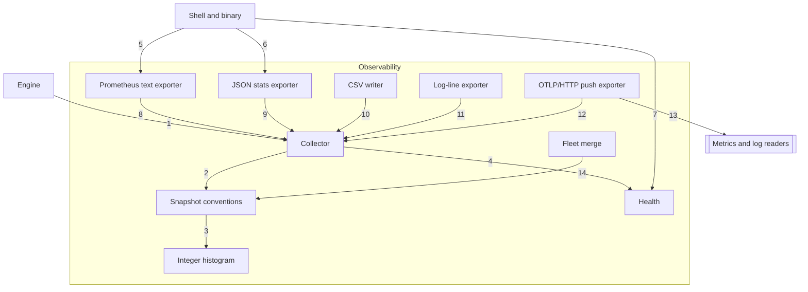

# C4 Level 3: Components: observability

**Target architecture (planned). Nothing in this diagram is built yet.** Model: diagram `component-observability` in [model.json](model.json). Source of this page: [gen.py](gen.py).

One direction of dependency: components fill plain structs; the collector assembles them; exporters read only the collector. Adding an exporter touches no component.

## Elements

| Element | Kind | What it is |
| --- | --- | --- |
| Snapshot conventions | component | What every component's Snapshot() returns: a plain struct of monotonic counters and current gauges. No wall-clock time, no map order, no telemetry imports. |
| Integer histogram | component | Fixed array, fixed relative error, no allocation on record; record, merge, percentile. Out-of-range values are clamped and counted. |
| Collector | component | Assembles one instance snapshot from the component snapshots, with instance id, build and config fingerprint. Keeps the last published copy; readers never wait on the engine. |
| Fleet merge | component | Merges instance snapshots: counters and gauges sum, histograms merge, ratios are recomputed, never averaged. |
| Health | component | Three states: ok; degraded while shedding, while the breaker is open, at the limit's floor, or draining; failed only when this instance cannot work. A database outage is degraded. |
| Prometheus text exporter | component | Low-cardinality labels and a bounded tenant label (configured tenants up to a cap, the rest as other). |
| JSON stats exporter | component | The full snapshot, including every active tenant. |
| CSV writer | component | Evidence tables for scenarios and benchmarks. |
| Log-line exporter | component | One structured line per interval. |
| OTLP/HTTP push exporter | component | Hand-written on the standard library, no SDK. Bounded queue, timeout, drop-and-count when the collector is down. Lands in the last build chunk and touches no component. |
| Engine | neighbouring container | internal/proxy. One single-threaded, sans-I/O state machine per instance: events in, actions out. Holds the client and database connection tables and the request pipeline with its stage seams. The simulator and the shell drive this same code. |
| Shell and binary | neighbouring container | cmd/mini-gateway and internal/shell. Listeners, one reader and one writer goroutine per connection, bounded mailboxes, a deadline on every socket operation, the admin listener on its own port, signal handling. Makes no decisions: it posts events to the engine and performs the actions the engine returns. |
| Metrics and log readers | softwareSystem, external | A Prometheus scraper, an OpenTelemetry Collector, CSV files, log readers. They read exporters and merge across instances; no component knows about them. |

## Relationships

| # | From | To | What | How |
| --- | --- | --- | --- | --- |
| 1 | Engine | Collector | Hands over every component's snapshot at each publish | Go, plain structs |
| 2 | Collector | Snapshot conventions | Assembles the instance snapshot | Go |
| 3 | Snapshot conventions | Integer histogram | Histograms inside snapshots | Go |
| 4 | Collector | Health | Derives the health state and its reasons | Go |
| 5 | Shell and binary | Prometheus text exporter | Admin listener serves /metrics | HTTP |
| 6 | Shell and binary | JSON stats exporter | Admin listener serves /stats | HTTP |
| 7 | Shell and binary | Health | Admin listener serves /health | HTTP |
| 8 | Prometheus text exporter | Collector | Reads the last published snapshot | Go |
| 9 | JSON stats exporter | Collector | Reads the last published snapshot | Go |
| 10 | CSV writer | Collector | Reads the last published snapshot | Go |
| 11 | Log-line exporter | Collector | Reads the last published snapshot | Go |
| 12 | OTLP/HTTP push exporter | Collector | Reads the last published snapshot | Go |
| 13 | OTLP/HTTP push exporter | Metrics and log readers | Pushes metrics | OTLP/HTTP JSON |
| 14 | Fleet merge | Snapshot conventions | Merges snapshots from several instances | Go |
